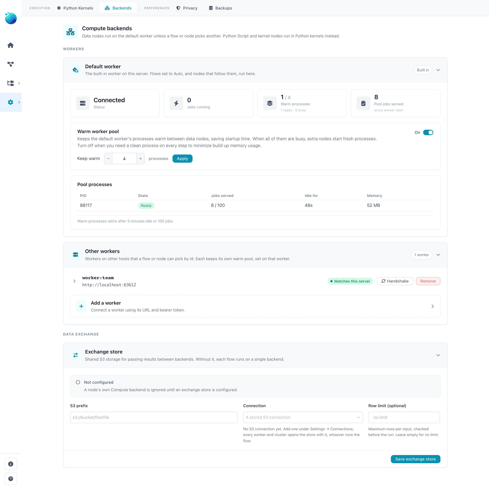
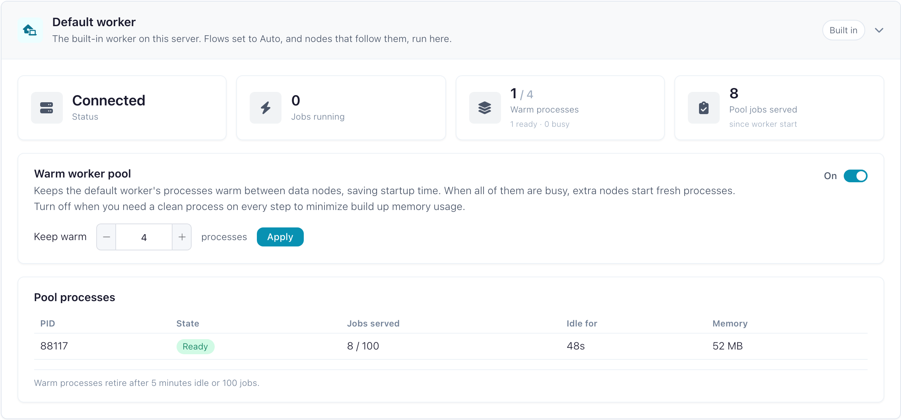
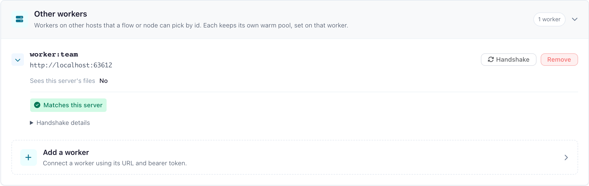
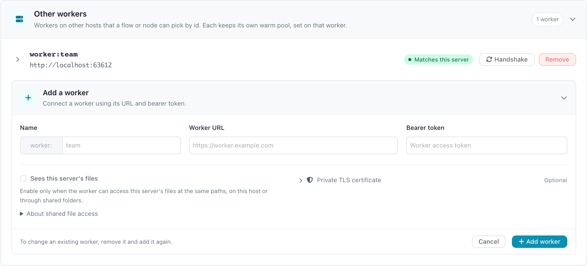
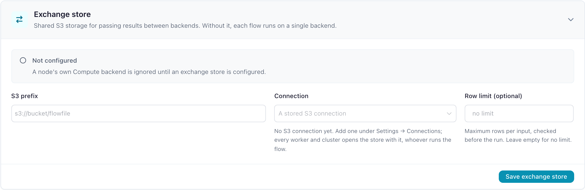
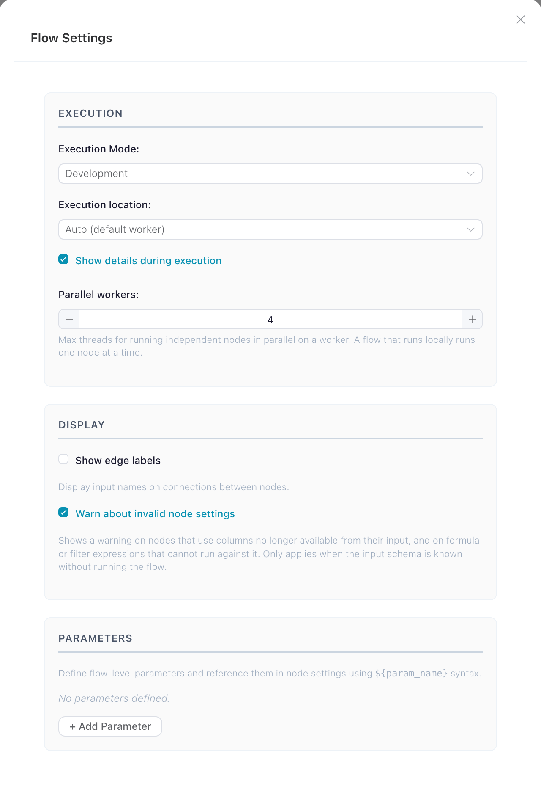
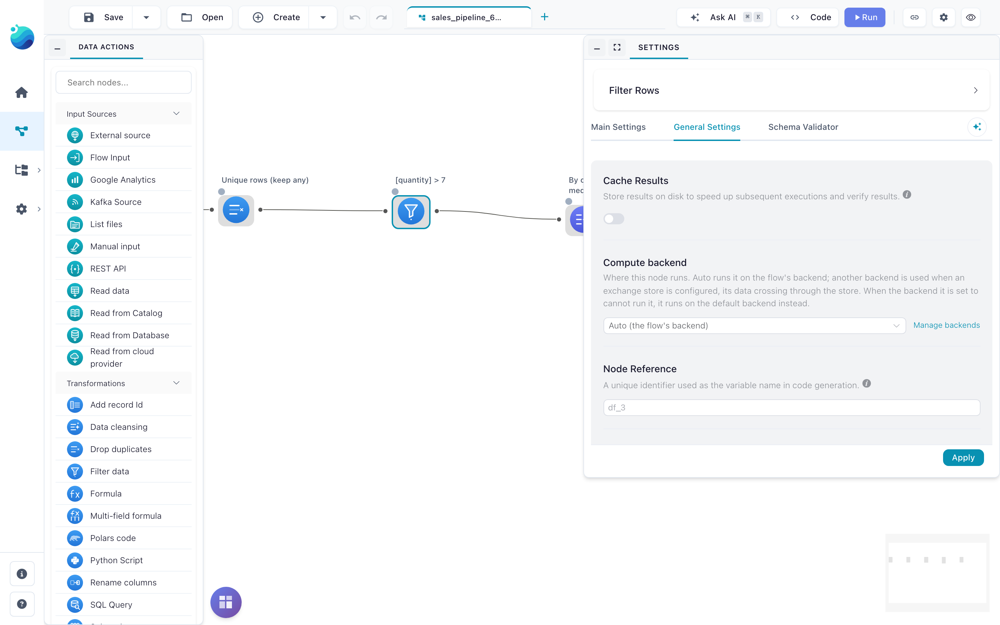
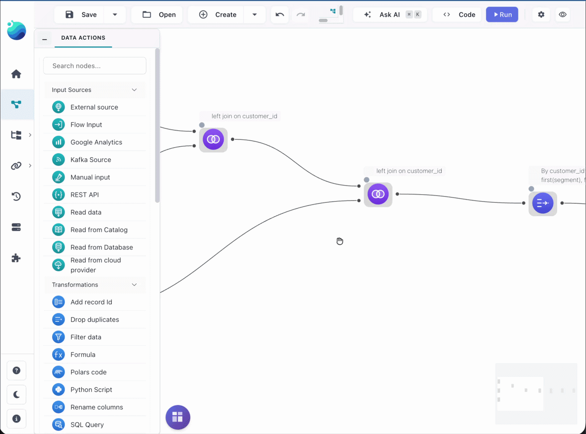

# Compute protocol v1: where the docs still describe the old model

Audit of every human-readable surface in this checkout for text that still describes the pre-v1 compute model (core computing in-process for `local`, the worker for `remote`, offloading, Arrow files on a shared disk, execution strategies), against how compute works now (`PROTOCOL_VERSION = 1`, on by default). Branch `compute/release-gate`, 2026-10-29. Audited at `afec416d`; every quote was re-checked against `626b61d9`, where all of them are still at the lines given, and the entries about headless runs carry a note for `a0c45bd6`, which moved a headless run's jobs into child processes while the audit ran.

## Summary

- **179 passages in 74 files** still describe the old model, each checked against the code by a second agent told to refute it. **64 are wrong** (contradict v1), **27 describe the `FLOWFILE_COMPUTE_PROTOCOL=0` path as if it were current**, **88 are misleading wording**.
- 99 further candidates were refuted on that check: 30 were accurate for v1 or explicitly legacy-scoped (listed at the end), and 69 sit in the frozen `.claude/investigation/` dossiers (see [that section](#frozen-investigation-dossiers)).
- The worst concentration is the agent-facing material: the `flowfile-architecture-contract`, `flowfile-run-and-operate`, `flowfile-config-and-flags`, `flowfile-frame-and-codegen` and `flowfile-node-development` skills still teach the strategy table, `results_exists` returning False, `External*Fetcher` as the node-authoring rule and `execution_location == "local"` branches. On the docs site, the quickstart GIF and the Flow Settings screenshot still show the Local/Remote picker, and several developer pages describe Performance mode and credentials the old way.
- `docs/for-developers/compute-protocol.md`, `compute-walkthrough.md`, `docs/users/deployment/where-flows-run.md` and `remote-worker.md` were also checked against the code: they hold only small items, listed below.

Severity: **WRONG** = contradicts v1. **LEGACY, UNLABELED** = true only with `FLOWFILE_COMPUTE_PROTOCOL=0`, presented as current. **LOOSE WORDING** = not false, but reads as the old model.

## Old model vs v1, for whoever rewrites these passages

| The old docs say | v1 (code) |
|---|---|
| Execution location **Local** = core computes in its own process; **Remote** = the worker service | `execution_location` is `"auto"` (default) or a backend id: `local` = the worker **embedded** in this process, `worker`, `worker:<name>`. `remote` is an alias of `auto`; a file saved `local`/`remote` opens as `auto` (`schemas.loaded_execution_location`). The designer never offers `local`; a serving core refuses it. |
| Core offloads heavy work to the worker (core computes the rest) | The worker is the only compute. Core builds a plan per node and calls a `ComputeBackend`; it holds a `ResultRef` and at most 100 preview rows. No fallback to computing in core. |
| Strategies `FULL_LOCAL` / `LOCAL_WITH_SAMPLING` / `REMOTE`; narrow nodes run in core, a 100-row sample on the worker (`ExternalSampler`, `/store_sample/`) | Gone. Every node `submit`s its plan with `SubmitHints`; the backend materialises when `must_materialise or (wide and (preview_rows or fanout > 1))`, otherwise keeps it deferred. |
| Performance mode: core builds the whole plan, transforms never reach the worker, sinks collect in core | Performance mode = `preview_rows=None`. Every node still submits; writes are operations (`file_write`, `database_write`, `cloud_write`, `delta_*`) on the backend. |
| The worker returns Arrow-IPC file paths that core reads; core and worker share a disk | Previews return inline (Arrow IPC bytes) on `submit`/`sample`. Core never opens a worker's file; no shared disk needed (only with the protocol off). |
| Polars Code / SQL Query run in core's sandbox | `polars_code` and `sql_query` are operations that run on the backend holding the inputs. |
| Plans carry `$ffsec$` credentials in an `EncryptedCredentialProvider` | Plans carry `CredentialRef(connection_id, user_id)`; whoever runs the plan resolves it (worker needs core's catalog DB and master key). `$ffsec$` in plans is the protocol-off path. |
| `FLOWFILE_OFFLOAD_TO_WORKER` decides where compute goes | `FLOWFILE_COMPUTE_BACKEND` names the default backend; `OFFLOAD_TO_WORKER` is legacy, read only by the registry when that is unset, and a serving core is never `local`. |
| `results_exists` returns False when the worker is down; core degrades gracefully | Unreachable compute is `ComputeUnavailable` (503 on the API), never a cache miss, never a local re-run. |
| Parallel workers apply to Remote only; Local is sequential in core | `max_parallel_workers` threads per stage on any backend; parallelism is 1 on `local` (the embedded worker). |
| Scheduled / CLI runs run locally (or on the worker) | They compute on the worker embedded in the runner's process unless `--backend`, a backend id saved in the flow, or `FLOWFILE_COMPUTE_BACKEND` names one. Since `a0c45bd6` each job runs in a child process of the runner (one kept warm, under `FLOWFILE_WORKER_TASK_TIMEOUT`); only Flowfile in Python runs jobs inline. A Docker scheduled run computes in core's container. |
| Per-node location / always one backend | A node's **Compute backend** is read only with an exchange store (`FLOWFILE_EXCHANGE_URI`); placement checks every node before the run and refuses with `cannot run on backend "<id>": <reason>`. |

Specs: [compute-protocol.md](../docs/for-developers/compute-protocol.md), [compute-walkthrough.md](../docs/for-developers/compute-walkthrough.md), [where-flows-run.md](../docs/users/deployment/where-flows-run.md), [remote-worker.md](../docs/users/deployment/remote-worker.md).

## Screenshots of the v1 compute settings

Captured from this checkout at 1440×900, 2×, on an isolated core with the default worker and a second worker registered as `worker:team` (its own storage, so it does not see core's files). The flow is the *Sales pipeline* template.

### Settings → Execution → Backends, whole page

`screenshots/01-backends-page.png` · New: no docs page shows it yet. Fits remote-worker.md *Add the worker to core* and where-flows-run.md's settings table.

### Default worker card with the warm pool

`screenshots/02-backends-card-default-worker.png` · The `FLOWFILE_WORKER_POOL_SIZE` docs and where-flows-run.md.

### Other workers: `worker:team` with its handshake verdict

`screenshots/02-backends-card-other-workers.png` · remote-worker.md *Add the worker to core*.

### A configured worker expanded: *Sees this server's files*, verdict, handshake details

`screenshots/09-backends-worker-row-expanded.png` · remote-worker.md *Versions and the handshake*.

### The Add a worker form

`screenshots/10-backends-add-worker-form.png` · remote-worker.md *Add the worker to core* (labels differ, see below).

### Exchange store card, not configured

`screenshots/02-backends-card-exchange-store.png` · remote-worker.md *Nodes on several backends*.

### Flow Settings: Execution location **Auto (default worker)**

`screenshots/03-flow-settings.png` · Replaces `docs/assets/images/guides/building-flows/flow-settings-modal.png` (shows *Remote* and the old Remote-only hint).

### Execution location picker: Auto + `worker:team · Compatible`

`screenshots/04-flow-settings-execution-location-open.png` · Stands in for `docs/assets/images/quickstart/flow_settings.gif` (Local/Remote) until the GIF is re-recorded.

### A node's General Settings with **Compute backend**

`screenshots/05-node-general-settings.png` · building-flows.md *A node's own backend*.

### Compute backend picker: Auto (the flow's backend), Default worker, `worker:team`

`screenshots/06-node-compute-backend-open.png` · building-flows.md *A node's own backend*.

### A run refused before any node starts: `cannot run on backend "worker:team": it reads local files`

`screenshots/07-run-refused-on-worker-team.png` · where-flows-run.md *Before a run starts*.

### The same flow on Auto, succeeded; the log shows `-> worker, SubmitHints(...)`

`screenshots/08-run-on-default-worker.png` · Replaces `docs/assets/images/quickstart/after_group_by.png`, whose log line reads `NEVER_RAN -> FULL_LOCAL` (re-capture the same quickstart step).

**v1 docs vs the current UI**, seen while capturing (checked against the components, not part of the audit counts):

- remote-worker.md:77 names the Add-a-worker fields **URL**, **Token**, **CA certificate (PEM, optional)** and the button **Add**; the form says **Worker URL**, **Bearer token**, a collapsible **Private TLS certificate**, and **+ Add worker** (screenshot 10).
- remote-worker.md:68 and where-flows-run.md list the verdicts *Compatible, Accepted with differences, Limited · N unavailable, Not accepted, Handshake failed, Not checked*. Those are the pickers' labels (`utils/executionLocation.ts`); the Backends page uses *Matches this server, Accepted with differences, Accepted with limitations, Not accepted by this server, Handshake failed, Not checked* (`components/settings/handshakeStatus.ts`).

## Findings

### User docs (docs site: users, quickstart, AI)

26 passages in 18 files, 8 wrong.

#### `docs/users/visual-editor/catalog/flow-api.md`

- [L16](../docs/users/visual-editor/catalog/flow-api.md#L16) · **LOOSE WORDING**
  - Says: "| **Max rows** | Optional cap on the number of rows returned; a flow that runs on a worker returns at most 10,000 |"
  - Now: With the compute protocol on (the default), every published response is capped at 10,000 rows, whatever Max rows says, because the response is a worker sample. With the protocol off there is no such cap.
  - Fix: Change the row to: 'Optional cap on the number of rows returned; a response never holds more than 10,000 rows (the worker's sample cap)', with an optional footnote that the cap does not apply with FLOWFILE_COMPUTE_PROTOCOL=0.
- [L57](../docs/users/visual-editor/catalog/flow-api.md#L57) · **WRONG**
  - Says: "A flow that runs locally returns every row up to **Max rows**, and `truncated` is always `false`."
  - Now: Every published call in a serving core (desktop, Docker, pip server) runs on the default backend, which is never local there. With FLOWFILE_COMPUTE_PROTOCOL on (the default), the response is sample(ref, n) on the backend that holds the api_response result. n is Max rows clamped to 10,000, and truncated is true when the cap left rows out (api_runner.py:177-180, 211-223). With the protocol off, the worker path (ExternalDfFetcher, api_runner.py:182-208) applies no 10,000 cap and truncated stays false. In neither state does a published flow run in core.
  - Fix: Remove the 'runs on a worker' vs 'runs locally' split. Say that every published call computes on the worker and returns at most 10,000 rows, whatever Max rows says, and that `truncated` is true when that cap left rows out. Optionally add: with FLOWFILE_COMPUTE_PROTOCOL=0 there is no 10,000 cap and `truncated` is always false.
- [L93](../docs/users/visual-editor/catalog/flow-api.md#L93) · **WRONG**
  - Says: "Heavy computation is offloaded to the worker when one is available, so the API surface stays responsive."
  - Now: The published flow always computes on the serving core's default backend, the worker. An unreachable worker fails the request with 503, and a worker that cannot run it fails with 500. Nothing runs in core. Each node submits its own plan to the worker with no preview sample. Results stay deferred on the worker (the worker keeps the plan) except Cache Results nodes, inputs that crossed from another backend, and wide results read by more than one node, which are stored. The response is sample(ref, n) of the api_response node's reference, which runs the composed plan on the worker.
  - Fix: Replace the sentence with: the flow computes on the worker (the server's default compute backend), so the API process stays responsive; if the worker cannot be reached, the call fails with 503 rather than running elsewhere.
- [L112](../docs/users/visual-editor/catalog/flow-api.md#L112) · **LOOSE WORDING**
  - Says: "| `503` | The concurrent-run cap is reached; retry shortly |"
  - Now: 503 means either the concurrent-run cap was reached or the compute backend (the worker) could not be reached; the public detail for the second case is 'Compute unavailable'.
  - Fix: Change the 503 row to: 'The concurrent-run cap is reached, or the compute backend (worker) could not be reached; retry shortly.'

#### `docs/users/python-api/reference/native-nodes.md`

- [L44–344](../docs/users/python-api/reference/native-nodes.md#L44) · **LOOSE WORDING**
  - Says: "or an installed custom node on a graph that does not execute locally | The node runs in a kernel or the worker, is an output node, or its columns are only known after it ran."
  - Now: An installed custom node (one with a node file) is deferred on a graph whose execution_location is not 'local', because its node file would be shipped to the flow's backend, normally a worker outside this process. On a 'local' graph the worker embedded in this process runs it as the custom_node operation at build. Either way a worker runs it, never core's code.
  - Fix: Line 44: 'an installed custom node on a graph whose execution location is not `local` (the worker embedded in this process)'. Change the Why cell to 'The node runs in a kernel or on a worker outside this process, is an output node, or its columns are only known after it ran.' Make the same change at line 344. Optionally update the _offloaded_to_worker docstring in custom_node.py:370 too.
- [L614](../docs/users/python-api/reference/native-nodes.md#L614) · **WRONG**
  - Says: "**`pivot` below a deferred frame raises at build.** Its columns come from the pivot column's values, which the zero-row placeholder does not have: `ValueError: Failed to fetch unique values`."
  - Now: Pivot values are read through bounded.unique_values on the current context's backend (the embedded worker for a script). On a zero-row placeholder that read returns no values, so a pivot below a deferred frame builds without error but has only its index columns. No backend changes that, there is no fallback collect in core, and the ValueError text no longer exists.
  - Fix: Rewrite the bullet. Below a deferred frame, `pivot` builds without an error but with only its index columns, because the zero-row placeholder holds no pivot values. Collect the input first, or pass the pivot's output fields. Drop the ValueError text and the sentence about a `flowfile_worker` process answering the probe.

#### `docs/quickstart.md`

- [L48–55](../docs/quickstart.md#L48) · **WRONG**
  - Says: ""
  - Now: Flow Settings 'Execution location' offers 'Auto (default worker)' plus each configured worker id with its handshake summary (executionLocation.ts:57-68), and never 'local'. A flow saved local/remote opens as auto. A core that serves refuses a run that reaches 'local'. 'local' is the worker embedded in the process, not core. The Parallel workers hint says 'Max threads for running independent nodes in parallel on a worker. A flow that runs locally runs one node at a time.'
  - Fix: Re-record flow_settings.gif against the current Flow Settings dialog. It should show Execution Mode: Development, Execution location: Auto (default worker) (with no Local/Remote options), 'Show details during execution' ticked, and the current Parallel workers hint.

#### `docs/users/build-flows-visually.md`

- [L45](../docs/users/build-flows-visually.md#L45) · **WRONG**
  - Says: ""
  - Now: Flow Settings → Execution location offers 'Auto (default worker)' plus each configured worker id with its handshake verdict (Compatible / Limited / ...), and a BackendHandshakeStatus line under it. 'local' is never offered. The Parallel workers hint reads 'Max threads for running independent nodes in parallel on a worker. A flow that runs locally runs one node at a time.' Parallelism is 1 only on the embedded backend 'local' (execution/context.py:55-57).
  - Fix: Re-record flow_settings.gif against the current dialog: Execution mode, 'Auto (default worker)' selected, the handshake status line and the new Parallel workers hint. It is embedded at docs/users/build-flows-visually.md:45 and docs/quickstart.md:55, so both pages pick up the new file.

#### `docs/users/deployment/docker.md`

- [L57–127](../docs/users/deployment/docker.md#L57) · **WRONG**
  - Says: "The compose file bundled at the repo root is the source of truth. A trimmed version showing the load-bearing settings:"
  - Now: Core in compose sets WORKER_HOST, so it treats the worker as reached at a configured address and offers it 'file' only if the worker declares it. The worker declares it only with FLOWFILE_WORKER_LOCAL_FILES=1, which the real compose sets because the worker mounts core's data volumes. Without it, a Read/Write node with a local path, a local-disk catalog namespace or a kernel node fails the run before any node starts: cannot run on backend "worker": it reads local files (or namespace "..." is on local disk).
  - Fix: Add '# Shares core's data volumes, so it declares local files among the schemes it reads and writes' and '- FLOWFILE_WORKER_LOCAL_FILES=1' to the trimmed flowfile-worker environment. Optionally add '- FLOWFILE_COMPUTE_BACKEND=${FLOWFILE_COMPUTE_BACKEND:-}' to the core block so the trimmed compose matches docker-compose.yml and line 131.

#### `docs/users/python-api/reference/writing-data.md`

- [L73–76](../docs/users/python-api/reference/writing-data.md#L73) · **WRONG**
  - Says: "Avro write and all worker-offloaded writes materialise in the worker process,"
  - Now: Every native writer (IPC, NDJSON, Avro, Parquet, CSV) is a file_write operation on the flow's backend. For a Python script that backend is the worker embedded in the script's own process, which runs the job in that process. The worker sinks lazy formats from the plan and collects Avro before writing, and core's own code never materialises the data.
  - Fix: Rewrite the box: every `write_*` runs as a write operation on the flow's backend, which for a script is the worker embedded in your process. Lazy formats (IPC, NDJSON) sink from the plan there, Avro is collected there first because it has no lazy sink, and flowfile_core's code never materialises the data. Remove 'all worker-offloaded writes' and 'in the worker process'.

#### `docs/users/visual-editor/nodes/combine.md`

- [L208](../docs/users/visual-editor/nodes/combine.md#L208) · **WRONG**
  - Says: "In Development mode the node fails with the message. In Performance mode, or when the flow runs without a worker, the node's rows are only computed by what reads them"
  - Now: The node is computed by whatever reads it only in Performance mode, where preview_rows is None and a wide result with one consumer stays deferred. In Development mode it fails at itself on any backend, the embedded 'local' worker included.
  - Fix: Drop 'or when the flow runs without a worker' so the sentence reads: 'In Performance mode the node's rows are only computed by what reads them...'.

#### `docs/users/visual-editor/creating-custom-nodes.md`

- [L97](../docs/users/visual-editor/creating-custom-nodes.md#L97) · **LOOSE WORDING**
  - Says: "This holds everywhere the node runs — worker, local fallback, isolated kernel, and dry-run."
  - Now: process() receives LazyFrames everywhere it runs: on the flow's compute backend (a worker service, or the worker embedded in this process for headless and Python runs), on the embedded worker for a class registered in process with no node file, in a kernel, and in the dry run. There is no 'local fallback'. An unreachable backend fails the node with ComputeUnavailable.
  - Fix: Replace 'worker, local fallback, isolated kernel, and dry-run' with 'on the flow's compute backend (a worker, or the worker embedded in this process), in an isolated kernel, and in a dry run'.
- [L518](../docs/users/visual-editor/creating-custom-nodes.md#L518) · **LOOSE WORDING**
  - Says: "- **`"local"`** (default) — `process` runs in a `flowfile_worker` subprocess: a killable, isolated child process that owns the dataset memory."
  - Now: process runs as the custom_node operation on the flow's compute backend. On a worker service (the desktop sidecar, the Docker worker, or a configured worker:<name> on any host) that is a killable spawned child. On the worker embedded in a headless or Python run it runs inline in that process, which cannot be cancelled or OOM-isolated. [Update for a0c45bd6, which landed during the audit: a headless run (flowfile run flow, --run-flow, a scheduled run) now runs each job in a child process of the runner, one kept warm, under FLOWFILE_WORKER_TASK_TIMEOUT and cancellable; only Flowfile in Python still runs its jobs inline. Write the fix that way.]
  - Fix: Say: process runs on the flow's compute backend, in a killable child process of a worker service, or inside the runner's own process for headless and Python runs, which embed the worker. Add that the environment value "local" (as opposed to "kernel") is not the execution location "local".
- [L615](../docs/users/visual-editor/creating-custom-nodes.md#L615) · **LOOSE WORDING**
  - Says: "through the same worker seam as a real run (with `flow_id = -1` and row/timeout caps)"
  - Now: The dry run runs the candidate in the built-in worker's custom-node child through the worker's /execute_custom_node task route, with flow_id -1 and row and time caps. A flow run sends the custom_node operation to the flow's own backend, which may be another worker or, in headless runs, the worker embedded in the runner (in-process, no time limit). [Update for a0c45bd6, which landed during the audit: a headless run (flowfile run flow, --run-flow, a scheduled run) now runs each job in a child process of the runner, one kept warm, under FLOWFILE_WORKER_TASK_TIMEOUT and cancellable; only Flowfile in Python still runs its jobs inline. Write the fix that way.]
  - Fix: Say that the dry run executes the node in the built-in worker's custom-node child (the same runner a worker uses for a flow run), with flow_id -1 and row and time caps, without implying it uses the flow's backend.
- [L633–638](../docs/users/visual-editor/creating-custom-nodes.md#L633) · **LOOSE WORDING**
  - Says: "4. Writes each output as Arrow IPC and returns paths and row counts. Core binds the primary output back with `pl.scan_ipc` and never materializes the dataset."
  - Now: Core sends the custom_node operation (source text, resolved settings, secret ciphertext, input plans) to the flow's compute backend. A worker service loads the source in a spawned child, writes each output as Arrow IPC and holds it as a result. Core gets ResultRefs back, and plan_for gives it a scan of the worker's file that only that worker runs. In headless and Python runs the embedded worker does the same steps inline in the runner's process. A class with no node file always runs in this process. [Update for a0c45bd6, which landed during the audit: a headless run (flowfile run flow, --run-flow, a scheduled run) now runs each job in a child process of the runner, one kept warm, under FLOW…
  - Fix: Keep step 4, optionally adding that the scan names the worker's own file and only that worker runs it. Qualify line 633 and step 1: on a worker service the source is loaded in a spawned subprocess; headless and Python runs embed the worker and run it in their own process.

#### `docs/users/visual-editor/node-designer.md`

- [L169](../docs/users/visual-editor/node-designer.md#L169) · **LOOSE WORDING**
  - Says: "The **Test** tab runs the node against sample data without adding it to a flow — the same execution path a real run uses."
  - Now: The Test tab runs a local node in the built-in worker's custom-node child through its dry-run task route. That is the same runner but not necessarily the backend or route a flow run uses. A kernel node runs on the picked kernel as in a real run.
  - Fix: Say that the Test tab runs the node on the built-in worker (or on the selected kernel for an isolated-kernel node), using the same node runner as a flow run.
- [L187](../docs/users/visual-editor/node-designer.md#L187) · **LOOSE WORDING**
  - Says: "- **Local (Polars)** — the default. `process` runs in a `flowfile_worker` subprocess: a killable, isolated child that owns the dataset memory. Fast, no Docker."
  - Now: process runs as the custom_node operation on the flow's compute backend: in a killable child of a worker service (desktop, Docker, or a configured remote worker), or inline in the runner's own process for headless and Python runs, which embed the worker. [Update for a0c45bd6, which landed during the audit: a headless run (flowfile run flow, --run-flow, a scheduled run) now runs each job in a child process of the runner, one kept warm, under FLOWFILE_WORKER_TASK_TIMEOUT and cancellable; only Flowfile in Python still runs its jobs inline. Write the fix that way.]
  - Fix: Say that process runs on the flow's compute backend: a worker child process when a worker service runs it, in-process for headless and Python runs.

#### `docs/users/python-api/reference/cloud-connections.md`

- [L43–49](../docs/users/python-api/reference/cloud-connections.md#L43) · **LOOSE WORDING**
  - Says: "`aws_profile` names a profile in the AWS config on the machine running Flowfile."
  - Now: An aws-cli connection stores no credential. Its plan carries a CredentialRefProvider that is resolved where the node runs, so the profile is read from the AWS config of the host that runs the node: the script's own machine for the Python API (embedded worker), the worker's host for a Designer flow run on a remote worker.
  - Fix: Line 49: 'aws_profile names a profile in the AWS config of the host that runs the node: your machine for a script, the worker's host for a flow run on a remote worker.' Line 43: change the comment to '# Uses the AWS CLI credentials of the host that runs the node'.

#### `docs/users/python-api/reference/reading-data.md`

- [L71–77](../docs/users/python-api/reference/reading-data.md#L71) · **LOOSE WORDING** · found by the final sweep
  - Says: "# Avro (eager read — offloaded to the worker so core never holds the dataset)"
  - Now: Every read runs on the flow's backend. Lazy formats are submitted as Polars plans, and Avro and Arrow IPC stream run as a file_read operation on that backend. For a flow built in Python that backend is the worker embedded in the script's own process (jobs run in-process). For a designer flow it is the worker. Core only holds the ResultRef.
  - Fix: Line 71: '# Avro (eager read — runs as a file-read operation on the flow's backend)'. Lines 76-77: 'Avro and the Arrow IPC stream format have no lazy scan in Polars, so they are read eagerly as an operation on the flow's backend (for a flow built in Python, the worker embedded in your own process) instead of as a lazy plan.' Drop 'so core never holds the dataset'.

#### `docs/users/visual-editor/community-nodes.md`

- [L49](../docs/users/visual-editor/community-nodes.md#L49) · **LOOSE WORDING**
  - Says: "- **Where it runs** — a local node runs on this machine's worker with your data and any secrets you assign it; a kernel node runs in an isolated Docker kernel where your secrets are not available."
  - Now: A local community node runs on the flow's compute backend, a Flowfile worker that may be on another host. It runs with your data and any secrets you assign it, which that worker decrypts with the master key. A kernel node runs in an isolated Docker kernel without your secrets.
  - Fix: Say that a local node runs on the flow's compute backend (a Flowfile worker) with your data and any secrets you assign it. Update environmentNote in flowfile_frontend/src/renderer/app/views/CatalogView/communityCapabilities.ts:67 to match.

#### `docs/users/visual-editor/connections.md`

- [L122](../docs/users/visual-editor/connections.md#L122) · **LOOSE WORDING**
  - Says: "AWS CLI only: a profile from the AWS config on the machine running Flowfile; blank uses the default credentials"
  - Now: Node reads and writes use the AWS config of the host that runs the node: normally the worker, which is the worker container in Docker and the worker's host for a remote worker. The storage browser and Delta table checks in the node drawers use core's host.
  - Fix: Write: 'AWS CLI only: a profile from the AWS config of the host that runs the node (the worker; in Docker the worker container) and, for browsing and table checks, of core's host; blank uses the default credentials'. Link to remote-worker.md#the-shared-catalog-and-the-master-key.

#### `docs/users/visual-editor/kernel-api.md`

- [L310–319](../docs/users/visual-editor/kernel-api.md#L310) · **LOOSE WORDING**
  - Says: "Use `flowfile_ctx.get_shared_location()` to write files that are accessible across all Flowfile services and survive container restarts:"
  - Now: The shared location is the kernel shared volume on core's host. Core and its kernels can read it, and so can a worker that sees core's disk (the desktop worker, the default compose worker, or a backend marked shares_core_disk or with FLOWFILE_WORKER_LOCAL_FILES=1). A worker on another host cannot, and placement refuses nodes that need it there.
  - Fix: Say that the file is visible to core and its kernels, and to a worker only if that worker shares core's disk (the default desktop and Docker setups do; a remote worker does not). Consider updating the matching docstring in kernel_runtime/kernel_runtime/flowfile_client.py:769-775.

#### `docs/users/visual-editor/nodes/input.md`

- [L42](../docs/users/visual-editor/nodes/input.md#L42) · **LOOSE WORDING**
  - Says: "Read eagerly, on the compute worker rather than the core service"
  - Now: Every format is read on the flow's backend. Avro and Arrow IPC stream differ only in being read eagerly, as one file_read operation, instead of as a lazy scan.
  - Fix: Change line 42 to 'Row-based binary format that embeds its own schema. Read eagerly on the compute worker', matching line 41, and drop 'rather than the core service'.

#### `docs/users/visual-editor/subflows.md`

- [L95](../docs/users/visual-editor/subflows.md#L95) · **LOOSE WORDING**
  - Says: "It never registers itself as a live flow and never touches the global worker-offload setting. Outputs stay lazy in core; only the small parameter table is read eagerly."
  - Now: The child runs on the parent run's backend. Its outputs stay deferred on that backend. The parameter table, at most MAX_SUBFLOW_RUNS+1 rows, is read through that backend, not in core. No global offload setting is involved.
  - Fix: Replace the last two sentences with: 'It never registers itself as a live flow. Its outputs stay deferred on that backend; only the small parameter table is read, through the same backend.'

#### `docs/users/visual-editor/tutorials/cloud-connections.md`

- [L38](../docs/users/visual-editor/tutorials/cloud-connections.md#L38) · **LOOSE WORDING**
  - Says: "Uses credentials from the AWS configuration on the machine running Flowfile (`~/.aws/credentials`, `~/.aws/config`, or `AWS_*` environment variables)"
  - Now: Node runs read ~/.aws and AWS_* on the host that runs the node (normally the worker; in Docker the worker container). The storage browser and Delta table checks read them on core's host. On desktop and pip both are the same machine.
  - Fix: Write: 'Uses credentials from the AWS configuration (~/.aws/credentials, ~/.aws/config, or AWS_* environment variables) of the host that runs the node — the worker, in Docker the worker container — and of core's host for browsing and table checks; see Remote workers'. Link to remote-worker.md.

#### `docs/what-is-flowfile-technical.md`

- [L33](../docs/what-is-flowfile-technical.md#L33) · **LOOSE WORDING**
  - Says: "In the server deployment, full-dataset compute runs in a separate worker service (spawned subprocesses own dataset memory), keeping the API process responsive."
  - Now: All compute runs on a worker; core only builds plans and holds bounded inline previews. The desktop app and Docker run the worker as a separate service whose jobs run in pooled spawned subprocesses. The pip server embeds it and runs jobs in its pool. Headless/scheduled runs and Flowfile in Python embed it in their own process unless --backend, a saved backend id or FLOWFILE_COMPUTE_BACKEND names another.
  - Fix: Reword: 'All compute runs on a worker: a separate service in the desktop app and Docker (jobs in spawned subprocesses that own dataset memory), embedded in the process for headless runs, the pip server and the Python API. The API process only plans and holds bounded previews.'

### Developer docs (docs/for-developers)

29 passages in 8 files, 10 wrong.

#### `docs/for-developers/catalog-architecture.md`

- [L17](../docs/for-developers/catalog-architecture.md#L17) · **LEGACY, UNLABELED**
  - Says: "returns a `CatalogStorageTarget` with two credential forms: decrypted `storage_options` for core's own bounded reads, and an **owner-encrypted** `worker_interface` for the worker hand-off"
  - Now: resolve_for_namespace returns three credential forms, all resolved as the catalog owner. (1) With the protocol on, credential_ref + plan_storage_options: scan_kwargs builds a CredentialRefProvider carrying no secret, resolved by whichever process runs the plan. (2) worker_interface, owner-encrypted, for the worker's catalog routes and the Delta write payloads. (3) Decrypted storage_options for core's in-process work: freshness probes, CDC metadata, and catalog I/O when the context's backend is local.
  - Fix: Describe three forms: a CredentialRef (credential_ref/plan_storage_options via scan_kwargs) for scans in plans with the protocol on; the owner-encrypted worker_interface for the worker's catalog routes and Delta write payloads; decrypted storage_options only for core's own metadata work and catalog I/O on a local backend.
- [L51](../docs/for-developers/catalog-architecture.md#L51) · **WRONG**
  - Says: "**re-runs just that node** (performance mode; on the worker when offload is enabled) to rebuild its output"
  - Now: Standard resolution re-runs the matching catalog_writer node in Performance mode on the reading context's backend: the reader node's backend with the protocol on, else the flow's execution_location. Its output is that backend's ResultRef, deferred, or stored when the backend's policy stores it. The yielded LazyFrame is plan_for(ref) and is valid only on that backend.
  - Fix: Replace '(performance mode; on the worker when offload is enabled)' with '(performance mode, on the reading context's backend)'. Say the output is the backend's result reference, a deferred plan or a stored result held while it is read, rather than a plan rebuilt in core.
- [L52](../docs/for-developers/catalog-architecture.md#L52) · **WRONG**
  - Says: "a serialized cloud scan embeds decrypted `storage_options`, so `serialized_frame_uses_cloud` forces such tables onto the standard path permanently"
  - Now: A serialized cloud scan carries the connection as frozen at build time. With the protocol on that is a CredentialRefProvider (connection id, user, nonce) and no secret. With it off it is $ffsec$ ciphertext, plus inline ADLS service-principal or GCS key options. serialized_frame_uses_cloud still sends such tables down the standard path.
  - Fix: Keep the rule, but give the reason as credentials frozen at build time (a CredentialRef with the protocol on, ciphertext and some inline ADLS/GCS secrets with it off), not 'decrypted storage_options'.
- [L108](../docs/for-developers/catalog-architecture.md#L108) · **WRONG**
  - Says: "| Serialized cloud plans are never deserialized | They embed decrypted storage credentials |"
  - Now: Serialized cloud plans are not replayed because they freeze the connection from build time: a CredentialRef with the protocol on, $ffsec$ ciphertext (and inline ADLS SP/GCS options) with it off.
  - Fix: Reword the 'Why' cell: 'They freeze the connection reference (protocol on) or its ciphertext (protocol off) from build time and must not be replayed.'
- [L121](../docs/for-developers/catalog-architecture.md#L121) · **LOOSE WORDING**
  - Says: "**A new storage backend** extends `storage_backend.py` (URI schemes, `CatalogStorageTarget`, worker payload) and mirrors the join/decrypt on the worker side in `catalog_reader.py`"
  - Now: A storage backend touches two credential paths. With the protocol on, scans carry a CredentialRefProvider: credential_ref and plan_storage_options on the target, the secret-free plan options from CloudStorageReader.get_plan_storage_options, and resolution where the plan runs in shared/cloud_credential_provider.resolve_credential_ref. The owner-encrypted worker payload, decrypted in the worker's catalog_reader, remains for the worker's catalog routes and Delta writes.
  - Fix: Extend the recipe: add the URI scheme to storage_backend.py and shared/cloud_storage/uri.py, build credential_ref/plan_storage_options (CloudStorageReader.get_plan_storage_options) for scan_kwargs, teach shared/cloud_credential_provider.resolve_credential_ref/_provider_credentials to resolve it, and keep the worker payload plus the catalog_reader.py join/decrypt for the worker's catalog routes.

#### `docs/for-developers/design-philosophy.md`

- [L265–273](../docs/for-developers/design-philosophy.md#L265) · **WRONG**
  - Says: "FlowDataEngine wraps a Polars LazyFrame/DataFrame and decides where, when, and how transformations run:"
  - Now: FlowDataEngine carries one node's Polars plan and its cached schema. The node submits that plan to its ExecutionContext's backend: 'local' is the worker embedded in this process, 'worker' or 'worker:<name>' a worker process. The backend's materialise policy (must_materialise, or wide with a preview or fanout>1) decides whether the result is stored or kept as a deferred plan.
  - Fix: Rewrite the 'Execution is Everything' list. FlowDataEngine carries a node's plan and schema. FlowNode submits it to current_context().backend, chosen by ExecutionContext.for_flow from execution_location. The backend decides storing versus deferring from SubmitHints. Drop 'worker service vs local execution'.
- [L390–394](../docs/for-developers/design-philosophy.md#L390) · **WRONG**
  - Says: "**Performance mode.** Pull the final result; Polars optimizes and runs the whole pipeline once, with no intermediate materialization."
  - Now: Performance mode runs run_graph like Development mode, but every node submits with preview_rows=None, so no sample job runs. Narrow and single-consumer wide results stay deferred on the backend. Operations (database, Kafka, REST and GA reads, writes), Cache Results nodes and wide nodes read by several consumers are still materialised there. get_resulting_data() on its own computes nothing.
  - Fix: Say Performance mode is run_graph with execution_mode='Performance': each node still submits its plan to the flow's backend with no preview, deferred unless required, read by several consumers or an operation. Replace the get_resulting_data example with flow.flow_settings.execution_mode = 'Performance'; flow.run_graph(), or say get_resulting_data only composes a plan.
- [L396](../docs/for-developers/design-philosophy.md#L396) · **WRONG**
  - Says: "**Development mode.** Push-based execution in topological order; each node's output is written to disk so any intermediate result can be inspected."
  - Now: In Development mode each node submits its plan with preview_rows=100, and the first 100 rows come back inline on submit, which is what makes every intermediate result inspectable. Wide results, Cache Results nodes and operations are stored in the backend's own storage, which core never opens. Narrow results stay deferred plans on the backend.
  - Fix: Replace 'each node's output is written to disk' with: each node submits with a 100-row preview that returns inline; wide and cached results are stored on the backend's own storage, narrow ones kept as deferred plans.
- [L413–421](../docs/for-developers/design-philosophy.md#L413) · **LOOSE WORDING**
  - Says: "**Explain plan.** See the optimized Polars plan without executing."
  - Now: On an un-run graph of plain-plan nodes, explain() shows the composed plan. A Polars Code or SQL node's plan is built by running its operation on the backend. After a run, a stored node's plan starts at a scan of the backend's result file, which only that backend can resolve (explain raises FileNotFoundError when core cannot see the path).
  - Fix: Scope the example to a graph that has not run, and note that after a run the plan starts at the backend's result leaf and that Polars Code and SQL nodes run on the backend when their plan is built.

#### `docs/for-developers/kernel-architecture.md`

- [L19](../docs/for-developers/kernel-architecture.md#L19) · **LOOSE WORDING**
  - Says: "Core, the kernels, and a shared volume exchange parquet I/O and artifacts"
  - Now: Kernels read their inputs from and write their outputs to the shared volume on core's host. The input parquet is written by the run's compute backend, and the output parquet is read by that backend through the scan plan core submits. Core orchestrates and checks for the files but reads no rows.
  - Fix: Reword the alt text and the SVG's aria-label and labels so the compute backend (worker) and the kernels exchange parquet through the shared volume while core orchestrates.
- [L35](../docs/for-developers/kernel-architecture.md#L35) · **WRONG**
  - Says: "| **Execute** | Serializes inputs to parquet, sends `ExecuteRequest` via HTTP, tracks kernel state |"
  - Now: Before an ExecuteRequest, a kernel node's inputs are written as parquet onto the kernel shared volume by a file_write operation on the run's compute backend (kernel/execution.py::write_parquet_for_kernel). That is why a kernel node runs only on a backend that writes 'file' on core's host. The Kernel Manager sends the ExecuteRequest and tracks kernel state.
  - Fix: Change the Execute row to: 'Sends ExecuteRequest via HTTP and tracks kernel state; the node's inputs are written to the shared volume beforehand by a parquet file_write on the run's backend (kernel/execution.py::write_parquet_for_kernel).'
- [L147](../docs/for-developers/kernel-architecture.md#L147) · **WRONG**
  - Says: "Manager->>Manager: Write inputs to parquet"
  - Now: Core's kernel execution path asks the run's ComputeBackend to write each input as parquet onto the shared volume (run_op file_write), then the Kernel Manager POSTs /execute.
  - Fix: Add a 'Compute backend' participant: Core->>Backend: run_op(file_write) inputs to parquet on the shared volume; then Manager->>Runtime: POST /execute. Remove Manager->>Manager: Write inputs to parquet.

#### `docs/for-developers/flowfile-core.md`

- [L19](../docs/for-developers/flowfile-core.md#L19) · **LOOSE WORDING** · found by the final sweep
  - Says: "3. **`FlowDataEngine`**: The data itself, which flows between nodes. It's a wrapper around a [Polars LazyFrame]"
  - Now: A node's FlowDataEngine is core's handle on its output: a Polars plan over the result its backend holds (plan_for(ref)), plus the schema and row count from the ResultRef. The rows stay on the backend, and core holds at most a preview sample.
  - Fix: Reword to: 'FlowDataEngine: core's handle on a node's output, a wrapper around a Polars LazyFrame that plans over the result the compute backend holds, carrying its schema and row count; the rows stay on the backend.'
- [L247–275](../docs/for-developers/flowfile-core.md#L247) · **LOOSE WORDING** · found by the final sweep
  - Says: "## 4. The FlowDataEngine: The Data Carrier When data moves from one node to another, it's bundled up in a FlowDataEngine object."
  - Now: With default settings the tutorial's flow runs on the 'worker' backend, so flowfile_worker must be running, unless execution_location='local' (the worker embedded in the script) or FLOWFILE_COMPUTE_BACKEND=local. Every node submits its plan to that backend. A node's engine is a plan over the backend's ResultRef (flow_node.py:1882-1883), and collect() in the script computes that plan in the caller's process as a script-only convenience.
  - Fix: Add a note near the FlowSettings example: the snippets need a running worker, or pass execution_location='local' to use the worker embedded in your script. In section 4, describe FlowDataEngine as a plan over the backend's result plus its schema and row count, rather than 'carries the data', and present collect() as a script convenience rather than how data moves between nodes.
- [L385](../docs/for-developers/flowfile-core.md#L385) · **LOOSE WORDING**
  - Says: "## Execution Strategy: How Nodes Decide Where to Run"
  - Now: A node does not decide where it runs. ExecutionContext.for_flow and placement (execution/placement.py, called from FlowGraph._place_run) give each node a backend before the run starts. NodeExecutor._decide_execution decides only whether the node runs, and the node submits its plan with hints to that backend.
  - Fix: Rename the heading, for example to 'Execution: Whether a Node Runs and How It Is Submitted'. Update all three links to #execution-strategy-how-nodes-decide-where-to-run: architecture.md:102, architecture.md:131 and compute-protocol.md:252.
- [L420](../docs/for-developers/flowfile-core.md#L420) · **LEGACY, UNLABELED**
  - Says: "worker file the last run left (result or sample) gone"
  - Now: With the protocol on, a node that ran with its current setup reruns when the backend that minted its result no longer holds it (exists is False). A backend that cannot answer fails the node and is never read as a missing result. The shared-disk file check (the result or sample file a task-route run left) applies only with FLOWFILE_COMPUTE_PROTOCOL=0.
  - Fix: Reword the row as 'result the node holds gone from its backend (exists) → RUN'. Note that with FLOWFILE_COMPUTE_PROTOCOL=0 this is a check that the task-route file is still on the shared disk.
- [L453](../docs/for-developers/flowfile-core.md#L453) · **LEGACY, UNLABELED**
  - Says: "deferred: core holds the plan object in its own process, unserialised | inline when `preview_rows` is set: read from the Arrow IPC file the worker stored, or, for a deferred plan, from a worker sampler task over it"
  - Now: With the protocol on, the worker holds every result. A stored one is an Arrow IPC file in the worker's storage; a deferred one is its plan, kept in the worker's ResultRecord. The deferred ref's location also carries the serialised plan, so core's plan_for composes on it without a call, and core never runs it. The preview comes back inline in the submit answer, computed by the worker's submit child (df.head of the stored frame, or lf.head of the deferred plan). Core reads no file and starts no sampler task.
  - Fix: Rewrite the WorkerBackend row for /v1. Otherwise: 'deferred: the worker holds the plan (its ref's location carries the serialised plan, which plan_for composes on)'. Preview: 'inline when preview_rows is set, computed by the worker's submit child'. Move the in-core _DeferredPlan, the Arrow-file read and the ExternalSampler task into a note labelled FLOWFILE_COMPUTE_PROTOCOL=0 (task routes).
- [L464](../docs/for-developers/flowfile-core.md#L464) · **LEGACY, UNLABELED**
  - Says: "deferred; sampled inline by a worker sampler task"
  - Now: In Development mode a narrow transform stays deferred on the worker. Its 100-row preview is computed by the worker's submit child and returned inline in the submit answer, with no separate sampler task. A stored node's preview is likewise the head of the frame the submit child collected.
  - Fix: Change the cell to 'deferred; sample returned inline by the worker's submit'. Optionally change 'sampled inline from its file' at lines 465-467 to 'sampled inline by its submit'. Keep the sampler-task and read-from-file wording only in a FLOWFILE_COMPUTE_PROTOCOL=0 note.
- [L474](../docs/for-developers/flowfile-core.md#L474) · **LOOSE WORDING**
  - Says: "fuzzy join; custom nodes; random split; Polars Code; model training and apply; the Delta writes; and visualisation sessions"
  - Now: sql_query is an OperationKind like polars_code. With the protocol on, a SQL Query node's statement is translated and run as the sql_query operation on its backend, and the designer predicts its schema the same way over empty frames. Core translates no SQL; it does so only with FLOWFILE_COMPUTE_PROTOCOL=0.
  - Fix: Change 'Polars Code;' to 'Polars Code and SQL Query;'. Extend the last sentence: 'a Polars Code or SQL Query node runs its code as the polars_code / sql_query operation on its backend, never in core, and the designer predicts its schema by the same operation over empty frames.'
- [L485](../docs/for-developers/flowfile-core.md#L485) · **WRONG**
  - Says: "the API calls `.get_resulting_data()` on the corresponding `FlowNode` and returns a sample to the client"
  - Now: The preview route returns FlowNode.get_table_example. Its rows come from the backend that holds the result: the inline sample returned with submit, or backend.sample(ref, 100) when the preview is first opened (not in Performance mode). For a named output they come from a sample of the held output or a bounded head_rows on that backend. A writer previews its input. Core forwards those rows and never reads or samples the node's data.
  - Fix: Replace the bullet with: 'Data previews: when you view a node's output, the API returns FlowNode.get_table_example. Its rows are the sample the compute backend sent back inline with submit, or a backend sample(ref, 100) taken the first time the preview is opened (none in Performance mode). Core forwards the rows without reading the node's data.'

#### `docs/for-developers/visualizations.md`

- [L104](../docs/for-developers/visualizations.md#L104) · **LEGACY, UNLABELED**
  - Says: "(S3 and Azure key credentials as a `$ffsec$` ciphertext inside an `EncryptedCredentialProvider`, an Azure client secret or GCS key still inline in `storage_options`)"
  - Now: A cloud scan's plan freezes the connection from build time: a CredentialRefProvider (connection id, user, nonce) with the protocol on, a $ffsec$ ciphertext plus any inline Azure client secret or GCS key with it off. A viz session child is long-lived, so serialized_frame_uses_cloud refuses such plans.
  - Fix: Say the plan carries the connection frozen at build time (a CredentialRef with the protocol on; with it off a $ffsec$ ciphertext and inline Azure/GCS secrets), and keep the refusal. Update the node_viz.py:106 comment and the CLAUDE.md bullet to match.
- [L108–109](../docs/for-developers/visualizations.md#L108) · **WRONG**
  - Says: "`node_stats.has_completed_last_run` looks like the right flag but is only set when `performance_mode` is off, so a Performance-mode local run leaves it `False` on a node that ran perfectly well."
  - Now: has_completed_last_run is set on every successful node execution in both Development and Performance mode, on any backend ('local' included). The readiness gate keys on results.resulting_data because a viz request needs the node's result plan, not because of a mode or location difference.
  - Fix: Drop the 'Performance-mode local run' rationale here, in node_viz.py:73-77 and in the CLAUDE.md bullet. Say readiness is results.resulting_data because the chart needs the node's result plan.
- [L111–112](../docs/for-developers/visualizations.md#L111) · **LEGACY, UNLABELED**
  - Says: "which skips the `ExternalDfFetcher` store entirely and leaves the fetch as "build the lazy plan""
  - Now: Both fetches place the node and submit its plan to its backend. The default fetch asks for a 100-row inline preview, and the backend stores the result only when it is wide or required. The performance fetch asks for none, so the result stays a deferred plan on the backend unless it must be materialised. The ExternalDfFetcher store applies only with FLOWFILE_COMPUTE_PROTOCOL=0.
  - Fix: Describe the two fetches as submit-with-preview versus submit-without-preview on the node's backend (deferred unless required), and mention the ExternalDfFetcher store only as the FLOWFILE_COMPUTE_PROTOCOL=0 path.

#### `docs/for-developers/architecture.md`

- [L7](../docs/for-developers/architecture.md#L7) · **LOOSE WORDING**
  - Says: "Core orchestrates everything else and never materializes full datasets itself — heavy compute is offloaded."
  - Now: Core computes no node data. It builds each node's plan, sends it to the compute backend (the worker, or the worker embedded in a non-serving process), and holds ResultRefs plus at most 100 preview rows the backend returns. The worker is the only compute.
  - Fix: Reword to: 'Core orchestrates everything else and computes no data itself: it sends each node's plan to the worker, the only compute, and holds references and bounded previews.'
- [L33](../docs/for-developers/architecture.md#L33) · **LOOSE WORDING**
  - Says: "**Worker Service (FastAPI)** Handles heavy data computations in isolated processes."
  - Now: The Worker service runs all node computation (every plan and every operation, including reads, writes and user code) in pooled or spawned child processes, and keeps the results, writing stored ones as Arrow IPC files. Core runs none of it.
  - Fix: Change 'Handles heavy data computations in isolated processes' to 'Runs all of a flow's data computation, each job in a pooled or spawned child process'. Leave the rest of the paragraph, and add no in-process caveat here.
- [L113–115](../docs/for-developers/architecture.md#L113) · **LOOSE WORDING**
  - Says: "Builds full plan, executes minimally"
  - Now: Both modes submit every node's plan to the backend. In Development each node returns a 100-row preview; wide, fanned-out and cache_results results are stored and narrow ones stay deferred plans. In Performance results stay deferred unless cached or fanned out, so the writer runs the composed plan once. Only cache_results nodes keep a preview, and other nodes, including the final ones, show rows only after Fetch Data.
  - Fix: Keep the Execution row. Change Preview Data / Performance to 'Only for nodes with Cache results (others on Fetch Data)'. Optionally change Data Caching / Development to 'Stores wide results; keeps a preview of every step'.
- [L178–219](../docs/for-developers/architecture.md#L178) · **LOOSE WORDING**
  - Says: "The worker's task routes start a job through `spawner.py::start_process`, below; its `/v1` routes run theirs in a pool of child processes kept warm."
  - Now: Both route families start a job through spawner.start_process. In a process that embeds the worker and does not serve, it runs the job in that process (run_inline). Otherwise it leases a warm pool member for a poolable operation (store, submit_result, export_result, the writes, sql_query and others). It spawns a fresh child when the pool is off, has no free member, or the operation runs user Python or is excluded (polars_code, custom nodes, fuzzy join, ML). [Update for a0c45bd6, which landed during the audit: a headless run (flowfile run flow, --run-flow, a scheduled run) now runs each job in a child process of the runner, one kept warm, under FLOWFILE_WORKER_TASK_TIMEOUT and cancellable; o…
  - Fix: Replace the sentence with: 'Both the /v1 routes and the task routes start a job through spawner.py::start_process, which runs it in-process when the worker is embedded in a process that does not serve, leases a warm pool member for a poolable operation, and otherwise spawns a fresh child (below).' Relabel the example as the spawn fallback, or add the pool lease to it.

#### `docs/for-developers/compute-protocol.md`

- [L45](../docs/for-developers/compute-protocol.md#L45) · **LOOSE WORDING**
  - Says: "**Core receives at most `preview_rows` rows of any result.**"
  - Now: Core receives only bounded samples of a result: the inline preview_rows sample on submit, or sample(ref, n) / bounded.head_rows with n capped at the worker's 10,000-row sample cap. Core never collects a backend's plan.
  - Fix: State invariant 1 as 'Core receives only bounded samples: the inline preview_rows sample on submit, or sample(ref, n) with n at most the worker's 10,000-row cap.'

#### `docs/for-developers/compute-walkthrough.md`

- [L104](../docs/for-developers/compute-walkthrough.md#L104) · **LOOSE WORDING**
  - Says: "falls back to the default backend when that fits, else is refused with both reasons"
  - Now: Under MixedPlacementPolicy an unfit node moves to registry.fallback_backend_id(): the default backend in a core that serves, the embedded 'local' worker in a process that does not (a headless run, Flowfile in Python), even when a --backend override made another backend the default. Otherwise it is refused with both reasons.
  - Fix: Say 'falls back to the fallback backend (the default in a serving core, the embedded local worker elsewhere) when that fits'.

### Diagrams and screenshots on the docs site

11 passages in 11 files, 4 wrong.

#### `docs/assets/images/guides/building-flows/flow-settings-modal.png`

- [L1](../docs/assets/images/guides/building-flows/flow-settings-modal.png#L1) · **WRONG**
  - Says: "Execution location: Remote ... Parallel workers: 4 — "Max threads for running independent nodes in parallel. Only applies when execution location is Remote. Local execution always runs sequentially.""
  - Now: Flow Settings 'Execution location' offers 'Auto (default worker)' plus each configured worker:<name> with its handshake verdict, and never Local. The Parallel workers hint says the setting applies to a worker and that a local run goes one node at a time. The current dialog also has a 'Warn about invalid node settings' checkbox, which the screenshot lacks.
  - Fix: Recapture the Flow Settings modal on the current build: Execution location 'Auto (default worker)', the new Parallel workers hint, and the 'Warn about invalid node settings' checkbox.

#### `docs/assets/images/guides/catalog/virtual-table-resolution.svg`

- [L97](../docs/assets/images/guides/catalog/virtual-table-resolution.svg#L97) · **WRONG** · found by the final sweep
  - Says: "<text class="s" x="432" y="542">worker when offloaded &#183; result stays lazy</text>"
  - Now: The producer's catalog_writer node is re-run (performance mode) on the compute backend of the current execution context: the run's backend, the default backend, or the embedded worker for 'local'. Its result is a plan over the backend's ResultRef. If that backend is unreachable, ComputeUnavailable is raised and nothing runs in core.
  - Fix: Replace 'worker when offloaded · result stays lazy' with 'on the run's compute backend · result stays lazy'. Fix the twin text at catalog-architecture.md:51 ('on the worker when offload is enabled') at the same time.

#### `docs/assets/images/quickstart/after_group_by.png`

- [L1](../docs/assets/images/quickstart/after_group_by.png#L1) · **WRONG**
  - Says: "INFO - Node ID: 5 - Starting to run group_by (NEVER_RAN -> FULL_LOCAL)"
  - Now: Execution strategies no longer exist. A node logs the backend it submitted its plan to and the SubmitHints, e.g. '(NEVER_RAN -> worker, SubmitHints(...))'.
  - Fix: Recapture after_group_by.png (docs/quickstart.md:119) on the current build, so the log shows '-> worker, SubmitHints(...)'. Alternatively, crop the log panel out.

#### `docs/assets/images/quickstart/flow_settings.gif`

- [L1](../docs/assets/images/quickstart/flow_settings.gif#L1) · **WRONG**
  - Says: "Execution location dropdown opened showing options "Local" / "Remote", user picks "Local"; hint "Only applies when execution location is Remote. Local execution always runs sequentially.""
  - Now: The designer offers 'Auto (default worker)' plus configured worker ids, never Local. With the protocol on, a desktop/Docker/pip core refuses a run that reaches 'local'.
  - Fix: Re-record the GIF on the current build: switch only the Execution Mode to Development, leaving Execution location on 'Auto (default worker)'. Keep the alt text in quickstart.md:55 and build-flows-visually.md:45 in line with it.

#### `docs/assets/flows/*.yaml`

- L7 · **LEGACY, UNLABELED**
  - Says: "execution_location: local"
  - Now: A saved 'local' or 'remote' opens as 'auto' while the protocol is on and has no effect on where the flow runs. Headless runs use --backend, else a saved backend id, else FLOWFILE_COMPUTE_BACKEND, else the embedded worker. Only with FLOWFILE_COMPUTE_PROTOCOL=0 does 'local' mean the embedded worker in core's process.
  - Fix: Drop the execution_location key from the three 'local' files rather than writing 'auto', which releases before 0.24 reject (Literal['local','remote']). The loader default 'local' already opens as 'auto'. For automl_demo.yaml, dropping 'remote' would change protocol-off placement to local, so either leave it or accept that. Do not re-save the files from the current app, which writes 'auto'.

#### `docs/assets/images/architecture/kernel-flow.svg`

- [L87–97](../docs/assets/images/architecture/kernel-flow.svg#L87) · **LOOSE WORDING**
  - Says: "parquet read / write"
  - Now: The run's compute backend writes a kernel node's inputs to the kernel shared volume as a parquet file_write; that backend is the worker on core's host, or the embedded worker. The node's outputs come back as a scan_parquet plan that the backend reads when the next node submits it. Core only creates and clears the directories and checks that the output files exist; it never reads or writes their rows.
  - Fix: Draw the parquet hand-off as written and read by the run's compute backend (a 'Worker' chip on core's host), and relabel Core's edge to the volume as something like 'prepares dirs / checks outputs'. Update the SVG aria-label and the alt text at docs/for-developers/kernel-architecture.md:19 to match. Consider noting at kernel-architecture.md:35 that inputs are serialised by the backend's file_writ…

#### `docs/assets/images/architecture/one-worker-two-adapters.svg`

- [L81–85](../docs/assets/images/architecture/one-worker-two-adapters.svg#L81) · **LOOSE WORDING**
  - Says: "<text class="s" x="322" y="407">the pip server</text>"
  - Now: EmbeddedWorkerBackend serves as 'local' in a headless run or Flowfile in Python, with jobs in-process, and as 'worker' in the pip server, with jobs in the worker pool. WorkerBackend is the desktop/Docker 'worker' and every 'worker:<name>'. [Update for a0c45bd6, which landed during the audit: a headless run (flowfile run flow, --run-flow, a scheduled run) now runs each job in a child process of the runner, one kept warm, under FLOWFILE_WORKER_TASK_TIMEOUT and cancellable; only Flowfile in Python still runs its jobs inline. Write the fix that way.]
  - Fix: Label the embedded adapter 'id local (headless, Python) or worker (pip server)' and narrow WorkerBackend to the desktop/Docker 'worker' and worker:<name>. Apply the same to the alt text at compute-walkthrough.md:49.

#### `docs/assets/images/architecture/placing-a-run.svg`

- [L124–126](../docs/assets/images/architecture/placing-a-run.svg#L124) · **LOOSE WORDING**
  - Says: "<text class="s" x="146" y="751">assigned to the default backend</text>"
  - Now: A fallback node is assigned to registry.fallback_backend_id(): the default backend while serving, 'local' (the embedded worker) otherwise.
  - Fix: Relabel the Fallback box and the aria-label 'assigned to the fallback backend' (default in a serving core, local elsewhere).

#### `docs/assets/images/concepts/team-deployment-architecture.svg`

- [L112–176](../docs/assets/images/concepts/team-deployment-architecture.svg#L112) · **LOOSE WORDING**
  - Says: "<text class="albl" x="520" y="170" text-anchor="middle">offload</text>"
  - Now: The worker is the only compute. Core holds the flow and sends one plan per node, and the worker runs every node and keeps the result in its own storage (core-plans-worker-computes.svg uses 'one plan per node' / 'runs the node, keeps the result'). In compose both core and the worker mount internal storage and user data. Core writes the catalog DB and logs, and the worker writes node outputs and catalog/Delta table data.
  - Fix: Relabel the core-to-worker edge 'one plan per node' and change the Worker subtitle to something like 'runs every node'. Add persist arrows from the Worker to both state volumes as well as from Core.

#### `docs/assets/images/guides/catalog/run-detail.png`

- [L1](../docs/assets/images/guides/catalog/run-detail.png#L1) · **LOOSE WORDING** · found by the final sweep
  - Says: ""execution_location": "remote","
  - Now: A run snapshot taken with the protocol on records execution_location 'auto' or a backend id ('worker', 'worker:<name>'), never 'remote'.
  - Fix: Retake run-detail.png from a current build, so the snapshot shows "execution_location": "auto" (low priority, cosmetic).

#### `docs/assets/images/quickstart/flow_settings.png`

- [L1](../docs/assets/images/quickstart/flow_settings.png#L1) · **LOOSE WORDING**
  - Says: "Execution location: Local — "Max threads for running independent nodes in parallel. Only applies when execution location is Remote. Local execution always runs sequentially.""
  - Now: The image is orphaned. If it were shown it would be wrong: Local is not offered in the designer, and the options are Auto (default worker) plus configured workers.
  - Fix: Delete docs/assets/images/quickstart/flow_settings.png. If a page is meant to use it, replace it with a current capture first.

### Text in the product: UI strings, docstrings mkdocstrings renders, AI prompts, CLI help

19 passages in 15 files, 5 wrong.

#### `flowfile_core/flowfile_core/flowfile/flow_data_engine/flow_data_engine.py`

- [L519](../flowfile_core/flowfile_core/flowfile/flow_data_engine/flow_data_engine.py#L519) · **WRONG**
  - Says: """"Writes the DataFrame to a SQL database in-process (local execution path).""""
  - Now: Database writes are the database_write operation on the run's backend; for a local flow that is the embedded worker. to_database_obj has no callers and is not part of any execution path. Database writes are the database_write operation on the flow's backend, the embedded worker for a 'local' flow. to_database_obj is an unused helper.
  - Fix: Drop "(local execution path)" and describe it as an unused in-process helper outside the node path, or delete the method.
- [L3116–3120](../flowfile_core/flowfile_core/flowfile/flow_data_engine/flow_data_engine.py#L3116) · **WRONG**
  - Says: "For remote-worker writes the caller (``add_output._func``) uses"
  - Now: An output node's write is the file_write operation on the flow's backend (the embedded worker for 'local', a worker process otherwise). ExternalOutputWriter appears only inside WorkerBackend's FLOWFILE_COMPUTE_PROTOCOL=0 task-route path. FlowDataEngine.output is not on the output node's path. add_output writes through the file_write operation on the flow's backend (io.py:273-283). ExternalOutputWriter is used only by WorkerBackend with the protocol off. FlowDataEngine.output has no callers.
  - Fix: Update the docstring: output nodes write through a file_write operation on the flow's backend, and this method is an unused in-process helper (or remove it).

#### `flowfile_core/flowfile_core/flowfile/flow_graph/builders/io.py`

- [L304–308](../flowfile_core/flowfile_core/flowfile/flow_graph/builders/io.py#L304) · **WRONG**
  - Says: "and serializes it as the response body. Behaves like an output node so its result is always materialized locally."
  - Now: The node passes its input through. Its plan is submitted to the run's backend like any node and is not materialised (only a boundary input makes it so). The published endpoint samples the held result on that backend, up to max_rows and the worker's sample cap (api_runner.py:177-180).
  - Fix: "Its result equals its input. The published endpoint samples this node's held result on the backend that holds it, capped at max_rows (and the worker's sample cap), and serializes the rows as the response body." Drop "materialized locally".
- [L592–595](../flowfile_core/flowfile_core/flowfile/flow_graph/builders/io.py#L592) · **LOOSE WORDING**
  - Says: "The scan runs in core rather than on the worker: it is local filesystem metadata (one ``iterdir``/``stat`` pass), not network I/O and not a dataset, so there is nothing to offload and a CLI/scheduler run with no worker still works."
  - Now: The directory walk is filesystem metadata read in core. The resulting frame goes to the run's compute backend like any other node. Headless runs always have a backend: the worker embedded in the runner's process.
  - Fix: Keep "the walk is local filesystem metadata read in core (one iterdir/stat pass)". Replace "so there is nothing to offload and a CLI/scheduler run with no worker still works" with "its result frame is then submitted to the run's backend like any node".

#### `flowfile_core/flowfile_core/flowfile/flow_graph/builders/subflow.py`

- [L27](../flowfile_core/flowfile_core/flowfile/flow_graph/builders/subflow.py#L27) · **WRONG**
  - Says: """"Adds a named subflow-output sink (passthrough, always materialized)."
  - Now: flow_output is a passthrough whose plan goes to the run's backend; it is materialised only when it reads an input that crossed from another backend. A run_flow parent adopts the child's results, deferred plans included (flow_node.py:1632-1649, 1693-1705).
  - Fix: "Adds a named subflow-output sink (passthrough; the parent reads the result the child's backend holds)." Drop "always materialized".

#### `flowfile_frontend/src/renderer/app/components/nodes/baseNode/genericNodeSettings.vue`

- [L59–63](../flowfile_frontend/src/renderer/app/components/nodes/baseNode/genericNodeSettings.vue#L59) · **WRONG**
  - Says: "content="Caching is only active when the flow is executed in performance mode""
  - Now: Cache Results makes the node's result materialised on the compute backend's own storage in either mode (executor.py:72-85). A later run skips the node while that backend still holds the stored result under the node's current hash (executor.py:305-314). It works the same in Development and Performance.
  - Fix: Remove the Performance-only tooltip. Say: "The node's result is stored on the flow's compute backend and reused while that backend still holds it."

#### `flowfile_frame/flowfile_frame/flow_frame.py`

- [L1800–1802](../flowfile_frame/flowfile_frame/flow_frame.py#L1800) · **LOOSE WORDING**
  - Says: "The model is fitted and held where the flow runs: in the core process for a local flow (a new graph is local), or on the worker for a remote one."
  - Now: The model is fitted with the ml_train operation on the flow's backend. For a new (local) graph that is the worker embedded in this Python process. For auto (legacy "remote") it is the default backend, normally the default worker. The backend holds the fitted model as a blob.
  - Fix: "The model is fitted and held on the flow's backend: the worker embedded in this process for a local graph (the default for a new graph), or the default backend for an auto flow."
- [L4517–4519](../flowfile_frame/flowfile_frame/flow_frame.py#L4517) · **LOOSE WORDING**
  - Says: "the drop list comes from a bounded null-count aggregation (worker-first) taken"
  - Now: The drop list comes from one bounded null-count aggregation run on the current execution context's compute backend (for a frame's local graph, the embedded worker). There is no fallback to computing in core.
  - Fix: Replace "(worker-first)" with "(on the flow's compute backend)", and check the "taken when this method is called" timing against apply_data_cleansing.

#### `flowfile_frontend/src/renderer/app/views/ComputeView/ComputeBackendsPanel.vue`

- [L9–11](../flowfile_frontend/src/renderer/app/views/ComputeView/ComputeBackendsPanel.vue#L9) · **LOOSE WORDING**
  - Says: "Data nodes run on the default worker unless a flow or node picks another. Python Script and kernel nodes run in Python kernels instead."
  - Now: From the designer, data nodes run on the flow's backend: the default backend (the built-in worker unless FLOWFILE_COMPUTE_BACKEND names another) or the backend the flow's Execution location names. A node's own Compute backend applies only when an exchange store is configured. Scheduled and CLI runs default to the worker embedded in their own process (run_flow_cli.py:48).
  - Fix: "Data nodes run on the flow's backend: the default worker unless the flow's Execution location, FLOWFILE_COMPUTE_BACKEND or (with an exchange store) a node's Compute backend names another. Scheduled runs compute in their own process by default. Python Script and kernel nodes run in Python kernels." Or add a link to Where flows run.
- [L27–29](../flowfile_frontend/src/renderer/app/views/ComputeView/ComputeBackendsPanel.vue#L27) · **LOOSE WORDING**
  - Says: "The built-in worker on this server. Flows set to Auto, and nodes that follow them, run here."
  - Now: Interactive runs of Auto flows, and nodes set to Auto, run on the default backend. That is the built-in worker unless FLOWFILE_COMPUTE_BACKEND names another (registry.py:184-196). Scheduled and CLI runs compute on the worker embedded in their own process (in Docker, core's container) unless --backend, the flow's saved backend id or FLOWFILE_COMPUTE_BACKEND names a backend (run_flow_cli.py:48, 78-80).
  - Fix: "The built-in worker on this server. Flows set to Auto run here when you run them from the designer, unless FLOWFILE_COMPUTE_BACKEND names another backend. Scheduled runs compute in their own process unless configured otherwise." Add a link to Where flows run.

#### `flowfile_core/flowfile_core/flowfile/flow_graph/builders/custom_nodes.py`

- [L62–64](../flowfile_core/flowfile_core/flowfile/flow_graph/builders/custom_nodes.py#L62) · **LOOSE WORDING**
  - Says: "When the custom node has a ``kernel_id`` set, the process code is sent to the kernel for execution instead of running locally."
  - Now: A non-kernel custom node from the registry runs as the custom_node operation on the flow's backend. Only a class with no node file runs on local, the worker embedded in this process (custom_nodes.py:323-352).
  - Fix: "…the process code is sent to the kernel for execution instead of running as the custom_node operation on the flow's backend."

#### `flowfile_core/flowfile_core/flowfile/flow_graph/builders/ml.py`

- [L316–318](../flowfile_core/flowfile_core/flowfile/flow_graph/builders/ml.py#L316) · **LOOSE WORDING**
  - Says: "Pure polars — no worker offload, no model file read."
  - Now: Evaluate Model builds a plain Polars plan with no operation and no model read. Like any transform, it is submitted to the flow's compute backend.
  - Fix: "A plain Polars plan (no operation, no model read), submitted to the flow's backend like any transform."

#### `flowfile_core/flowfile_core/flowfile/flow_node/flow_node.py`

- [L1323–1325](../flowfile_core/flowfile_core/flowfile/flow_node/flow_node.py#L1323) · **LOOSE WORDING** · found by the final sweep
  - Says: "so the bounded reads the node's function makes through ``current_context()`` run where the graph runs: in core for a local graph, on the default backend for a remote one."
  - Now: The node's bounded reads run on the graph's backend: the embedded worker for 'local' (its jobs run in this process only when the process neither serves nor runs headless), the default backend for 'auto' or the legacy 'remote', and the named backend for 'worker' or 'worker:<name>'.
  - Fix: Reword to: '...so the bounded reads the node's function makes through current_context() run on the graph's backend: the worker embedded in this process for local, the default backend for auto, or the backend the location names.'

#### `flowfile_core/flowfile_core/schemas/schemas.py`

- [L205–207](../flowfile_core/flowfile_core/schemas/schemas.py#L205) · **LOOSE WORDING**
  - Says: "2. **If another value is provided**: It checks if the value is compatible with the global settings. If not (e.g., requesting 'remote' when only 'local' is possible),"
  - Now: None, "" and "auto" become default_execution_location() ("auto" with the protocol on). A "remote" (the legacy alias of "auto") becomes "local" when the registry's default backend is local; this applies in both protocol modes and changes nothing about where the flow runs. Any other value, including a backend id, passes unchanged.
  - Fix: "2. Otherwise a 'remote' (legacy alias of 'auto') becomes 'local' when the default backend is local (get_global_execution_location); any other value, a backend id included, passes unchanged."

#### `flowfile_frame/flowfile_frame/custom_node.py`

- [L369–372](../flowfile_frame/flowfile_frame/custom_node.py#L369) · **LOOSE WORDING** · found by the final sweep
  - Says: "def _offloaded_to_worker(graph: FlowGraph, node_type: str) -> bool: """Whether core runs this local custom node on the worker: a remote graph and a node file to ship.""""
  - Now: The function says whether building would run the node's process() on a backend outside this process: the graph is not on 'local' (it is on auto, worker or worker:<name>) and the node has a node file to ship. On a 'local' graph, or for a class without a node file, process() runs as the custom_node operation on the worker embedded in this process.
  - Fix: Reword the docstring to 'Whether the node would run on a backend outside this process: a graph not on local, and a node file to ship.' Optionally rename to _runs_outside_this_process.

#### `flowfile_frontend/src/renderer/app/components/common/CloudConnectionPicker/connectionOptions.ts`

- [L55–80](../flowfile_frontend/src/renderer/app/components/common/CloudConnectionPicker/connectionOptions.ts#L55) · **LOOSE WORDING**
  - Says: ""Uses the AWS credentials of the machine running Flowfile (the ~/.aws profile or AWS_* " +"
  - Now: With no saved connection the plan carries no credential, and the default credential chain resolves on the host that runs the node. That is this machine for the built-in worker and the worker host for a worker configured on another host (flow_data_engine.py:573-581; compute-protocol.md:196). The option is disabled in multi-user (docker) mode.
  - Fix: In all three variants, say "the credentials of the machine that runs the node (this machine for the built-in worker; the worker's host for a remote worker)", and adjust the "this machine's … credentials" labels to match.

#### `flowfile_frontend/src/renderer/app/features/designer/dataPreview/ColumnStatsPanel.vue`

- [L28](../flowfile_frontend/src/renderer/app/features/designer/dataPreview/ColumnStatsPanel.vue#L28) · **LOOSE WORDING**
  - Says: "
Computing statistics — a locally-run step may re-run.
"
  - Now: Column statistics are one bounded aggregate run on the compute backend that holds the node's result (flow_node.py:2424-2432, column_stats.py). When that result is a deferred plan (a narrow step), the backend runs the plan again to compute them. No step is run locally in core.
  - Fix: "Computing statistics on the compute backend — a step kept as a plan may run again." Drop "locally-run".

#### `flowfile_frontend/src/renderer/app/views/CloudConnectionView/CloudConnectionSettings.vue`

- [L131–134](../flowfile_frontend/src/renderer/app/views/CloudConnectionView/CloudConnectionSettings.vue#L131) · **LOOSE WORDING**
  - Says: "A profile from the AWS config on the machine running Flowfile. Leave blank to use the default credentials."
  - Now: The profile's credentials resolve on the host that runs the node: this machine for the built-in worker, the worker host for a remote worker. When the connection names no region, core takes the region for reads from its own copy of the profile (cloud_storage_reader.py:147-148), so with a remote worker the profile should exist on both hosts or the connection should set a region.
  - Fix: "A profile from the AWS config on the host that runs the node (the worker's host for a remote worker). Leave blank to use that host's default credentials." Consider adding: set a region when the worker is on another host.

#### `flowfile_frontend/src/renderer/app/views/ComputeView/computeHelp.ts`

- [L21–23](../flowfile_frontend/src/renderer/app/views/ComputeView/computeHelp.ts#L21) · **LOOSE WORDING**
  - Says: ""The built-in worker on this server that runs the regular data nodes (joins, filters, formulas, …)."
  - Now: The built-in worker runs the regular data nodes of flows run from the designer while it is the default backend. Scheduled and CLI runs compute on the worker embedded in their own process unless --backend, the flow's saved backend id or FLOWFILE_COMPUTE_BACKEND names one. In Docker that process is core's container.
  - Fix: "The built-in worker on this server that runs the regular data nodes (joins, filters, formulas, …) of flows run from the designer; scheduled runs compute in their own process unless configured otherwise."

### CLAUDE.md files

27 passages in 5 files, 5 wrong.

#### `CLAUDE.md`

- [L15](../CLAUDE.md#L15) · **LOOSE WORDING**
  - Says: "heavy data processing offload (port 63579)"
  - Now: The worker is the only compute; core never computes a node's data.
  - Fix: Change the comment to '# FastAPI compute worker - runs every node's plan (port 63579)'.
- [L61](../CLAUDE.md#L61) · **LOOSE WORDING**
  - Says: "for a `local` flow, the registry's default backend for a `remote` one"
  - Now: A node submits to the backend of its flow's context: the embedded worker for a `local` flow (Python-API graphs), the registry's default backend for `auto` (legacy alias `remote`), and the named backend for `worker` or `worker:<name>`.
  - Fix: Say: 'the worker embedded in this process for a `local` flow (Python-API graphs), the registry's default backend for an `auto` (legacy `remote`) one, the backend of that id for `worker` / `worker:<name>`'.
- [L70](../CLAUDE.md#L70) · **WRONG**
  - Says: "in core only when `execution_location=="local"` or the class has no node file"
  - Now: Every custom node with a node file runs as the custom_node operation on the run context's backend, with its source and `$ffsec$` secrets shipped the same way whether that backend is the worker or `local`, the embedded worker (whose job runs in this process when the process does not serve). Only a class with no node file is pinned to `local`, where EmbeddedWorkerBackend._custom_node_here calls process() in this process.
  - Fix: Replace the parenthetical with: 'runs as the custom_node operation on the run's backend (source text + `$ffsec$` ciphertext shipped, the embedded `local` worker included); a class with no node file (registered in-process, e.g. by ff.CustomNode) is pinned to `local`, where process() runs in this process'.
- [L75](../CLAUDE.md#L75) · **WRONG**
  - Says: "Merge modes or `track_changes` dispatch the catalog's generic `merge_delta`/`write_delta` worker ops with an owner-encrypted `storage_payload` (local execution merges in-process — the sanctioned local collect)"
  - Now: Merge modes and track_changes run the delta_merge / delta_write operation on the run context's backend, with the connection owner-encrypted. On `local` the embedded worker runs it through service._run, which is in this process for a non-serving host. Core does not collect anything.
  - Fix: Drop '(local execution merges in-process — the sanctioned local collect)'. Say instead: 'run the delta_merge / delta_write operation on the run's backend (the embedded worker for `local`)'.
- [L78](../CLAUDE.md#L78) · **LOOSE WORDING**
  - Says: "are held and run in core."
  - Now: Core orchestrates held nodes: it builds a graph that lives for the call, with the canvas flow's execution_location, and the nodes compute on that flow's backend. File and catalog reads named by a cell are likewise made through core's backend, not in the kernel.
  - Fix: Say 'are held and run by core on the canvas flow's backend', and likewise 'read through core' or 'read by core's backend' for the file and catalog reads.
- [L336](../CLAUDE.md#L336) · **LOOSE WORDING**
  - Says: "**Async:** FastAPI endpoints; heavy work offloaded to the worker service"
  - Now: All node compute runs on a compute backend (the worker, or the worker embedded as `local`). Core's few bounded reads also go through the backend.
  - Fix: Say 'FastAPI endpoints; all node compute runs on the worker (a compute backend)'.
- [L337](../CLAUDE.md#L337) · **LOOSE WORDING**
  - Says: "it ships paths/JSON, the worker holds dataset memory"
  - Now: Core ships serialized plans and JSON and gets back a ResultRef plus inline samples. It never opens a result file the worker wrote.
  - Fix: Say 'it ships plans/JSON, the worker holds dataset memory'.
- [L406](../CLAUDE.md#L406) · **LOOSE WORDING**
  - Says: "`local` also makes new flows default to local execution."
  - Now: FLOWFILE_COMPUTE_BACKEND names the default backend, which `auto` (legacy `remote`) flows run on. With the protocol on new flows are saved as `auto`, so `local` makes them run on the embedded worker in a non-serving process; a serving core still uses `worker`. Only with the protocol off does `local` make new flows store execution_location `local`.
  - Fix: Say 'the one an `auto` (legacy `remote`) flow runs on', and replace the sentence with 'With the protocol off, `local` also makes new flows default to execution_location `local`; with it on they are `auto`, which then resolves to `local` outside a serving process'.
- [L514](../CLAUDE.md#L514) · **LOOSE WORDING**
  - Says: "core ships paths/JSON; the worker holds dataset memory in spawned subprocesses"
  - Now: Core ships plans/JSON. The backend holds dataset memory: the worker's spawned or pooled children, or, for the embedded worker in a non-serving process, that process itself.
  - Fix: Say 'core ships plans/JSON; the backend (worker) holds dataset memory'.

#### `flowfile_worker/CLAUDE.md`

- [L3](../flowfile_worker/CLAUDE.md#L3) · **LOOSE WORDING**
  - Says: "Standalone FastAPI compute service that offloads heavy Polars/data work from `flowfile_core`"
  - Now: The worker is Flowfile's only compute. It runs every node's plan and operation for flowfile_core, beside core over HTTP/WS, or embedded in the process as `local`.
  - Fix: Describe it as 'the compute service that runs every node's plan and operation for flowfile_core, each job in a spawned subprocess; ...'.
- [L6](../flowfile_worker/CLAUDE.md#L6) · **WRONG**
  - Says: "the custom-node dry run and the handshake (`GET /capabilities` and its plugin probe)"
  - Now: With FLOWFILE_COMPUTE_PROTOCOL on, the handshake reads GET /v1/capabilities and runs its probes as ordinary /v1 submits. It uses GET /capabilities and task-route submits only with the flag off.
  - Fix: Remove 'and the handshake (`GET /capabilities` and its plugin probe)' from the task routes core calls with the flag on. Add that the handshake reads GET /v1/capabilities and submits its probes over /v1, and uses GET /capabilities only with the flag off.
- [L8](../flowfile_worker/CLAUDE.md#L8) · **LEGACY, UNLABELED**
  - Says: "Results land as Arrow IPC files under `CACHE_DIR/<flow_id>/<task_id>.arrow`; the serialized `scan_ipc` plan (not the data) is returned to core via the WS binary frame / REST `status.results`."
  - Now: With the protocol on, the worker holds each result (materialised as an IPC file at result_path, or deferred as its plan) and answers a ResultRef plus an inline Arrow sample. Core never opens a result file. The <task_id>.arrow file + serialized scan_ipc plan in status.results / the WS binary frame is the task-route path (FLOWFILE_COMPUTE_PROTOCOL off, and the Delta/viz tasks).
  - Fix: Start with the /v1 model (held results, ResultRef, inline samples, materialised vs deferred). Label the CACHE_DIR/<flow_id>/<task_id>.arrow + scan_ipc return as the task-route path. Change 'ships paths/JSON' to 'ships plans/JSON'.
- [L9](../flowfile_worker/CLAUDE.md#L9) · **LOOSE WORDING**
  - Says: "The FastAPI process only spawns, monitors shared `Value`/`Array`/`Queue`, ships paths, and kills children."
  - Now: The parent spawns, monitors and kills children and holds no large dataset. On /v1 it answers ResultRefs plus bounded inline samples (reading up to 1 000 rows of a materialised result itself), holds import scans and copies blobs. Only the task routes ship result paths.
  - Fix: Replace 'ships paths' with 'answers result refs and bounded inline samples (result paths only on the task routes)', and keep 'no large dataset in the parent'.
- [L39](../flowfile_worker/CLAUDE.md#L39) · **LEGACY, UNLABELED**
  - Says: "`BaseFetcher.get_result` recovers the class from that same prefix, so it is load-bearing for **every** fetcher path (sampler, output writer, ML, custom node, readers/writers), not just the two `_do_execute_remote` sites"
  - Now: The class prefix is load-bearing on both paths. On /v1 (the default) a failed job reaches core as the backend's TaskFailed, whose message carries 'ClassName: ...'. flow_node._failed_class / run_operation and the submit path in _do_execute re-raise it as RemoteExecutionError with that class. On the task routes (every kind with FLOWFILE_COMPUTE_PROTOCOL off, and the Delta writes with it on) BaseFetcher.get_result recovers the class from the same prefix. `_do_execute_remote` no longer exists.
  - Fix: Name flow_node._failed_class / run_operation over the backend's TaskFailed as the /v1 consumer. Keep BaseFetcher.get_result as the task-route consumer (protocol off, plus the Delta writes). Drop the `_do_execute_remote` reference and the sampler/output-writer list, or label that list protocol-off.
- [L41](../flowfile_worker/CLAUDE.md#L41) · **LEGACY, UNLABELED**
  - Says: "IPC files are the canonical hand-off; `Status.file_ref` points at them."
  - Now: This is the task routes' result transport (FLOWFILE_COMPUTE_PROTOCOL off, and the Delta writes, viz sessions and custom-node dry run with it on). On /v1 the worker's results registry holds the record, and core gets a ResultRef and an inline sample, never a file path.
  - Fix: Title the bullet 'Task-route result transport (protocol off; Delta/viz tasks)' and point to the '/v1 wire' bullet for the default path.
- [L52](../flowfile_worker/CLAUDE.md#L52) · **LEGACY, UNLABELED**
  - Says: "for a core-built cloud read, `CredentialDecryptionError: Could not decrypt the cloud storage credentials embedded in this query plan…`"
  - Now: A split secure store breaks every secret-touching job. For a cloud read of a stored connection with the protocol on, the error is CredentialDecryptionError 'Could not decrypt the secrets of <connection>. Core and the worker must share the same master key.' The 'embedded in this query plan' message is the protocol-off EncryptedCredentialProvider case.
  - Fix: Quote the CredentialRefProvider message as the default example and label 'embedded in this query plan' as the protocol-off case.
- [L71](../flowfile_worker/CLAUDE.md#L71) · **LEGACY, UNLABELED**
  - Says: "`GET /capabilities` is core's handshake"
  - Now: Core's handshake reads GET /v1/capabilities (GET /capabilities with FLOWFILE_COMPUTE_PROTOCOL off). Both routes answer service.worker_capabilities().
  - Fix: Start the bullet with 'GET /v1/capabilities (GET /capabilities with FLOWFILE_COMPUTE_PROTOCOL off; both answer service.worker_capabilities()) is core's handshake'.
- [L75](../flowfile_worker/CLAUDE.md#L75) · **LEGACY, UNLABELED**
  - Says: "On WebSocket client disconnect mid-task the subprocess is **handed off** to a daemon `handle_task` thread (`_handoff_to_background`), not killed"
  - Now: On the legacy /ws/submit (protocol off, and task-route work such as the Delta writes) a disconnect hands the running child off to a daemon handle_task thread. On /v1/ws/submit, the default submit with the protocol on, a client that goes away cancels the job (service._stop), and a result that completed before it left is released (_release_unread).
  - Fix: Scope the gotcha to the legacy /ws/submit, and add that /v1/ws/submit cancels the job and releases an unread result on disconnect.

#### `flowfile_core/CLAUDE.md`

- [L3](../flowfile_core/CLAUDE.md#L3) · **WRONG**
  - Says: "runs node compute on Polars, hosts auth/catalog/secrets/AI/kernel subsystems, and offloads heavy work to `flowfile_worker`"
  - Now: Core builds each node's Polars plan and sends it to a compute backend: the worker beside core, or the worker embedded in this process (`local`). It holds a ResultRef and at most the preview rows. All node compute runs on the backend.
  - Fix: Rephrase as 'manages flows as DAGs, builds each node's Polars plan and sends it to a compute backend (the worker beside core, or the worker embedded in this process), hosts auth/catalog/secrets/AI/kernel subsystems'.
- [L19](../flowfile_core/CLAUDE.md#L19) · **LEGACY, UNLABELED**
  - Says: "Cloud-backed plans are refused: the blob carries the connection's credentials frozen at build time (`$ffsec$`-encrypted inside an `EncryptedCredentialProvider`)"
  - Now: Cloud-backed plans are refused before anything is sent. With the protocol off the plan carries `$ffsec$` ciphertext in an EncryptedCredentialProvider (some ADLS/GCS secrets still inline). With it on, a stored connection's read carries a CredentialRefProvider, which the viz child cannot resolve either, since it registers no decryptor.
  - Fix: Keep the refusal and give both reasons: `$ffsec$` ciphertext (protocol off) or a CredentialRefProvider (protocol on), neither of which the viz child can resolve because it registers no decryptor. Update the comment at node_viz.py:108 to match.
- [L70](../flowfile_core/CLAUDE.md#L70) · **LEGACY, UNLABELED**
  - Says: "a worker-offloaded failure keeps its class because `BaseFetcher.get_result` raises `RemoteExecutionError(desc, recover_error_class(None, desc))`, so every fetcher path"
  - Now: With the protocol on, a failed job is the backend's TaskFailed (or worker_failure's typed error). flow_node._failed_class / run_operation and the submit path re-raise it as RemoteExecutionError carrying the class from 'ClassName:'. BaseFetcher.get_result does the same on the task routes, which cover every fetcher with the flag off and only the Delta writes with it on.
  - Fix: Name run_operation/_failed_class and the submit path over the backend's TaskFailed as the mechanism. Label 'BaseFetcher.get_result ... sampler, output writer, ML, custom node, readers/writers' as the task-route (protocol-off) path.
- [L83](../flowfile_core/CLAUDE.md#L83) · **LEGACY, UNLABELED**
  - Says: "`subprocess_operations.results_exists` raises `ComputeUnavailable` (naming the worker URL) when the worker cannot be reached"
  - Now: The cache check's backend.exists raises ComputeUnavailable when the backend cannot be reached. For a /v1 ref that is HEAD /v1/results/{id}, and False means only that the worker answered it no longer holds the result. subprocess_operations.results_exists is the protocol-off (task-route) form of the same rule. The worker's error_kind reaches errors.worker_failure from the /v1 error answer's detail (`_v1_error`, backends/worker.py:1497-1507: the REST 500 detail, the /v1/ws/submit error frame, or the embedded backend's HTTPException), and from BaseFetcher.error_kind on the task routes (worker.py:1403).
  - Fix: Say that backend.exists (HEAD /v1/results/{id} with the flag on) raises ComputeUnavailable when the backend is unreachable, and mention results_exists only as the protocol-off path.
- [L104](../flowfile_core/CLAUDE.md#L104) · **LEGACY, UNLABELED**
  - Says: "An unreachable worker is never a cache miss: `results_exists` raises instead of answering `False`."
  - Now: An unreachable backend is never a cache miss: backend.exists (HEAD /v1/results/{id} on a worker with the protocol on) raises ComputeUnavailable instead of answering False. results_exists is the protocol-off form.
  - Fix: Rephrase as: '`backend.exists` raises ComputeUnavailable instead of answering False (results_exists with the protocol off)'.

#### `shared/CLAUDE.md`

- [L21](../shared/CLAUDE.md#L21) · **WRONG**
  - Says: "`is_utf8_encoding` (the local-vs-worker csv routing test)"
  - Now: is_utf8_encoding picks the form of the read, not where it runs. A UTF-8 CSV (like parquet/ipc/ndjson) is a lazy scan the node submits to its backend; any other encoding is the file_read operation on the same backend. It also decides directory-scan eligibility.
  - Fix: Change the parenthetical to '(the lazy-scan vs file_read-operation test for CSVs, and directory-scan eligibility)', and fix the matching docstring in shared/path_utils.py:137-142.
- [L47](../shared/CLAUDE.md#L47) · **LOOSE WORDING**
  - Says: "`base_directory` (internal core↔worker volume; local `~/.flowfile`, Docker `/app/internal_storage`)"
  - Now: base_directory is the internal storage root of each process (local ~/.flowfile, Docker /app/internal_storage). The default compose also mounts it into the co-located worker, but with the protocol on results are not exchanged through it. The kernel shared volume under it remains a core↔kernel exchange.
  - Fix: Call it '(internal storage root; local ~/.flowfile, Docker /app/internal_storage, also mounted into the co-located worker by the default compose)', not the core↔worker exchange volume.
- [L67](../shared/CLAUDE.md#L67) · **LOOSE WORDING**
  - Says: "reach it *through the worker*, not by calling it in-process."
  - Now: Core never calls fetch_rest_api from its own code. The REST source runs as the rest_api_read operation on a backend: the worker for the designer's 'Fetch sample' route, and the embedded worker, in the Python process itself, for a flowfile_frame graph.
  - Fix: Say 'reach it through the rest_api_read operation on a compute backend (the embedded worker, in-process, for a Python-API graph), never by calling fetch_rest_api from core code'.

#### `kernel_runtime/CLAUDE.md`

- [L29](../kernel_runtime/CLAUDE.md#L29) · **LOOSE WORDING**
  - Says: "the env (the migration/seeding/GC/telemetry/offload switches) comes from core's `_notebook_env`"
  - Now: _notebook_env adds registry.child_env(): FLOWFILE_COMPUTE_BACKEND=local, so the kernel's flowfile computes on the worker embedded in its own process. FLOWFILE_OFFLOAD_TO_WORKER=0 is sent beside it only for older releases that know only that flag.
  - Fix: Replace 'the migration/seeding/GC/telemetry/offload switches' with 'the migration/seeding/GC/telemetry switches and the compute backend (FLOWFILE_COMPUTE_BACKEND=local via registry.child_env(), so it computes on the worker embedded in its own process)'.

### Skills (.claude/skills)

55 passages in 9 files, 28 wrong.

#### `.claude/skills/flowfile-architecture-contract/SKILL.md`

- [L52–58](../.claude/skills/flowfile-architecture-contract/SKILL.md#L52) · **WRONG**
  - Says: "CLAUDE.md:** the worker does **not** open this DB — verified, no"
  - Now: With FLOWFILE_COMPUTE_PROTOCOL on, the worker opens the catalog database itself to resolve CredentialRef connections (shared/database.py::cloud_connection_record via CredentialRefProvider). It needs core's catalog DB (a co-located SQLite file, or the shared Postgres for a worker on another host) and the same master key.
  - Fix: Replace the 'correction' with: the worker reads core's catalog DB (shared.database.cloud_connection_record) to resolve a plan's CredentialRef and decrypts with the shared master key, so a remote worker needs the shared Postgres catalog. Point the provenance grep at shared/cloud_credential_provider.py and shared/database.py.
- [L64–71](../.claude/skills/flowfile-architecture-contract/SKILL.md#L64) · **LOOSE WORDING**
  - Says: "**worker holds dataset memory**, and only inside subprocesses it spawns"
  - Now: Core + Worker (desktop, Docker): the worker holds dataset memory in pooled spawned children. Core(Worker) (scheduled run, flowfile run flow / --run-flow, Flowfile in Python): the embedded worker (EmbeddedWorkerBackend, id local) runs each job in the runner's own process. The pip server embeds the worker as backend 'worker' and runs jobs in its pool. [Update for a0c45bd6, which landed during the audit: a headless run (flowfile run flow, --run-flow, a scheduled run) now runs each job in a child process of the runner, one kept warm, under FLOWFILE_WORKER_TASK_TIMEOUT and cancellable; only Flowfile in Python still runs its jobs inline. Write the fix that way.]
  - Fix: Name both shapes: the separate worker with pooled spawned children, and the embedded worker that runs jobs in-process for headless runs and the Python API.
- [L73–83](../.claude/skills/flowfile-architecture-contract/SKILL.md#L73) · **WRONG**
  - Says: "it is a **convention, not a mechanically enforced rule**. No lint or test"
  - Now: The rule is partly enforced. test_serving_app_ratchet.py forbids collecting a plan_for leaf in core and the pip server, and bounded reads (count_rows/head_rows/single_row/unique_values) are submitted to the context's backend. flow_node.py:1818 _do_execute submits every node's plan through backend.submit, and there is no _do_execute_remote.
  - Fix: Rewrite the enforcement paragraph around the ratchet tests and bounded.py, drop the _do_execute_remote reference, and cite the truthiness comment at its current location.
- [L84–87](../.claude/skills/flowfile-architecture-contract/SKILL.md#L84) · **WRONG**
  - Says: "rule. Accepted, deliberate exceptions where core **does** collect a full"
  - Now: Catalog writes and Explore Data run as operations on the backend. Previews are bounded samples read through a backend. The only collect left in that list is the manual-input node's user-typed rows at creation (builders/io.py:573).
  - Fix: Drop the catalog-write, Explore Data and to_arrow/to_pylist/to_dict preview entries. Keep manual-input seeding as the one in-memory exception, and state that every other read of rows is a bounded read or sample through a backend.
- [L99–108](../.claude/skills/flowfile-architecture-contract/SKILL.md#L99) · **WRONG**
  - Says: "Config (`configs/settings.py`): `OFFLOAD_TO_WORKER` is a live-mutable"
  - Now: FLOWFILE_COMPUTE_BACKEND names the default backend. FLOWFILE_OFFLOAD_TO_WORKER is a legacy fallback read only by registry.default_backend_id when that is unset: '1' gives worker, anything else gives local (the worker embedded in this process), and it has no effect in a serving core.
  - Fix: Lead with FLOWFILE_COMPUTE_BACKEND and registry.default_backend_id, describe OFFLOAD_TO_WORKER as the legacy fallback with its '1'-only parse, and replace 'silently disabling offload' with its effect on the default backend id.
- [L110–123](../.claude/skills/flowfile-architecture-contract/SKILL.md#L110) · **LEGACY, UNLABELED**
  - Says: "Wire protocol (`flow_data_engine/subprocess_operations/subprocess_operations.py`):"
  - Now: With FLOWFILE_COMPUTE_PROTOCOL on (the default), WorkerBackend submits plans over WS /v1/ws/submit (else POST /v1/submit) and operations over POST /v1/ops/{kind}. Previews come back inline and core never opens a file the worker wrote. The task routes described here are used only with the flag off, plus the Delta writes and viz_session.
  - Fix: Label this section as the FLOWFILE_COMPUTE_PROTOCOL=0 path and point to compute-protocol.md for the /v1 wire.
- [L121–123](../.claude/skills/flowfile-architecture-contract/SKILL.md#L121) · **WRONG**
  - Says: "**False on connection error** (worker down), not an exception — a known weak"
  - Now: An unreachable worker raises ComputeUnavailable and is never read as a cache miss. results_exists is a protocol-off helper; the v1 check is FlowNode.held_result + backend.exists, and a ComputeError fails the node.
  - Fix: State that an unreachable worker raises ComputeUnavailable, never a cache miss, and drop the 'known weak point' cross-reference.
- [L125–129](../.claude/skills/flowfile-architecture-contract/SKILL.md#L125) · **WRONG**
  - Says: "`_do_execute_local_with_sampling` computes narrow transforms lazily in core"
  - Now: FlowNode._do_execute builds the plan and calls backend.submit(plan, inputs, hints_for(...), result_id=node.hash). It keeps a ResultRef plus the inline preview sample. No node is computed in core with a 100-row sample job.
  - Fix: Replace the paragraph with _do_execute -> backend.submit(plan, hints) -> ResultRef + inline sample, and drop ExternalDfFetcher/ExternalSampler (or mark them protocol-off).
- [L130–135](../.claude/skills/flowfile-architecture-contract/SKILL.md#L130) · **WRONG**
  - Says: "never fetch in core — they use an `External*Fetcher`/`External*Writer`"
  - Now: Sources run their declared operation (database_read, kafka_read, rest_api_read, file_read) through node.run_op on the context's backend, with the Google Analytics reader pinned to the worker. A sink's write is a file_write/database_write/cloud_write operation on the context's backend. IN_CORE_NODE_TYPES only exempts a sink's pass-through result from being submitted or sampled.
  - Fix: Describe sources and sinks as run_op operations on the context's backend, with GA pinned to the worker, and drop ExternalOutputWriter and 'when not local'.
- [L135–139](../.claude/skills/flowfile-architecture-contract/SKILL.md#L135) · **WRONG**
  - Says: "also keeps an in-core `execution_location == "local"` branch (e.g. the"
  - Now: No inline location branch remains. Headless runs and package mode compute on the worker embedded in the runner's process (EmbeddedWorkerBackend, id local), which runs the same operation in-process. [Update for a0c45bd6, which landed during the audit: a headless run (flowfile run flow, --run-flow, a scheduled run) now runs each job in a child process of the runner, one kept warm, under FLOWFILE_WORKER_TASK_TIMEOUT and cancellable; only Flowfile in Python still runs its jobs inline. Write the fix that way.]
  - Fix: Delete the local-branch sentence and say headless runs and the Python API compute on the embedded worker.
- [L170–181](../.claude/skills/flowfile-architecture-contract/SKILL.md#L170) · **LEGACY, UNLABELED**
  - Says: "`CloudStorageReader.get_secure_scan_kwargs(...)`: the credentials ride in a"
  - Now: With the protocol on, a scan of a stored connection carries a CredentialRefProvider (connection id + user id, no secret), resolved where the plan runs against that process's catalog DB and master key. EncryptedCredentialProvider ($ffsec$ in the plan) is the protocol-off path, or the path for a read with no saved connection.
  - Fix: Describe CredentialRefProvider (get_read_credentials) as the default, and label EncryptedCredentialProvider/get_secure_scan_kwargs as protocol-off or no-saved-connection.
- [L238–248](../.claude/skills/flowfile-architecture-contract/SKILL.md#L238) · **WRONG**
  - Says: "| 4 | `cache_results=True`, `results_exists(hash)` | **SKIP** | cache hit — checked *before* performance mode so a cached result survives even when upstream had no new data |"
  - Now: Order: output -> run_flow -> formula gate -> FORCED_REFRESH -> SOURCE_FILE_CHANGED -> CACHE_MISSING (artifact vanished) -> cache_results (held stored result on the run's backend and backend.exists, else CACHE_MISSING; a ComputeError fails the node) -> PERFORMANCE_MODE -> NEVER_RAN -> skip.
  - Fix: Redo the table from the current _decide_execution, replacing results_exists with held_result/backend.exists.
- [L250–254](../.claude/skills/flowfile-architecture-contract/SKILL.md#L250) · **WRONG**
  - Says: "Strategy (`_determine_strategy`, once RUN is decided): `run_location =="
  - Now: There is no strategy step. Every running node submits its plan to its backend with SubmitHints from hints_for: must_materialise (cache_results or a boundary input), wide (not narrow), fanout and preview_rows (100 in Development, None in Performance). The backend materialises when required, or when the result is wide and has a preview or more than one consumer.
  - Fix: Replace the paragraph with the hints_for / materialise rule.
- [L262–264](../.claude/skills/flowfile-architecture-contract/SKILL.md#L262) · **LEGACY, UNLABELED**
  - Says: "(`file_ref` in the wire protocol above) — `results_exists(hash)` and"
  - Now: The node hash is the result_id under which the node submits to its backend and under which the backend holds the ResultRef. The cache check is held_result + backend.exists. results_exists and get_external_df_result are the protocol-off task-route helpers.
  - Fix: Say the hash is the backend result_id, and mention the task-route helpers only as the protocol-off path.
- [L373](../.claude/skills/flowfile-architecture-contract/SKILL.md#L373) · **WRONG**
  - Says: "The inline `execution_location == "local"` branches remain, concentrated in the connector, io, cloud and catalog-write modules"
  - Now: The execution seam shipped. No inline execution_location branch remains, and test_inline_location_branches.py holds the count at zero.
  - Fix: Drop the 'branches remain ... follow-up' sentence and keep only the flow_graph package-split note.
- [L375](../.claude/skills/flowfile-architecture-contract/SKILL.md#L375) · **WRONG**
  - Says: "| **`results_exists` swallows worker downtime** | Returns `False` on an HTTP connection error, same as a genuine cache miss."
  - Now: Worker downtime raises ComputeUnavailable and fails the node. It is never read as a cache miss and never silently reruns.
  - Fix: Remove this weak-point row, or restate it as fixed: unreachable means ComputeUnavailable.
- [L377](../.claude/skills/flowfile-architecture-contract/SKILL.md#L377) · **LEGACY, UNLABELED**
  - Says: "| **`FLOWFILE_OFFLOAD_TO_WORKER` truthy parsing** | Only the literal string `"1"` enables offload; `"true"` silently disables it. See §3. |"
  - Now: FLOWFILE_OFFLOAD_TO_WORKER is legacy and is read only when FLOWFILE_COMPUTE_BACKEND is unset. Only '1' keeps the default backend 'worker'; any other value makes it 'local' (the embedded worker) in a non-serving process and has no effect in a serving core.
  - Fix: Label the row legacy and describe the parse quirk as its effect on registry.default_backend_id.
- [L394–398](../.claude/skills/flowfile-architecture-contract/SKILL.md#L394) · **LOOSE WORDING**
  - Says: "process itself; so does the pip server, its jobs in the worker's pool."
  - Now: The pip server (flowfile run ui) computes on an EmbeddedWorkerBackend registered under id 'worker', with jobs in the worker's pool. The id 'local' is the embedded worker of non-serving processes and is refused in a serving core.
  - Fix: Say the pip server embeds the worker as the registry's 'worker' backend, with jobs in the pool, not under id local.
- [L445–450](../.claude/skills/flowfile-architecture-contract/SKILL.md#L445) · **LOOSE WORDING**
  - Says: "Phase 1 landed 2026-10-03: **held nodes run in core from their settings.**"
  - Now: Core builds and runs a short-lived FlowGraph for the held node with the canvas flow's execution_location. Its nodes compute on that flow's backend (the worker for an auto flow), and the outputs are written as parquet by that backend.
  - Fix: Say held nodes are run by core (not the kernel) on the canvas flow's compute backend.
- [L626–627](../.claude/skills/flowfile-architecture-contract/SKILL.md#L626) · **LOOSE WORDING** · found by the final sweep
  - Says: "# system map / "worker doesn't touch the catalog DB" claim grep -rn "create_engine|Session|shared.models" flowfile_worker/flowfile_worker/ | grep -v __pycache__"
  - Now: With FLOWFILE_COMPUTE_PROTOCOL on, the worker opens the catalog database to read stored cloud connection rows when it resolves a plan's CredentialRef: core's SQLite when co-located, the shared Postgres on another host.
  - Fix: Relabel the check as 'worker reads connection rows from the catalog DB to resolve CredentialRefs'. Point it at shared/cloud_credential_provider.py (resolve_credential_ref) and shared/database.py (cloud_connection_record), e.g. grep -n "cloud_connection_record\|get_database_url" shared/cloud_credential_provider.py shared/database.py, and use grep -E for alternation.
- [L648–649](../.claude/skills/flowfile-architecture-contract/SKILL.md#L648) · **WRONG**
  - Says: "sed -n '/_decide_execution/,/_determine_strategy/p' flowfile_core/flowfile_core/flowfile/flow_node/executor.py"
  - Now: executor.py holds hints_for (51-82) and _decide_execution (about 270-320), with no _determine_strategy. The default backend is decided in registry.default_backend_id.
  - Fix: Point the decision-table check at _decide_execution/hints_for (e.g. a sed range ending at _gate_routes_on_formula), and replace or extend the OFFLOAD grep with grep -n 'def default_backend_id' -A12 registry.py.

#### `.claude/skills/flowfile-frame-and-codegen/SKILL.md`

- [L28](../.claude/skills/flowfile-frame-and-codegen/SKILL.md#L28) · **WRONG**
  - Says: "the comment in source is explicit: *"so that the run time does not attempt to use the flowfile_worker process."*"
  - Now: create_flow_graph sets execution_location='local', the worker embedded in the script's process (EmbeddedWorkerBackend), which is started lazily on first submit. Writes and pivot are eager because each FlowFrame call runs the node's get_resulting_data at build time, which runs file_write or a bounded unique_values read on that backend.
  - Fix: Remove the invented quote, say 'local' is the embedded worker, and explain eagerness through build-time get_resulting_data.
- [L51](../.claude/skills/flowfile-frame-and-codegen/SKILL.md#L51) · **LEGACY, UNLABELED**
  - Says: "Core re-executes that string in a sandbox at run time (§6)"
  - Now: With the protocol on, the generated string runs as the polars_code operation on the graph's backend (the embedded worker for frame graphs, the worker for designer runs) in the shared.polars_code_parser sandbox. Core only validates it statically; core executes it only with the flag off.
  - Fix: Say the backend runs the string in the Polars Code sandbox, with core executing it only when FLOWFILE_COMPUTE_PROTOCOL=0.
- [L155](../.claude/skills/flowfile-frame-and-codegen/SKILL.md#L155) · **LOOSE WORDING**
  - Says: "it resolves only because core's sandbox injects bare dtype names into its namespace (§6)."
  - Now: Bare dtype names come from the Polars Code sandbox's safe_globals (shared/polars_code_parser.py:307), which runs wherever the polars_code operation runs (the backend).
  - Fix: Call it the Polars Code sandbox (shared.polars_code_parser.PolarsCodeParser.safe_globals).
- [L169](../.claude/skills/flowfile-frame-and-codegen/SKILL.md#L169) · **LOOSE WORDING**
  - Says: "it does **not** invoke core's run machinery or talk to the worker."
  - Now: collect() collects the frame's accumulated LazyFrame in-process. A deferred frame, or one below a gate, first runs its lineage through run_graph on the graph's backend (the embedded worker) and reads the node's result via plan_for.
  - Fix: Add the deferred / below-a-gate exception and update the line reference to flow_frame.py:3057.
- [L175](../.claude/skills/flowfile-frame-and-codegen/SKILL.md#L175) · **WRONG**
  - Says: "`add_output`'s node function calls `df.output(..., execute_remote=False)` **at graph-build time** because `execution_location == "local"` always holds for frame graphs."
  - Now: A FlowFrame write is eager because building the node calls get_resulting_data, which runs add_output's file_write operation on the graph's backend (the embedded worker for frame graphs). The file therefore exists before collect(); this has nothing to do with execution_location == 'local'.
  - Fix: Describe the eager write as a build-time file_write run_op on the graph's backend.
- [L176](../.claude/skills/flowfile-frame-and-codegen/SKILL.md#L176) · **WRONG**
  - Says: "Log line `Reading entire file: ~/.flowfile/cache/1/<uuid>.arrow … Got N unique values from external source`; leaves a cache file under `~/.flowfile/cache/`."
  - Now: Pivot makes a bounded unique_values read (the first 200 distinct pivot values) on the graph's backend at build time. No Arrow file is read back by core, and the bounded job is released after the read.
  - Fix: Say pivot makes a bounded unique_values read on the graph's backend at build, and drop the cache-file evidence.
- [L189](../.claude/skills/flowfile-frame-and-codegen/SKILL.md#L189) · **WRONG**
  - Says: "Polars-code nodes execute inside `flowfile_core/flowfile_core/flowfile/flow_data_engine/polars_code_parser.py`'s `PolarsCodeExecutor`."
  - Now: Polars-code nodes run in shared/polars_code_parser.py's PolarsCodeParser sandbox (safe_globals :307, _validate_code :372, _wrap_in_function :426). With FLOWFILE_COMPUTE_PROTOCOL on it runs as the polars_code operation on the backend; core runs it only with the flag off.
  - Fix: Point at shared/polars_code_parser.py::PolarsCodeParser with current line numbers, say it runs on the backend, and update the provenance grep at line 346.
- [L205](../.claude/skills/flowfile-frame-and-codegen/SKILL.md#L205) · **LOOSE WORDING**
  - Says: "but the saved *file* still has `execution_location="local"` baked in"
  - Now: The saved copy carries execution_location='local', but with the protocol on it opens as 'auto' and the serving core runs it on its worker.
  - Fix: Note that the saved 'local' opens as auto.

#### `.claude/skills/flowfile-node-development/SKILL.md`

- [L87](../.claude/skills/flowfile-node-development/SKILL.md#L87) · **WRONG**
  - Says: "`transform_type` (`"narrow"` → eligible for local-with-sampling execution; `"wide"` → forced remote/worker under `optimize_for_downstream`)"
  - Now: transform_type only sets the 'wide' SubmitHint: non-narrow nodes are wide, and the backend stores a wide result when a preview is asked or more than one downstream node reads it. Every node runs on its placed backend whatever its transform_type.
  - Fix: Describe transform_type as the narrow/wide materialisation hint (hints_for).
- [L109](../.claude/skills/flowfile-node-development/SKILL.md#L109) · **LOOSE WORDING**
  - Says: "local/parquet/ipc/ndjson/utf-8-CSV stay in-core as a lazy scan (`FlowDataEngine.create_from_path`)"
  - Now: Those formats are built in core as a lazy scan plan, which the node submits to its backend like any other plan. Excel, JSON, Avro and non-UTF-8 CSV run the file_read operation on the backend.
  - Fix: Say they are built as a lazy scan plan in core and submitted to the backend.
- [L110](../.claude/skills/flowfile-node-development/SKILL.md#L110) · **WRONG**
  - Says: "Template: `input=2, transform_type="wide"` (wide ⇒ eligible to be forced onto the worker when optimizing downstream execution)."
  - Now: Every node runs on the backend it is placed on. wide=True only tells the backend to materialise the result when a preview is requested or there is fanout > 1.
  - Fix: Replace the parenthetical with the materialisation-hint meaning.
- [L174](../.claude/skills/flowfile-node-development/SKILL.md#L174) · **WRONG**
  - Says: "that core re-executes in its sandboxed `PolarsCodeExecutor` (`flowfile_core/flowfile_core/flowfile/flow_data_engine/polars_code_parser.py`) at run time"
  - Now: Generated Polars code runs as the polars_code operation on the graph's backend in shared.polars_code_parser.PolarsCodeParser. Core validates it statically and executes it only with FLOWFILE_COMPUTE_PROTOCOL off.
  - Fix: Say the backend runs it in the shared PolarsCodeParser sandbox (shared/polars_code_parser.py), and drop PolarsCodeExecutor.
- [L292–293](../.claude/skills/flowfile-node-development/SKILL.md#L292) · **WRONG**
  - Says: "# core: confirm which network-source nodes have a local-execution branch (should stay GA4=none, DB/REST=yes)"
  - Now: No network-source node has a local-execution branch. DB, Kafka and REST readers run their operation via node.run_op on the context's backend, and only GA is pinned to the worker.
  - Fix: Expect no matches (or point at test_inline_location_branches.py), or replace it with a grep for run_op / WORKER_BACKEND_ID in builders/connectors.py.

#### `.claude/skills/flowfile-debugging-playbook/SKILL.md`

- [L37–41](../.claude/skills/flowfile-debugging-playbook/SKILL.md#L37) · **WRONG**
  - Says: "worker never talks to a database; it holds results in spawned child processes"
  - Now: With FLOWFILE_COMPUTE_PROTOCOL on, the process that runs a plan resolves its CredentialRef. On the worker that means reading the catalog database (core's SQLite file when on the same host, the shared Postgres catalog from another host) and decrypting with the same master key. Results are held in the worker's pooled spawned children and its own storage. Scheduled runs, flowfile run flow and Flowfile in Python embed the worker in their own process.
  - Fix: Say the worker reads the catalog DB to resolve credential references and must use core's catalog (shared Postgres for a worker on another host). Mention the embedded Core(Worker) shape next to the Core + Worker triangle.
- [L55](../.claude/skills/flowfile-debugging-playbook/SKILL.md#L55) · **LOOSE WORDING**
  - Says: "check core's startup log line `Worker configured at <URL>` and the Backends page's handshake verdict"
  - Now: At startup core prints "Compute backend '<id>'; worker configured at <url>", naming the default backend first.
  - Fix: Quote the current line: Compute backend '<id>'; worker configured at <url>.
- [L62](../.claude/skills/flowfile-debugging-playbook/SKILL.md#L62) · **WRONG**
  - Says: "or set the flow's `execution_location` to `local` to bypass the worker entirely"
  - Now: "local" is the worker embedded in this process (EmbeddedWorkerBackend), not core computing. A serving core (desktop, Docker, pip server) refuses any run that reaches it: cannot run on backend "local": this core serves; compute runs on its worker. A flow saved as local opens as auto, and the designer never offers local. An unreachable worker fails the node with ComputeUnavailable (503 on the API) and nothing runs elsewhere. /submit_query/ only shows up with FLOWFILE_COMPUTE_PROTOCOL=0. Core's startup line is now "Compute backend '<id>'; worker configured at <url>".
  - Fix: Remove the advice to set execution_location to local. Say the run fails with ComputeUnavailable until the worker (or the configured worker:<name> on the Backends page) can be reached. Mark the /submit_query/ symptom as protocol-off (FLOWFILE_COMPUTE_PROTOCOL=0) only, and quote the current startup line.
- [L63](../.claude/skills/flowfile-debugging-playbook/SKILL.md#L63) · **WRONG**
  - Says: "Core degrades gracefully (keeps its own lazy frame, shows a warning, no example data) — not silent data loss"
  - Now: When the worker's child is killed (error code -1), the node fails with a typed TaskFailed, or PlanRejected for a time-limit or environment failure. Downstream nodes are skipped. Core keeps no frame of its own and computes nothing in its place.
  - Fix: Replace the 'degrades gracefully' text: the node fails with TaskFailed (or PlanRejected), downstream nodes are skipped, and nothing continues in core. Keep the advice to reduce data volume or fix the leak.

#### `.claude/skills/flowfile-run-and-operate/SKILL.md`

- [L26–43](../.claude/skills/flowfile-run-and-operate/SKILL.md#L26) · **LOOSE WORDING**
  - Says: "[--param KEY=VALUE ...] [--run-id N]"
  - Now: flowfile run flow also takes --backend <id> (local, worker or worker:<name>). Without it the run uses a backend id saved as the flow's execution_location, else FLOWFILE_COMPUTE_BACKEND, else local.
  - Fix: Add [--backend ID] to the usage line and a --backend row to the flag table.
- [L87](../.claude/skills/flowfile-run-and-operate/SKILL.md#L87) · **WRONG**
  - Says: "unless `--backend` or a backend id saved in the flow names another, so a run with none named computes in-process"
  - Now: Headless runs use --backend, else a backend id saved as the flow's execution_location, else FLOWFILE_COMPUTE_BACKEND when set and non-empty, else local (the embedded worker, jobs in-process). A named worker that is unreachable fails the run. [Update for a0c45bd6, which landed during the audit: a headless run (flowfile run flow, --run-flow, a scheduled run) now runs each job in a child process of the runner, one kept warm, under FLOWFILE_WORKER_TASK_TIMEOUT and cancellable; only Flowfile in Python still runs its jobs inline. Write the fix that way.]
  - Fix: Add FLOWFILE_COMPUTE_BACKEND to the precedence before local.
- [L104](../.claude/skills/flowfile-run-and-operate/SKILL.md#L104) · **LOOSE WORDING**
  - Says: "python -m flowfile_core.main --run-flow <path> --run-id <id> # --run-id is REQUIRED here"
  - Now: python -m flowfile_core.main --run-flow <path> --run-id <id> [--backend <id>]; --run-id is required.
  - Fix: Show [--backend <id>] in the usage line.
- [L127–131](../.claude/skills/flowfile-run-and-operate/SKILL.md#L127) · **WRONG**
  - Says: "The worker is independent: core starts fine without it, but any worker-offloaded node run fails until the worker is up."
  - Now: Core starts without the worker, but a served core (dev, desktop, Docker, pip server) computes every flow run on its worker, never in-process. Until the worker is up, every run fails with ComputeUnavailable.
  - Fix: Say the worker is required for every run from a served core and core only starts without it. Change the terminal comment to 'needed for any flow run'.
- [L178–180](../.claude/skills/flowfile-run-and-operate/SKILL.md#L178) · **LEGACY, UNLABELED**
  - Says: "# execution_location (local|remote|...), auto_save,"
  - Now: execution_location is 'auto' (the default for new flows) or a backend id (local, worker, worker:<name>). 'remote' is the legacy alias of auto, and a file saved local or remote opens as auto while FLOWFILE_COMPUTE_PROTOCOL is on.
  - Fix: Write execution_location (auto | <backend id>; local/remote are legacy and open as auto).
- [L226](../.claude/skills/flowfile-run-and-operate/SKILL.md#L226) · **LEGACY, UNLABELED**
  - Says: "worker↔core IPC; `.arrow` results under `cache/<flow_id>/<task_id>.arrow`; **cleaned when >1h old at every core startup**"
  - Now: cache_directory holds the worker's own result store (materialised results as cache/<flow_id>/<result_id>.arrow), cleaned when over 1h old at core startup. With FLOWFILE_COMPUTE_PROTOCOL on, core never reads it; core reads the worker's files over the shared disk only with the flag off.
  - Fix: Call it the worker's result store, and label core reading it as protocol-off.
- [L267](../.claude/skills/flowfile-run-and-operate/SKILL.md#L267) · **LOOSE WORDING**
  - Says: "- All reads/writes go through the **worker**, never core in-process"
  - Now: Catalog table I/O (metadata, previews, history, optimize, vacuum, edits) goes to the worker unless the context's backend is local, in which case it runs in this process. An unreachable worker is ComputeUnavailable. Core also reads and commits tables itself for the freshness check, enabling CDF and the SCD2 result read.
  - Fix: Say catalog compute runs where the context's backend is (in-process for local), and list core's own metadata reads and commits.
- [L307](../.claude/skills/flowfile-run-and-operate/SKILL.md#L307) · **LOOSE WORDING**
  - Says: "5. Cache files older than 1h are deleted every time core starts — don't assume a `Status.file_ref` survives a restart."
  - Now: The worker's result-store files older than 1h are deleted at core startup. A node's result is a ResultRef held in core memory and released on close, so no result survives a core restart. Status.file_ref is the protocol-off task-route model.
  - Fix: Reword around ResultRef and the worker's result store, and mention Status.file_ref only as protocol-off.

#### `.claude/skills/flowfile-config-and-flags/SKILL.md`

- [L61](../.claude/skills/flowfile-config-and-flags/SKILL.md#L61) · **WRONG**
  - Says: "Every variable read anywhere in package source, grouped as in the codebase."
  - Now: Compute variables read in source: FLOWFILE_COMPUTE_BACKEND (registry.py:43/191-197, the default backend id), FLOWFILE_COMPUTE_PROTOCOL (settings.py:56-57, default on, true/1/yes/on), FLOWFILE_EXCHANGE_URI/_CONNECTION/_MAX_ROWS (configs/exchange_config.py:17-19), FLOWFILE_WORKER_LOCAL_FILES (flowfile_worker/service.py:563, exact '1'), FLOWFILE_WORKER_TLS_CERT/KEY (flowfile_worker/main.py:138-139).
  - Fix: Add a compute section with these variables, their readers, defaults and parse rules.
- [L83](../.claude/skills/flowfile-config-and-flags/SKILL.md#L83) · **WRONG**
  - Says: "consumed as `WORKER_URL` throughout `flow_data_engine/subprocess_operations/subprocess_operations.py`."
  - Now: settings.WORKER_URL is read only by the backend registry (registry.worker_url(), and the built-in WorkerBackend(url=settings.WORKER_URL) at registry.py:74). subprocess_operations takes worker_url from its caller: WorkerBackend.url, or registry.worker_url().
  - Fix: Say it is consumed by the registry's built-in worker backend and registry.worker_url(), and that subprocess_operations takes worker_url as a parameter.
- [L255](../.claude/skills/flowfile-config-and-flags/SKILL.md#L255) · **LOOSE WORDING**
  - Says: "`settings.py` exports six instances: `SINGLE_FILE_MODE`, `OFFLOAD_TO_WORKER`, `FEATURE_FLAG_AI`, `FLOWFILE_LSP_ENABLED`, `FLOWFILE_AI_LOG_PROMPTS`, `FLOWFILE_AI_LOG_PROMPTS_SCRUB`."
  - Now: settings.py also exports FLOWFILE_COMPUTE_PROTOCOL as a MutableBool read per call (default on), plus FLOWFILE_ENABLE_PROJECTS and FLOWFILE_CUSTOM_NODE_HOT_RELOAD.
  - Fix: List FLOWFILE_COMPUTE_PROTOCOL (and the other two) among the MutableBool instances.
- [L264](../.claude/skills/flowfile-config-and-flags/SKILL.md#L264) · **LOOSE WORDING**
  - Says: "make `local`, the worker embedded in their process, that process's default through `registry.set_default_override`"
  - Now: Headless runners set the process default via registry.set_default_override to --backend, else a backend id saved as the flow's execution_location, else FLOWFILE_COMPUTE_BACKEND, else local (the embedded worker).
  - Fix: Add the precedence.
- [L279](../.claude/skills/flowfile-config-and-flags/SKILL.md#L279) · **LOOSE WORDING**
  - Says: "| exact string `"1"` only | `FLOWFILE_SINGLE_FILE_MODE`, `FLOWFILE_OFFLOAD_TO_WORKER` — `=true` or `=yes` silently does nothing. |"
  - Now: FLOWFILE_OFFLOAD_TO_WORKER=true counts as off: with FLOWFILE_COMPUTE_BACKEND unset, a non-serving process then defaults to local (the embedded worker), and a serving core ignores it. FLOWFILE_COMPUTE_PROTOCOL follows the true/1/yes/on rule with default on, and any other value switches core to the worker's task routes.
  - Fix: Correct the OFFLOAD effect and add FLOWFILE_COMPUTE_PROTOCOL to the true/1/yes/on row, noting that it defaults on.

#### `.claude/skills/flowfile-research-frontier/SKILL.md`

- [L227–235](../.claude/skills/flowfile-research-frontier/SKILL.md#L227) · **LEGACY, UNLABELED**
  - Says: "A serialized cloud-scan LazyFrame blob carries its source's **credentials, frozen at build time**:"
  - Now: By default (protocol on), a cloud scan's plan carries only transport options and a CredentialRefProvider(connection_id, user_id). The process that runs the plan resolves it against its own catalog and master key, including Azure service principals and GCS service accounts. The $ffsec$ ciphertext and inline ADLS/GCS keys are the FLOWFILE_COMPUTE_PROTOCOL=0 path. A replayed blob is still hazardous, because it resolves against whichever catalog the executing process reads.
  - Fix: Label the $ffsec$ and inline-key description as the protocol-off path. Describe the v1 plan as carrying a CredentialRef resolved by the executing process's catalog, and restate the cross-instance hazard in those terms. Update the citation to storage_backend.py:36.
- [L356–362](../.claude/skills/flowfile-research-frontier/SKILL.md#L356) · **LOOSE WORDING**
  - Says: "introduces an `ExecutionBackend` seam (local vs worker compute), a `WorkerTransport` owner of worker"
  - Now: A compute-backend seam has landed on main as the compute protocol: ComputeBackend in execution/protocol.py, a registry of local (embedded worker), worker and worker:<name>, placement, and the /v1 wire. 'local' means the embedded worker, not core compute. A remote worker on another host with a shared Postgres catalog is already supported, which bears directly on Pillar C.
  - Fix: Note that the ComputeBackend seam has landed (flowfile/execution/), drop the 'local vs worker compute' framing, add a grep for class ComputeBackend next to the branch grep, and re-scope Pillar C against remote workers and placement.

#### `.claude/skills/flowfile-build-and-env/SKILL.md`

- [L161](../.claude/skills/flowfile-build-and-env/SKILL.md#L161) · **LOOSE WORDING**
  - Says: "(`run flow` computes on the worker embedded in its own process unless `--backend` or the flow's saved backend id names one, and strips UI-only nodes)"
  - Now: flowfile run flow computes on the backend named by --backend, else a backend id saved as the flow's execution_location, else FLOWFILE_COMPUTE_BACKEND when it is set and not empty, else the worker embedded in its own process (local).
  - Fix: Add FLOWFILE_COMPUTE_BACKEND as the third source, before the embedded-worker default.

#### `.claude/skills/flowfile-docs-review/SKILL.md`

- [L101](../.claude/skills/flowfile-docs-review/SKILL.md#L101) · **LOOSE WORDING**
  - Says: "runs with `execution_location="local"` (no worker), asserts success."
  - Now: The template test runs each flow on the worker embedded in the test process (EmbeddedWorkerBackend, id "local"). No separate worker process is needed, but the compute still goes through the worker.
  - Fix: Replace '(no worker)' with '(on the worker embedded in the test process; no separate worker needed)'.

### READMEs, ROADMAP, compose/env files and shipped flow files

12 passages in 8 files, 4 wrong.

#### `flowfile_worker/README.md`

- [L3](../flowfile_worker/README.md#L3) · **LOOSE WORDING**
  - Says: "It runs as a separate process to manage heavy computational tasks and provides a REST API for executing Polars operations efficiently."
  - Now: The worker runs every node's plan; core only plans and holds ResultRefs and up to 100 preview rows. It runs as a separate service (desktop, Docker, or a remote host reached over /v1). It is embedded in the process for scheduled and CLI runs, Flowfile in Python and the pip server, whose jobs go to the worker's pool.
  - Fix: Reword: 'Flowfile Worker runs every node's Polars plan for Flowfile and holds the results. It runs as its own service (desktop app, Docker, or another host) or embedded in the process for scheduled/CLI runs, Flowfile in Python and the pip server.'
- [L19–31](../flowfile_worker/README.md#L19) · **LEGACY, UNLABELED**
  - Says: "`POST /submit_query/` - Submit a Polars operation for execution"
  - Now: With FLOWFILE_COMPUTE_PROTOCOL on (the default), core uses the worker's /v1 routes: submit, results sample/count/export/import/release, jobs and ops/<kind>, all requiring X-Flowfile-Internal and X-Protocol-Version. Four groups remain on the task routes: /submit_query/ and /status for protocol-off, the catalog/delta routes, viz, and /cancel_task, /clear_task, /pool. /write_results/, /create_table, /add_fuzzy_join and /memory_usage are deprecated.
  - Fix: Document the /v1 routes as the worker's current API. Move the task routes into a section labelled 'legacy (FLOWFILE_COMPUTE_PROTOCOL=0)', mark the deprecated ones, and keep the catalog/delta/viz/pool routes listed separately.
- [L46–60](../flowfile_worker/README.md#L46) · **WRONG**
  - Says: "task = requests.post("http://localhost:63579/submit_query/", json={"
  - Now: POST /v1/submit (multipart: plan bytes + SubmitMeta JSON; headers X-Flowfile-Internal and X-Protocol-Version: 1) returns a SubmitResult (ResultRef plus inline Arrow preview when preview_rows is set). Rows are read via GET /v1/results/{id}/sample?n= and the result is released with DELETE /v1/results/{id}. The legacy /submit_query/ takes raw plan bytes with X-* headers and writes an Arrow file under the worker's cache dir. It is used only with FLOWFILE_COMPUTE_PROTOCOL=0.
  - Fix: Replace the example with a /v1/submit call that sends the serialized LazyFrame as the `plan` file part and SubmitMeta JSON as `meta`, with the X-Flowfile-Internal and X-Protocol-Version headers, then reads /v1/results/{id}/sample. Or drop the example and point to docs/for-developers/compute-protocol.md. Do not keep the JSON-body /submit_query/ example under a legacy label: it does not work on any…

#### `ROADMAP.md`

- [L23](../ROADMAP.md#L23) · **WRONG**
  - Says: "flows with kernel nodes still run on core's host | Run one flow's nodes on two backends through an exchange store, so a flow with kernel nodes can use a remote worker too."
  - Now: With an exchange store (FLOWFILE_EXCHANGE_URI/_CONNECTION, or the Backends page), each node runs on its own Compute backend and results cross as parquet. A node its backend cannot run, such as a kernel node on a worker without 'file', moves to the default backend. A flow with kernel nodes can therefore use a remote worker for its other nodes. Only without an exchange store does such a flow run whole on a backend on core's host. With an exchange store configured (FLOWFILE_EXCHANGE_URI or the Backends page), MixedPlacementPolicy puts each node on the backend its Compute backend setting names, and results cross backends as parquet through export/import_uri. A kernel node still needs a backend…
  - Fix: Rewrite row 3. Status: core and worker on separate hosts without a shared disk, and one flow's nodes on several backends through an exchange store (kernel nodes stay on a backend on core's host). Next milestone: what roadmap-details lists next (Polars Cloud; kernels on a remote Docker host).

#### `flowfile_core/README.md`

- [L75](../flowfile_core/README.md#L75) · **WRONG**
  - Says: "flow.get_execution_location() # Get execution context"
  - Now: FlowGraph has no get_execution_location(). The flow's location is flow.flow_settings.execution_location: 'auto' or a backend id ('local' = the worker embedded in this process, 'worker', 'worker:<name>'). The compute backend in effect is current_context(flow).backend.
  - Fix: Replace the line with `flow.flow_settings.execution_location # 'auto' or a backend id`, or with `current_context(flow).backend` from flowfile_core.flowfile.execution.context, or drop it.

#### `flowfile_core/flowfile_core/catalog/demo_flows/*.yaml`

- L7 · **WRONG**
  - Says: "execution_location: local"
  - Now: open_flow turns the YAML's 'local' into 'auto', but demo_seed.py:160 sets 'local' again. When the demo is seeded from the UI (a serving core), the in-process run of demo_sales_by_region is refused before any node starts, so its output is not populated at seed time unless an exchange store is configured. Seeding from the non-serving `flowfile` CLI (__main__.py:500-503) runs it on the embedded worker. The registered copy is saved 'local' but opens as 'auto'. Scheduled FX runs use run_flow_cli's backend order and ignore the saved 'local'.
  - Fix: Code change: delete demo_seed.py:160, or set 'auto', so the seed run goes to the default backend (the worker in a serving core, the embedded worker from the CLI). Change both demo_flows YAMLs to 'auto' or drop the key. These ship inside the flowfile_core package with the same release, so 'auto' is safe here, unlike the GitHub-fetched templates. Add a test that seeds with registry.mark_serving() a…

#### `README.md`

- [L59](../README.md#L59) · **LOOSE WORDING**
  - Says: "a Polars code node gives you full Polars for anything the palette doesn't cover — all running in-process, no external engine."
  - Now: Nodes, formulas and Polars Code run as Polars on Flowfile's own worker: a separate process or host for desktop and Docker, embedded for Python and headless runs. Polars Code user code runs on the backend, never in core. No external cluster engine is involved.
  - Fix: Replace 'all running in-process, no external engine' with 'all running on Polars in Flowfile's own worker, no external engine or cluster'.
- [L200](../README.md#L200) · **LOOSE WORDING**
  - Says: "Flowfile is deliberately a one-machine tool: Polars in-process, no cluster."
  - Now: Flowfile computes with single-node Polars on a worker. The worker is embedded in the process for pip/CLI/Python runs, or a separate service that can run on another host with no shared disk, and with an exchange store one flow's nodes can run on several workers. There is no distributed cluster engine.
  - Fix: Reword to 'Flowfile is deliberately single-node Polars, no cluster', and add that the worker can run beside core or on another machine (link remote-worker.md).
- [L215–219](../README.md#L215) · **LOOSE WORDING**
  - Says: "- **Core** (FastAPI) — ETL engine running Polars (`:63578`)"
  - Now: Core (FastAPI, :63578) holds flows, places nodes, predicts schemas and serves the API. It plans each node as a Polars plan and submits it to a compute backend. The worker (:63579) is the only compute and holds the results. In flowfile run ui, scheduled/CLI runs and import flowfile, the worker is embedded in the same process.
  - Fix: Change the Core bullet to something like 'Core (FastAPI) — flow engine: plans each node and orchestrates it (`:63578`)' and the Worker bullet to 'the only compute: runs every node and holds the results (`:63579`)'. Add one line that pip/CLI/Python runs embed the worker in one process.

#### `data/templates/flows/*.yaml`

- L7 · **LEGACY, UNLABELED**
  - Says: "execution_location: local"
  - Now: With the protocol on, a template's 'local' opens as 'auto'; users never see it, and a flow created from a template saves 'auto'. With FLOWFILE_COMPUTE_PROTOCOL=0, 'local' wins over the global 'remote' (get_prio_execution_location), so template flows compute on the embedded worker in core's process, unlike new blank flows.
  - Fix: Do not write 'auto': installed releases fetch these files from main, and pre-0.24 releases reject it. Either remove the key (the loader default 'local' opens as 'auto' with the protocol on), or keep 'local' and record why. The change is cosmetic for protocol-on users.

#### `docker-compose.yml`

- [L37–38](../docker-compose.yml#L37) · **LOOSE WORDING**
  - Says: "# The backend flows run on when they name none; empty means the worker below. See .env.example."
  - Now: With FLOWFILE_COMPUTE_BACKEND empty, designer runs on the serving core go to the worker container. A scheduled run (run_flow_cli) uses --backend, else a backend id saved as the flow's execution_location, else this variable, else local: the worker embedded in the run's process inside the core container.
  - Fix: Reword the comment: '# Default backend for flows that name none; empty means the worker below for designer runs, while scheduled runs then compute inside this container. See .env.example.'

#### `flowfile/readme.md`

- [L52–53](../flowfile/readme.md#L52) · **LOOSE WORDING**
  - Says: "1. **Core Service**: The main ETL engine (flowfile_core) that processes data transformations"
  - Now: In the pip server, core holds the flows and plans each node. The worker embedded in core's process runs every node, with its jobs in its pool of child processes. Core never computes a node's data.
  - Fix: Reword item 1 to 'Core Service: holds the flows and plans each node (flowfile_core)' and item 2 to 'Worker Service: runs every node and holds the results (flowfile_worker), embedded in the same process here'.

## Frozen investigation dossiers

69 passages in 9 files under `.claude/investigation/` state the old model in the present tense: `core-architecture.md` (26), `run-operate-data.md` (12), `config-flags.md` (9), `frame-api.md` (8), `subsystems-contracts.md` (6), `build-env.md` (3), `docs-manifests.md` (3), `frontend-tauri-wasm.md` (1), `test-infra.md` (1).

They were refuted as drift because every dossier opens with *FROZEN EVIDENCE: snapshot at commit f6963c77 (v0.12.7)*, and `.claude/investigation/README.md` says not to update them (fix the skill, not the dossier). Each passage was accurate at that snapshot. They still mislead an agent that reads them as current, so either add a one-line *Superseded by compute protocol v1: see docs/for-developers/compute-protocol.md* banner to `core-architecture.md`, `config-flags.md`, `run-operate-data.md`, `frame-api.md` and `subsystems-contracts.md` (its §3.2–§4, the worker offload seam, is entirely the old model), or delete the archive once the skills above are fixed.

## Checked and left alone

Candidates the checking agent refuted, with its reason (abridged):

- `.claude/skills/flowfile-custom-node-authoring/SKILL.md:38` — The quote is at SKILL.md:38. Same code as finding 4: custom_nodes.py:370-376 runs a registered node on the context's backend (the worker, or the embedded worker), and embedded.py:379-391 runs a class with no node file in this process. 'in-process/worker' covers both cases correctly, and the line is about environment=local versu…
- `.claude/skills/flowfile-custom-node-authoring/SKILL.md:179` — The quote is at SKILL.md:179. builders/custom_nodes.py:370-376: a node with a node file runs as the custom_node operation on current_context(self).backend, which is the worker in Core + Worker and the embedded worker in a headless run or Python process. A class with no node file runs on registry.backend(LOCAL_BACKEND_ID). backe…
- `.claude/skills/flowfile-failure-archaeology/SKILL.md:432` — The quote is at SKILL.md:432, in a branch inventory headed 'Confirmed-live as of 2026-07-03'. The branch origin/claude/core-abstraction-flowgraph-001hrn still exists unmerged (last commit Thu Jul 2 2026), and its ExecutionBackend is still not current truth on main (no class ExecutionBackend in flowfile_core). The row is a dated…
- `.claude/skills/flowfile-run-and-operate/SKILL.md:212` — Line 212 says open_graph_in_editor 'forces execution_location="local" + execution_mode="Development" on the saved copy'. flowfile/flowfile/api.py:433-434 does exactly that. The passage states what the code writes and does not claim the editor then runs the flow in core, so it does not misdescribe current behaviour. That the val…
- `CLAUDE.md:66` — Quote is at CLAUDE.md:66, in the Database & migrations bullet. It says the catalog DB is shared by core and the scheduler, which is true. It does not say no other process reads it. The worker's v1 need to read the catalog for a CredentialRefProvider (shared/cloud_credential_provider.py:105-130) is documented in the same file's…
- `CLAUDE.md:68` — Quote is at CLAUDE.md:68. The passage says 'Use it for every serializable cloud scan. With FLOWFILE_COMPUTE_PROTOCOL on, a scan of a stored connection carries a CredentialRefProvider ... instead' and names the three v1 call sites (get_read_credentials, _cloud_change_scan_kwargs, CatalogStorageTarget.scan_kwargs). That is accura…
- `docs/assets/images/concepts/dev-vs-performance.svg:57` — The subtitle is at docs/assets/images/concepts/dev-vs-performance.svg:57. It is a user-facing concept diagram (used at docs/users/build-flows-visually.md:51) in loose register. In Development every node runs and computes rows: a 100-row preview for every step, and a stored result for wide, fanned-out and cached nodes (executor.…
- `docs/for-developers/architecture.md:150` — The quote is at docs/for-developers/architecture.md:150, and the conditional is accurate. The 'Worker service' is the separate process WorkerBackend reaches. When the flow's backend is 'local' (EmbeddedWorkerBackend, registry.py and execution/context.py for_flow), the bulk processing happens in worker code embedded in the non-s…
- `docs/for-developers/catalog-architecture.md:93` — Line 93 is as quoted. 'Core builds the LazyFrame and offloads to the worker' is acceptable shorthand for v1: core builds each node's plan and submits it to the flow's backend, and it does not say core computes anything. The passage does not claim the full output comes back; that is the finding's inference. The bounded sample (f…
- `docs/for-developers/catalog-architecture.md:106` — Line 106 is as quoted, and it matches the code. Core does bounded preview reads of catalog tables in its own process. A local physical table's preview is read_delta_preview / read_top_n in core with no uses_worker check (catalog/services/previews.py:222-234; catalog/delta_utils.py:100-106). An external local Delta version is re…
- `docs/for-developers/flowfile-core.md:370` — The bullets at docs/for-developers/flowfile-core.md:370-376 are literally true in v1. A node's input FlowDataEngine is FlowDataEngine(backend.plan_for(ref)), built in _take_result (flow_node.py:1994-2000). The node's function applies its transformation to that lazy frame and returns a new FlowDataEngine (get_resulting_data, flo…
- `docs/users/connect/index.md:35` — docs/users/connect/index.md:35 is quoted correctly, but it is not pre-v1 drift. The UI's S3 'No connection (this machine's AWS credentials)' option (CloudConnectionPicker/connectionOptions.ts:75) sets auth_mode 'aws-cli' (cloudStorageReader/utils.ts:8). get_cloud_connection_settings maps that to an aws-cli connection with no na…
- `docs/users/deployment/cli.md:83` — The quote is at docs/users/deployment/cli.md:83. It says what the code does when FLOWFILE_WORKER_URL is unset: configs/settings.py:200-221 (get_default_worker_url) builds http://{WORKER_HOST}:{FLOWFILE_WORKER_PORT}, falling back to 0.0.0.0 or 127.0.0.1, and settings.py:239 uses that as WORKER_URL. The sentence makes no old-mode…
- `docs/users/python-api/reference/reading-data.md:71` — The quotes are at reading-data.md:71 and 76-77. In v1, Avro and ipc_stream reads do run as a file_read operation on current_context(self).backend (builders/io.py:441-453), and engine_from_read gives the frame a plan over the result the backend stored. Lazy scans stay plans (builders/io.py:434-439). A plain frame's collect() col…
- `docs/users/python-api/reference/writing-data.md:60` — The quote is at writing-data.md:60. The comment draws a materialisation distinction, not a location distinction, and that distinction holds in v1. The worker's write_output uses sink_ipc and sink_ndjson for the lazy formats, while Avro has no sink_avro and is collected first (flowfile_worker/flowfile_worker/funcs.py:835-847). S…
- `docs/users/visual-editor/connections.md:140` — No connection is refused in docker mode (sharing.ambient_credentials_allowed; docker.md:217-219: 'unavailable on a multi-user server'). It exists only on the desktop app and the pip package. There the node runs on the worker sidecar on the same machine, the pip server's embedded worker, or the embedded 'local' worker of a headl…
- `docs/users/visual-editor/index.md:12` — This index line comes from #579 and is user-level shorthand, not a pre-v1 compute claim. In both the old and the new model, Development mode computes every node so it can be previewed. In v1 every node submits with preview_rows=100 (execution/context.py:58; executor.py:51-82), and a narrow node returns an inline sample while st…
- `docs/users/visual-editor/nodes/input.md:152` — Same as findings 11 and 13. No connection is unavailable on a multi-user server, and the sentence itself says so. On desktop and pip the node runs on a worker on the same machine as core, so the executor's credentials are 'the machine running Flowfile'. The sentence makes no claim that core resolves them.
- `docs/users/visual-editor/nodes/output.md:79` — Same as finding 14. Cloud writes run as the cloud_write operation on the backend. With No connection, which is refused in docker mode, that backend is on the same machine as core in every remaining deployment (desktop sidecar, the pip server's embedded worker, headless/Python 'local'). The passage is accurate and does not name…
- `docs/users/visual-editor/nodes/transform.md:278` — This line was written in #852, the compute-protocol docs commit, and describes v1 accurately. With the protocol on, add_sql_query runs the sql_query operation on current_context(self).backend (flow_graph/builders/code.py:98-122). A 'local' run's backend is EmbeddedWorkerBackend, which runs jobs in the calling process when the h…
- `docs/users/visual-editor/nodes/transform.md:313` — Also written in #852. With the protocol on, add_polars_code runs the polars_code operation on current_context(self).backend (flow_graph/builders/code.py:56-81). On 'local' that is EmbeddedWorkerBackend, whose jobs run in the calling process for a non-serving host (embedded.py docstring). So 'for a local run, in Flowfile's own p…
- `docs/users/visual-editor/tutorials/cloud-connections.md:81` — The quoted phrases are on lines 83 and 91. The page itself says No connection is disabled on a multi-user (Docker) server (lines 93-95; docker.md:217-219). The remaining deployments are desktop, pip and headless/Python runs. In each, the worker that runs the node is on the same machine as core and inherits the same launch envir…
- `flowfile_core/flowfile_core/flowfile/flow_data_engine/flow_data_engine.py:1761` — The docstring at flow_data_engine.py:1761-1769 accurately describes the method body (an ExternalDfFetcher store at registry.worker_url(), then reading the cached result, :1771-1785). The method is not protocol-off-only: FlowFrame.cache() calls self.data.cache() in both flag states (flowfile_frame/flow_frame.py:3553-3557). So th…
- `flowfile_core/flowfile_core/flowfile/flow_graph/builders/connectors.py:504` — The quote is at connectors.py:504-505. The main claim, that network I/O runs on the execution context's backend, is the v1 rule. When the flow runs locally, the backend is local, the worker embedded in this process (registry.py:57-72), so the I/O does run in this process. Nothing here says core performs the I/O. "The worker" is…
- `flowfile_core/flowfile_core/flowfile/flow_node/flow_node.py:1334` — The quote is at flow_node.py:1334. The docstring is generic and accurate. get_resulting_data runs the node's function once under the node's own lock and memoises the FlowDataEngine it returns (flow_node.py:1352-1380). For an operation node that function calls run_op on the backend, so the backend does the work; for others the r…
- `flowfile_frontend/src/renderer/app/components/layout/Header/HeaderButtons.vue:233` — The hint was rewritten for v1 in #852; it replaced "Only applies when execution location is Remote. Local execution always runs sequentially". It is accurate. ExecutionContext.for_flow (context.py:57) sets parallelism to 1 only when the backend is "local" and to max_parallel_workers elsewhere. "A flow that runs locally" is a fl…
- `flowfile_frontend/tests/fixtures/complex-flow.yaml:7` — flowfile_frontend/tests/fixtures/complex-flow.yaml:7 does have execution_location: remote. It is a Playwright test fixture, not documentation, and nobody reads it as a description of behaviour. The legacy value is deliberately accepted: loaded_execution_location turns 'remote' into 'auto' with the protocol on (schemas.py:105-11…
- `flowfile_wasm/public/demo/sample-flow.yaml:7` — flowfile_wasm/public/demo/sample-flow.yaml:7 does have execution_location: local. As with index 7, it is WASM's own file. WASM runs it in Pyodide and ignores the value (types/index.ts:491; flow-store.ts:516, 2938), and core would open it as 'auto' (schemas.py:105-113). It describes nothing about core/worker compute, and 'auto'…
- `flowfile_wasm/public/templates/flows/*.yaml:7` — The five flowfile_wasm/public/templates/flows/*.yaml files do have execution_location: local at line 7, but they do not describe core's compute model. WASM executes everything in-browser in Pyodide, so 'local' is literally true there. Its FlowfileSettings type is 'local' | 'remote' (flowfile_wasm/src/types/index.ts:487-491), mi…
- `flowfile_worker/CLAUDE.md:53` — Quote is at flowfile_worker/CLAUDE.md:53, but the bullet scopes itself. Right after the headline it says 'With FLOWFILE_COMPUTE_PROTOCOL on in core, a read of a saved connection carries a ... CredentialRefProvider instead, resolved in the worker', and it then describes the catalog-DB and master-key resolution correctly. That ma…

**Not checked**: animated GIFs and a few screenshots the final sweep listed as worth a look, because they may show the old Flow Settings or run logs: `docs/assets/images/guides/node-designer/custom-node-designer.gif`, `docs/assets/images/guides/catalog/set-up-for-api.gif`, `docs/assets/images/guides/notebooks/notebook-in-action.gif`, `docs/assets/images/guides/code_generator/code_generator.gif`, `docs/assets/images/ai/ai-overview.gif`, `docs/assets/images/guides/catalog/table-detail.png`, `docs/assets/images/guides/catalog/register-flow.png`, `docs/assets/images/guides/node-designer/basic_overview.png`, `docs/assets/images/guides/settings/user-groups.gif`, `.github/images/flowfile_demo_1.gif`, `.github/images/superstore_demo.gif`.

## Auditors' notes beyond the findings

Each auditor also reported things outside its brief (stale UI unrelated to the protocol, broken anchors a rename would cause, omissions rather than wrong claims). Verbatim:

<b>dev-arch</b> (11 kept, 3 refuted)

Already correct for v1 (no findings): process-map.svg, compute-backend-overview.svg, compute-module-map.svg, flowfile_architecture.png (Designer -> Core -> Worker with 'Execution Plan' / 'Results / Status / Samples'), and parallel-workers.svg (it shows the Parallel workers setting, not processes). Most of architecture.md (lines 9-21, 119-161) and flowfile-core.md (lines 387-447, 454-470) has already been rewritten for v1 and checks out against the code.

Out of scope or borderline, not reported as findings:

1. architecture.md lines 104-106 and execution_settings.png are a stale UI. The screenshot shows an 'Execution Settings' dialog containing only Execution Mode. Today the gear opens 'Flow Settings', which has Execution Mode, Execution location ('Auto (default worker)' plus configured workers, with handshake verdicts) and Parallel workers (HeaderButtons.vue:167-235). The screenshot does not show a Local/Remote picker, so it is not old-model drift, but it is outdated.

2. architecture.md line 123 says 'Rows are computed in two places:' and then lists three bullets. This is an editorial slip.

3. The flowfile-core.md tutorial (lines 31-267) builds a raw FlowGraph. Its execution_location 'auto' resolves to the default backend 'worker' in a plain script (registry.default_backend_id, with OFFLOAD_TO_WORKER on by default). So run_graph() needs a flowfile_worker running at WORKER_HOST:63579, or FLOWFILE_COMPUTE_BACKEND=local / execution_location='local'. flowfile_frame avoids this by creating graphs with execution_location='local' (flowfile_frame/utils.py:84). The tutorial never says so.

4. The same tutorial's data_engine.collect() (lines 263-266) collects in the caller's process. That is allowed only outside a serving core, and for a stored result it scans the worker's file path directly, so it needs a shared disk.

5. Lines 19 and 248 describe the FlowDataEngine as 'the data itself'. In core it wraps backend.plan_for(ref). Worth softening, but not reported.

6. The flowfile-core.md 'Execution Strategy' section never mentions placement, per-node Compute backend (execution_location on a node, read only with an exchange store, i.e. MixedPlacementPolicy), placement refusals, or the Google Analytics pin. It reads as if every node always goes to the run context's backend. This is an omission rather than an old-model claim.

7. In dev-vs-performance.svg the Performance panel labels the Formula branch 'not needed · skipped'. In v1 that node still runs every Performance run: it submits a deferred plan that no backend computes. Run-report 'skipped' means something else (gates, failures).

8. Renaming the flowfile-core.md heading (finding on line 385) breaks the #execution-strategy-how-nodes-decide-where-to-run anchors in architecture.md lines 102 and 131. Other docs may link to it too.

<b>dev-other</b> (21 kept, 3 refuted)

python-api-reference.md itself is only mkdocstrings directives, with no prose drift. The three flow_data_engine.py findings are source docstrings it renders: cache, output and to_database_obj.

index.md, ai-architecture.md, boundary-crossing-sequence.svg, materialise-rule.svg, node-submit-sequence.svg and plan-credentials.svg are clean. The AI kernel dry-run and agent_live observation match the code.

compute-protocol.md and compute-walkthrough.md agree with the code apart from the items reported: the invariant-1 wording, the fallback wording and the pip-server adapter id. I checked the payload ciphertext claims, the polars_code/sql_query path, Delta and viz_session staying on task routes, the GA pin, the materialise rule and ExecutionContext.for_flow.

Outside my unit, for the lead:
(1) architecture.md, Execution Modes table around lines 112-116, still says Performance mode 'Builds full plan, executes minimally' and 'Preview Data: Only for final/cached nodes'. This is old-model framing even though the prose below it was updated.
(2) Code docstrings carry the same stale rationale as the visualizations note:
 - analytics/node_viz.py::has_result_to_visualize: 'a Performance-mode local run leaves it False'.
 - tests/flowfile/analytics/test_analytics_processor.py::test_readiness_signal_holds_in_every_execution_mode.
 - flow_graph/execution.py::trigger_fetch_node: 'skips that store entirely'.
 - catalog/storage_backend.py::serialized_frame_uses_cloud.
 - node_viz.py:105: '$ffsec$ ciphertext, some still inline'.
(3) Possible code issue, not docs: FlowFrame.cache() (flowfile_frame/flow_frame.py:3553-3557) calls FlowDataEngine.cache(), which posts an ExternalDfFetcher store to registry.worker_url() even with the protocol on. In Flowfile-in-Python there is no worker at that URL.
(4) SqlService.execute_sql_query (the catalog SQL editor) always posts trigger_sql_query to registry.worker_url() with virtual tables materialised to IPC paths, whatever uses_worker() says. catalog-architecture.md:60 describes this accurately; it is a task route core still calls with the protocol on.
(5) The api_runner still branches on execution_location == 'local' (api_runner.py:174,217).
(6) The kernel-flow.svg alt text sits in kernel-architecture.md:19 (reported); the SVG itself was not in my unit.

<b>deployment</b> (3 kept, 1 refuted)

The two reference pages in this unit, where-flows-run.md and remote-worker.md, matched the code wherever I checked them: headless backend precedence in flowfile/__main__.py:34-89, the SERVING_LOCAL refusal, the Google Analytics pin (placement.py:45), the ComputeUnavailable advice text (errors.py:1) and the materialise hints. cli.md, docker.md line 131, python.md, desktop.md, lite.md, sharing.md, backups.md, deploy-for-a-team.md, data-elsewhere.md and installation.md have no old-model claims about where compute runs. The other six concept SVGs are correct for v1 or say nothing about compute.

Out of scope, worth a look:
(1) docs/users/build-flows-visually.md:45 embeds the same outdated flow_settings.gif.
(2) docs/assets/flows/sales_pipeline.yaml:7 still saves `execution_location: local`. cli.md and quickstart.md link to it. It opens as 'auto' with the protocol on and headless runs ignore it, but it is an old-model value in a shipped sample (saved-flow-files unit).
(3) docker.md's Environment Variables table (133-151) lists no compute variables (FLOWFILE_COMPUTE_BACKEND, FLOWFILE_COMPUTE_PROTOCOL, FLOWFILE_WORKER_URL, FLOWFILE_WORKER_LOCAL_FILES, FLOWFILE_EXCHANGE_*). That is a gap, not a wrong claim. The trimmed compose also publishes the worker on 63579:63579, which the real compose does not.
(4) The root CLAUDE.md and flowfile_core/CLAUDE.md still describe ADLS service-principal and GCS service-account secrets as a known gap that travels in the options. shared/cloud_credential_provider.py:200-244 now mints bearer tokens where the plan runs, which matches remote-worker.md:28, so those CLAUDE.md lines are stale.
(5) Possible bug, not doc drift: under `flowfile run ui`, start_server sets settings.WORKER_URL in-process only (flowfile/web/__init__.py:178). A scheduled-run child therefore points its `worker` backend at the default 127.0.0.1:63579, where nothing listens, so a Google Analytics read (pinned to `worker`) in a pip-mode scheduled run probably cannot reach a worker. cli.md:116 only claims this for the desktop app and Docker.
(6) flowfile_core/CLAUDE.md's first line still says core 'runs node compute on Polars ... and offloads heavy work to flowfile_worker'.

<b>visual-editor-core</b> (9 kept, 7 refuted)

Most of the unit is already up to date for v1: building-flows.md (Execution location, Compute backend, exchange-store fallback, parallel workers), settings.md, notebook.md, ml.md, aggregate.md (pivot's distinct values are a bounded read through the backend) and output.md all match the code. The drift that is plainly wrong sits in the screenshots: flow-settings-modal.png, quickstart/flow_settings.gif and the orphaned quickstart/flow_settings.png show the Local/Remote picker, and quickstart/after_group_by.png has a FULL_LOCAL log line. The gif and after_group_by.png are embedded from pages outside this unit (docs/quickstart.md:55 and :119, docs/users/build-flows-visually.md:45), so whoever owns those pages should fix the alt text too.

Out of scope, worth telling the lead:
1. Downloadable flows linked from this unit still say `execution_location: local`: docs/assets/flows/sales_pipeline.yaml:7 (linked from sales-pipeline.md and building-flows.md:102), docs/assets/flows/sales_dashboard.yaml:7 and data/templates/flows/sales_dashboard.yaml:7. This does no harm, because a file saved local opens as auto while the protocol is on (schemas.loaded_execution_location). But these are example files that teach the old value, so they belong to the saved-flow-files unit. database_transform_write.yaml, embedded in database-connectivity.md, has no execution_location.
2. Eight images under docs/assets/images/ui/ are referenced by no page: action_buttons, creation_of_flow, data_actions, data_preview, graph, landing, node_settings and node_settings_page. They show a very old UI with a "Run Mode: auto" selector. I did not count that as compute-protocol drift, but they are dead and could be deleted.
3. The "machine running Flowfile" credential findings are loose-wording, not wrong. On a single-host desktop or Docker install the worker shares the machine. They become wrong with a remote worker, and in Docker the AWS_* variables have to be on the worker container. If you only want hard drift, the six credentials findings can be dropped together.
4. The two transform.md findings ("for a local run, in Flowfile's own process") were written in the v1 change (b7ec0713) and mean the embedded worker. I flagged them because the wording reads as core executing user code, and the designer never offers local.
5. output.md:221 ("A flow that runs on a worker returns at most 10,000 rows") matches the code: api_runner still collects a local run in core. A serving core never runs local, so the qualifier is moot but not false. Not reported.

<b>visual-editor-ext</b> (13 kept, 0 refuted)

No old-model text turned up in alerts.md, change-tracking.md, index.md, notebooks.md, schedules.md, secrets.md, slowly-changing-dimensions.md, sql-editor.md, virtual-tables.md, visualizations.md, kernels.md, kmeans-kernel-node.md or custom-node-tutorial.md. Their compute statements are compatible with v1 or say nothing about where compute runs. For example, index.md:265 says 'processed by the worker service', which is shorthand and does not claim core computes. The custom-node secret path ($ffsec$ ciphertext decrypted by the worker, creating-custom-nodes.md:467) is still correct in v1. CredentialRef applies to stored cloud connections, not to SecretSelector values.

'Local (Polars)' and environment="local" in the custom-node docs and the designer UI are a different axis from execution_location "local" (the embedded worker). Neither the docs nor the UI explain the difference, so readers may conflate them.

creating-custom-nodes.md:595 ('the same execution path as a real run') repeats the dry-run claim I reported at line 615 and node-designer.md:169. It was not listed separately.

Code observation, not docs: api_runner.run_flow_as_api:309 replaces the flow's saved execution_location with get_global_execution_location() ('remote'/'local'). A published flow saved on a worker:<name> backend therefore runs on the default backend instead of its own. Worth checking whether that is intended under v1.

Screenshots in this unit show no Local/Remote execution pickers. The dry-run result badge reads 'Worker', which is correct. The community consent dialog screenshot shows a kernel node, so it does not show the local-node 'this machine's worker' string, but that string is in communityCapabilities.ts:67.

<b>python-api</b> (4 kept, 2 refuted)

The python-api unit is mostly accurate for v1. index.md:6 ('runs the full Flowfile engine in-process'), visual-ui.md:29-30 (single-file mode with an embedded worker and a pool), design-concepts.md:40 (polars_code over in-memory rows is computed when the node is added), and native-nodes.md:59 (a plain collect() evaluates the plan in-process, as FlowFrame.collect does at flow_frame.py:3065-3068) all match the code and are not reported. None of the example scripts sets execution_location, FlowSettings or a backend. The three referenced screenshots and code-canvas-duality.svg show no Local/Remote picker and no core/worker transport.

Out of scope for this unit, but the same old wording appears in code docstrings: flowfile_frame/flow_frame_methods.py read_ipc_stream ('the read is offloaded to the worker'), flow_frame.py write_avro ('writing materialises in the worker'), flowfile_core/.../create/funcs.py:347 probe_eager_schema ('the data itself still comes from the worker in remote mode'), and custom_node.py:370 _offloaded_to_worker ('a remote graph').

Gaps rather than drift, not reported:
- No Python API page tells users that a frame graph is saved with execution_location 'local' and opens as 'auto' in a serving Designer. There it runs on the server's worker, where local paths and kernel nodes can be refused.
- write-python.md:71 ('no UI or services required' for `flowfile run flow`) holds by default, since the run embeds a worker. A flow saved with a worker:<name> location, or a run with --backend or FLOWFILE_COMPUTE_BACKEND set, needs that worker.

Behaviour note for the lead: the native-nodes.md:614 finding was confirmed by running a pivot below a deferred frame with isolated storage under the scratchpad. It now builds silently with only the index columns instead of raising, which may itself be worth a code-side look.

<b>docs-rest</b> (6 kept, 4 refuted)

1) The ROADMAP.md finding covers what docs/roadmap.md shows on the site: that page is a stub that includes ROADMAP.md through docs/hooks/roadmap.py. 2) docs/assets/images/quickstart/flow_settings.gif (old 'Execution location: Remote' picker and old Parallel workers hint) is also embedded at docs/quickstart.md:55. I reported it once, under build-flows-visually.md:45, because quickstart.md is not in this unit. 3) Code outside the docs unit that still writes legacy values: flowfile_core/flowfile_core/catalog/demo_seed.py:160 forces execution_location='local' on the seeded demo flows. flowfile_wasm/src/stores/flow-store.ts:516 and 2938 emit 'local', and the WASM type is 'local'|'remote' (types/index.ts:491). With the protocol on all of these open as 'auto', so it is harmless today. 4) Checked and NOT reported: connect/kafka.md:75 says '.collect() runs the consume in-process'. That is correct for v1, because Flowfile in Python builds a 'local' graph (flowfile_frame/utils.py:84), which is the worker embedded in this process. what-is-flowfile-technical.md:27 ('no services required' for flowfile run flow) is correct, since headless runs embed the worker. build-flows-visually.md:40 (Performance computes only what outputs need, nothing calculated for an unseen preview) fits v1: preview_rows=None and wide results stay deferred (executor.py hints_for). ai/index.md:35 ('runs (Performance) or samples (Development)') matches ai/agents/live_observation.py. roadmap-details.md:115-118 and 130-131 match v1. 5) Ambiguous, not reported: roadmap-details.md:146-147 'It will run in the worker so credentials stay out of the plan' (planned Iceberg reader). In v1 credentials stay out of every plan through CredentialRef, wherever it runs, so the reasoning reads slightly old-model. It can also be read as 'run as a backend operation', which is v1-correct. Worth a reword when that section is next touched. 6) No compute-model content in: ai/providers.md, connect/apis.md, formulas/index.md, what-is-flowfile.md, what-is-flowfile-plain.md, community.md, users/index.md, analyze-your-data.md, coming-from-alteryx.md, coming-from-excel.md, projects.md, telemetry.md, index.html, mkdocs.yml (the nav already lists Where Flows Run, Remote Workers, How Compute Works and Compute Protocol, and every docs page is in the nav), and the 12 concept SVGs (all text parsed; none mention core/worker/local/remote). 7) For the flow YAMLs I checked the execution settings lines with grep, not every node: execution_location appears only at flow level (line 7) in every file. 8) Before re-saving the downloadable docs flows as 'auto', check whether older releases rejected 'auto' (ExecutionLocationsLiteral used to be a local/remote literal), since users may open them in an older app.

<b>claude-md-core</b> (27 kept, 3 refuted)

Checked against code and deliberately NOT reported:
(a) root L208/L371 "each `local` node falling back": this is v1 placement.Fallback in a serving core.
(b) flowfile_core L65 gate formula "collected in core, or with FLOWFILE_COMPUTE_PROTOCOL on … bounded.head_rows": matches execution.py:120-122 and is scoped by the flag.
(c) flowfile_core L86 "a local run still collects in core" (published-flow runner) matches api_runner.py:174-175/217.
(d) shared L16 "kernel-free un-run chains are materialized in-core, pivot-style" (custom-node predict_output_schema with requires_data_for_prediction) matches flow_graph/builders/custom_nodes.py:224-262. Its own docstring says the same, and the hook may collect upstream plans (scan_ipc of worker paths) in core. This looks like a code-level v1 gap, not just doc drift; worth a look by the lead.
(e) root L266-268 "csp.spec.ts … hence the worker" is still accurate: web-flow.spec.ts runs no flow.
Omissions rather than false claims, so left out of findings: root L112-115 (npm run dev:web: "start poetry run flowfile_core first") and L256-257 (playwright: "flowfile_core and a Vite preview/dev server must already be running") don't mention that a serving core with no worker refuses every run (ComputeUnavailable). Old-model readers may assume core alone can run flows.
Same drift outside my unit, in code docstrings: shared/path_utils.py:137-142 ("callers deciding local-vs-worker"), flowfile_core/flowfile/analytics/node_viz.py:108 (the $ffsec$ rationale for the cloud refusal), and flowfile_core/flowfile/execution/registry.py:177 ("the one a \"remote\" flow … use"). `_do_execute_remote` also survives in .claude/skills/flowfile-architecture-contract/SKILL.md and .claude/investigation/core-architecture.md.
Unrelated to compute: shared/CLAUDE.md L68 lists get_database_url() resolution without FLOWFILE_DATABASE_URL, which contradicts L15 of the same file. The UI path for the Backends page is spelled 'Settings → Execution → Backends' in root L430 but 'Compute page → admin-only Backends tab' in worker L20 (the frontend route is /compute with an 'Execution' tab group, computeTabs.ts).

<b>claude-md-rest</b> (11 kept, 0 refuted)

Most of the unit is already correct for v1: the five package CLAUDE.md files (frame line 65, frontend lines 26-29 and 89, worker/scheduler/wasm), .env.example's Compute Protocol section, docker-compose.remote-worker.yml, flowfile/readme.md line 56, the kernel README, tests/integration, tools/migrate, and the two frontend refactoring notes, which have no compute content. flowfile_frame/CLAUDE.md line 24 ('local execution') matches code (utils.py:84 sets execution_location="local", the embedded worker) and is explained at line 65, so it is not reported. kernel_runtime/CLAUDE.md line 27 (worker writes an Arrow IPC snapshot to the kernel-shared volume) is still how /catalog/tables/{id}/materialize works (routes/catalog.py:893-907); it is the sanctioned kernel path, not core reading a worker file. Out of scope or unverified, for the lead: (1) README.md lines 34 and 223 link an external dev.to 'Architecting a Visual ETL Tool' article that probably describes the old local/worker model; not fetched. (2) The README embeds screenshots/GIFs (.github/images/*.gif/png, docs/assets/images/quickstart/python_example.png) that were not in my file list and were not inspected. (3) Staleness in flowfile_worker/README.md that is not about compute placement: 'pip install flowfile-worker' (no such package), and WORKER_PORT/CACHE_DIR env vars the worker does not read (configs.py reads CORE_HOST/CORE_PORT/TEST_MODE; the port is --port). (4) CONTRIBUTING.md:150's Windows Polars pin '<=1.25.2' contradicts the current >=1.39 range; not compute-related. (5) Code rather than docs: flowfile_frame/flowfile_frame/custom_node.py:369-372 has a docstring 'core runs this local custom node on the worker: a remote graph' and an inline execution_location != "local" compare outside the ratcheted execution directories. It is consistent with v1 semantics but uses the old local/remote vocabulary.

<b>skills-a</b> (46 kept, 1 refuted)

I read all five SKILL.md files in full. None of them has reference files. Several passages are already correct for v1 and are not reported:
- architecture-contract §12 (lines 381-424)
- config-and-flags OFFLOAD row (line 97) and SINGLE_FILE_MODE row (line 96)
- frame-and-codegen §8 (line 223)
- node-development §1.5 (lines 112-118)
- run-and-operate pip-server text (lines 139-145) and the worker-log row (line 290)

Some of these files now contradict themselves. Examples: architecture §11 line 373 against §12 line 416, and frame line 28 against line 223.

The architecture-contract skill drifts the most. §3 and §6 still describe the pre-protocol model in full (task routes, _do_execute_remote, _determine_strategy, results_exists returning False). They should be rewritten, not patched line by line.

Out of scope, seen while checking code:
- flowfile_core/tests/flowfile/test_flowfile.py:2379 still has a comment saying the formula node runs as LOCAL_WITH_SAMPLING.
- flowfile/flowfile/api.py:433 (open_graph_in_editor) still sets execution_location="local" on the saved copy. With the protocol on that file opens as "auto", so it is harmless but misleading.
- Root CLAUDE.md, explore-data bullet: it says cloud plans carry $ffsec$ in an EncryptedCredentialProvider without saying this is the protocol-off path. It may need a check in another unit.

Severity calls:
- Polars Code "runs in core" is marked legacy-unlabeled, not wrong. builders/code.py:62 still runs it in core when FLOWFILE_COMPUTE_PROTOCOL is off.
- results_exists is marked wrong. It now raises ComputeUnavailable in both flag states.

<b>skills-b</b> (8 kept, 3 refuted)

Out-of-scope or non-compute observations: (1) flowfile-research-frontier line 208 says get_database_url 'Today it only ever emits sqlite:///…', contradicting line 215 (#738 shipped); lines 283-287 contain a misplaced fragment ('1. Generalize the metadata seam — shipped (#738)…' and an orphan '(response-queue theft…)') inside methodology §1 - editing debris, not protocol drift. (2) Root CLAUDE.md says 'ADLS service-principal secrets and GCS service-account keys cannot go through a provider and still travel in the options (known gap)', but cloud_storage_reader.get_read_credentials with the protocol on gives every credential-holding stored connection (incl. Azure SP, GCS SA) a CredentialRefProvider and secret-free options; flowfile_core/CLAUDE.md agrees with the code. Worth a look by whoever owns root CLAUDE.md. (3) flowfile-svg-diagrams cites process-map.svg (Arrow IPC / shared-volume dashed edges) and dev-vs-performance.svg as exemplars; the skill's dash vocabulary itself is style guidance, but those SVG files likely depict the old model and should be audited by the unit that owns docs/assets/images. (4) flowfile_core/tests/conftest.py execution_location fixture docstring still describes FLOWFILE_OFFLOAD_TO_WORKER=0 downgrading remote to local via get_prio_execution_location (test code, not docs). (5) flowfile_worker/CLAUDE.md Role bullet 'Results land as Arrow IPC files under CACHE_DIR/<flow_id>/<task_id>.arrow; the serialized scan_ipc plan … is returned to core' describes the task-route path without labeling it protocol-off (different unit). (6) failure-archaeology incident 21's present-tense rule 'read all four commits before touching worker transport' points at the legacy ExternalDfFetcher/ExternalSampler WebSocket transport; with the protocol on the transport is WorkerBackend over /v1 (/v1/ws/submit). Marginal and framed as history, so not reported. testing-and-validation, frontend-conventions, ai-subsystem, change-control, codegen-parity-campaign, coding-discipline and docs-and-writing had no compute-model drift; the testing skill's description of the execution_location ['local','remote'] fixture is accurate to the test code.

<b>investigation</b> (0 kept, 69 refuted)

1) Every .claude/investigation dossier has a "FROZEN EVIDENCE — snapshot at f6963c77 (v0.12.7)" banner, and README.md says on purpose not to update dossiers ("fix the skill, not the dossier"; delete the archive once it stops being useful). So all findings above are the old model written in the present tense under a snapshot banner. The fixes describe what a rewrite would say. Per the README contract, the realistic choices are: (a) add a one-line "superseded by compute protocol v1, see docs/for-developers/compute-protocol.md" banner to core-architecture.md, config-flags.md, run-operate-data.md, frame-api.md and subsystems-contracts.md, or (b) delete the archive, and check that the matching skills (flowfile-architecture-contract, flowfile-config-and-flags, flowfile-run-and-operate, flowfile-frame-and-codegen) carry the v1 facts. core-architecture.md §3.2-§4 is the densest block, since its whole worker offload seam section is the old model.
2) Not reported, as historical narrative: git-archaeology.md incident #4 (the "silently fell back to local read" catalog bug), #21 (transport evolution: ExternalDfFetcher/ExternalSampler WebSocket), and the stalled-branch entry for claude/core-abstraction-flowgraph-001hrn ("ExecutionBackend seam (local vs worker compute)... pending direction"), which has since landed in another form as flowfile/execution/. That entry is now stale, but it is framed as a snapshot inventory.
3) Verified and deliberately not reported: frame-api.md:165 and run-operate-data.md:114 say open_graph_in_editor forces execution_location="local". The code still does (flowfile/api.py:433), but a protocol-on core opens that saved file as "auto". web/__init__.py does still set OFFLOAD_TO_WORKER.value=True (run-operate-data.md:167 is accurate). core-architecture.md:117 (parallelism 1 on local) is roughly right (context.py:57). FLOWFILE_SHARED_DIR / shared_directory described as a "core/worker/kernel exchange" was left alone: it is the kernel volume, and kernel nodes need a backend that writes `file`.
4) .claude/plans/simple-build-flowframe-code.md has no compute-protocol drift. Its "nothing runs in core" refers to the exec-free notebook clean run, which is correct.
5) Out of scope, but seen while checking code: shared/storage_config.py:68 ("Cache directory for worker-core communication") and :181-185 ("same volume that core and worker already share") still describe the shared-disk model in code docstrings. flowfile_core/tests/conftest.py:581-597 still describes the execution_location fixture in local/remote and OFFLOAD terms.

<b>in-code-text</b> (17 kept, 3 refuted)

Scope: the AI prompts (all 13 .md files), the tool-description strings in ai/tools/node_docs.py, gb.json, the CLI argparse/help text (flowfile/__main__.py, run_flow_cli.py) and the .pyi stubs (no docstrings, only signatures) are all clean for v1. The CLI --backend help and both run_flow docstrings describe the embedded-worker / --backend / FLOWFILE_COMPUTE_BACKEND order correctly.

mkdocs.yml sets inherited_members: true, so the FlowGraph mixin methods (builders/*.py, execution.py) are rendered under FlowGraph on the docs site. That is why the builder docstrings above count as rendered. Module-level and private docstrings are not rendered.

Not reported as findings (internal, unrendered code text), but drift worth a look:
- ai/agents/live_observation.py:206-212 ("dispatches a synchronous ExternalDfFetcher request to the worker").
- ai/tools/classification.py:14-18, ai/tools/predictor.py:162-164 and 213-221, ai/tools/executor/__init__.py:18-21 ("FlowDataEngine.create_from_path ... routes through the worker for non-trivial cases"). create_from_path builds a scan in core and routes nothing.
- flow_node.py:137-143 kernel_block_reason ("materializing it in-core during prediction is then acceptable").
- frame custom_node.py:369-372 _offloaded_to_worker ("a remote graph").
- notebook_cells.py:237 ("through the worker's cache when one is up").
- The "require a worker service" comments at __main__.py:91 and run_flow_cli.py:74.

Code-level v1 gap (out of scope for a text audit; I did not report it):
- FlowFrame.cache() (flow_frame.py:3553-3557) calls FlowDataEngine.cache() (flow_data_engine.py:1761-1786). That still uses ExternalDfFetcher on the task routes and swaps the frame for the worker's cached file whatever FLOWFILE_COMPUTE_PROTOCOL says. Its rendered docstring describes that behaviour accurately, which is why it is not a finding.

Rendered but borderline (left out):
- FlowDataEngine.random_split, "(in-process)": the Random Split node uses the random_split operation instead, so this method has no node caller.
- FlowDataEngine.known_record_count: "a remote run result".
- FlowDataEngine.create_from_path_worker: no callers.

Ambiguous items:
- Cloud picker: the CloudConnectionPicker.vue:82-83 defaults ("use local credentials") apply only where ambient-credentials is false. I could not tell what "No connection" means in those pickers, so I did not report them.
- DryRunResults.vue:82-84 labels executed_in "in_core" as "In core" and falls back to "In core". Core never produces "in_core" (dry_run.py:95 still allows it in the Literal), so the label is dead but misleading.
- The custom-node "Local" environment chips (CustomNode.vue:48, CommunityNodeDetailModal.vue:28) use the SDK's environment name. The node designer describes it correctly ("Local (Polars): Runs in the Flowfile worker"), so I did not report them.

## How this was produced

A workflow of 28 agents. Thirteen auditors each read one slice of the repo in full (docs site pages, SVGs and screenshots, every CLAUDE.md, READMEs, compose and env files, the skills, the investigation dossiers, UI strings, the docstrings `python-api-reference.md` renders, AI prompts and CLI help) against a v1 truth sheet drawn from the spec and the code. A second agent per slice re-opened every finding and the code behind it and refuted what it could not show was wrong. A final agent swept the whole repo with grep for the old vocabulary and its findings were checked the same way. Legacy code paths themselves (kept for `FLOWFILE_COMPUTE_PROTOCOL=0`) are out of scope; only text that describes them as current is listed.
