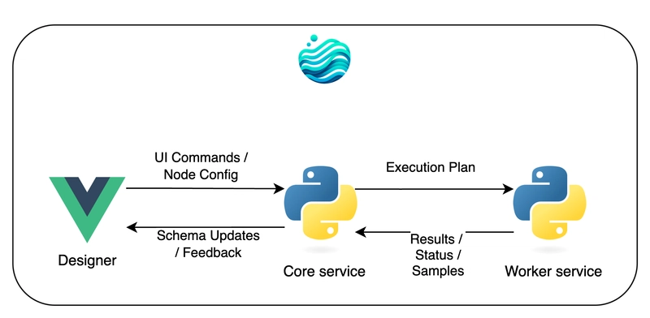
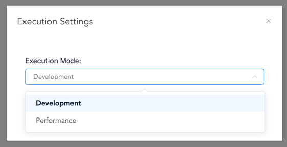

# Technical Architecture

Flowfile's architecture pairs visual design with data processing across three services, built on Polars' lazy evaluation. This page explains the three-service architecture, key technical features such as real-time schema prediction and efficient data exchange, and the role of Polars' lazy evaluation.

## Process & execution map

Flowfile runs as several cooperating processes. The Frontend talks only to Core; Core orchestrates everything else and never materializes full datasets itself — heavy compute is offloaded. The diagram shows every process and how the five kinds of execution flow through them.

![Process and execution map: the Frontend talks only to the Core process (FastAPI :63578), which houses the Core API, SqlService, Kernel Manager, and the embedded Scheduler loop. Five execution paths fan out — ① run a flow (Core serializes LazyFrames and POSTs to the Worker, which returns Arrow-IPC file paths), ② execute SQL on the Worker, ③ run notebook cells (Python in a kernel container, SQL on the Worker), ④ scheduled runs (the Scheduler polls the SQLite catalog DB for due triggers and spawns a detached headless subprocess), and ⑤ serving a published flow as an API endpoint (a GET /api/data/{slug} with an API key runs it and returns JSON). Datasets persist to Delta tables (local or S3); metadata to the SQLite catalog DB.](../assets/images/architecture/process-map.svg)

The five execution paths:

1. **Run flow / execute graph** — Core builds the LazyFrames, serializes them, and POSTs to the **Worker**, which holds dataset memory in spawned subprocesses and returns Arrow-IPC paths. Core ships paths, never collected frames.
2. **Execute SQL** (SQL editor and catalog SQL) — Core's `SqlService` registers the catalog tables and runs the query on the **Worker**.
3. **Execute a notebook** — Python cells run in the bound **kernel container** (which writes results to Delta and POSTs metadata back to Core); SQL cells take path ②; Markdown renders client-side.
4. **Scheduled run** — the embedded **scheduler** loop (only when `FLOWFILE_SCHEDULER_ENABLED`) polls the catalog DB for due triggers and launches a detached **headless subprocess** that runs the flow on a worker embedded in itself, beside the app's worker, which it uses only for a Google Analytics read (in Docker, inside the core container).
5. **Serve a flow as an API** — a registered flow is *published* under `/flow-api` (JWT-managed); the public, API-key-authenticated `GET /api/data/{slug}` then runs it synchronously and returns the output of its single `api_response` node as JSON. One key can call several published flows (`routes/flow_api.py`, `routes/api_consumers.py`).

The [canvas notebook](../users/visual-editor/notebook.md) adds no process. Core renders the flow as cells itself (`GET /notebook/render`). A sync (the notebook's **Run**, **Run all** or **Push**) hands every cell to the notebook runner Core installs at startup (`notebook/runner.py`), which *interprets* the cells rather than executing them: each cell is parsed, and it may only call the flow-building functions an allowlist names for the value it calls them on (`notebook/allowlist.py`, `notebook/interpret.py`); anything else is refused on its line as needing a kernel. The cells build nodes on a fresh graph without running any: sources and nodes whose columns depend on data take their schema from the canvas node they were rendered from, from what the cell declares, or from what the canvas itself reads to show a schema (a local file's header, a catalog table's registered schema), else no columns; no connection is opened. The result is relabelled onto the canvas's ids, reconciled against the live graph (`notebook/relabel.py`, `notebook/reconcile.py`) and applied as one undoable editor transaction. In a multi-user deployment only admins can sync. A node cell's **Run** then takes path ①, restricted to the cell node's lineage.

The **scheduler is not a separate service** — it's a loop inside the Core process. The separate OS processes are the Frontend, Core, Worker (plus its compute children), the kernel containers, and each spawned headless run.

## Core Components

### Three-Service Architecture



**Designer (Tauri + Vue)** The visual interface where data pipelines are built through drag-and-drop operations. It is a Tauri 2 desktop shell (Rust) wrapping a Vue 3 renderer, and the same renderer serves the web build. It communicates with the Core service for real-time feedback and data previews.

**Core Service (FastAPI)** The orchestration engine that manages workflows, predicts schemas, and coordinates execution. It maintains the Directed Acyclic Graph (DAG) structure and handles all UI interactions and overall flow logic.

**Worker Service (FastAPI)** Handles heavy data computations in isolated processes. It executes Polars transformations, materializes data, and manages data caching using Apache Arrow IPC format, preventing large datasets from overwhelming the Core service.

## Key Technical Features

### Real-time Schema Prediction

When you add or configure a node, Flowfile immediately shows how your data structure will change — **without executing any transformations**. This happens through:

-   **Schema Callbacks**: Custom functions, defined per node type, that calculate output schemas based on node settings and input schemas.
-   **Lazy Evaluation**: Leveraging Polars' ability to determine the schema of a planned transformation (`LazyFrame`) without processing the full dataset.

<details markdown="1">
<summary>View Schema Prediction Python Example</summary>

```python
# Example: Schema prediction for a Group By operation
def schema_callback():
    output_columns = [(c.old_name, c.new_name, c.output_type) for c in group_by_settings.groupby_input.agg_cols]
    depends_on = node.node_inputs.main_inputs[0]
    input_schema_dict: Dict[str, str] = {s.name: s.data_type for s in depends_on.schema}
    output_schema = []
    for old_name, new_name, data_type in output_columns:
        data_type = input_schema_dict[old_name] if data_type is None else data_type
        output_schema.append(FlowfileColumn.from_input(data_type=data_type, column_name=new_name))
    return output_schema
```

</details>

### The Directed Acyclic Graph (DAG): The Foundation of Workflows

As you add and connect nodes, Flowfile builds a Directed Acyclic Graph (DAG) where:

* **Nodes** represent data operations (read file, filter, join, write to database, etc.).
* **Edges** represent the flow of data between operations.

The DAG is managed by the `FlowGraph` class (`flowfile_core/flowfile_core/flowfile/flow_graph/graph.py`, imported from the `flowfile_core.flowfile.flow_graph` package) in the Core service, which orchestrates the entire workflow. The class shape below is illustrative — see the [Python API Reference](python-api-reference.md#flowgraph) for the real signatures.

<details markdown="1">
<summary>View FlowGraph shape (illustrative)</summary>

```python
class FlowGraph:
    """
    Manages the ETL workflow as a DAG. Stores nodes, dependencies,
    and settings, and handles the execution order.
    """
    uuid: str
    _node_db: Dict[Union[str, int], FlowNode]  # Internal storage for all nodes
    _flow_starts: List[FlowNode]               # Nodes that initiate data flow (e.g., readers)
    _node_ids: List[Union[str, int]]           # Tracking node identifiers
    flow_settings: schemas.FlowSettings        # Global configuration for the flow

    def add_node_step(self, node_id: Union[int, str], function: Callable,
                      node_type: str, **kwargs) -> None:
        """Adds a new FlowNode to the graph."""
        ...

    def run_graph(self) -> RunInformation:
        """Executes the flow in the correct topological order."""
        ...
```
</details>

Each `FlowNode` in the graph encapsulates its dependencies, transformation logic, and output schema. This lets Flowfile determine execution order, track data lineage, optimize performance, and predict schemas throughout the pipeline.

### Execution Modes

!!! info "Canonical explanation"
    This is the reference description of Development vs Performance mode. The [Core Developer Guide](flowfile-core.md#execution-strategy-how-nodes-decide-where-to-run) and [Design Philosophy](design-philosophy.md) pages link here rather than repeat it.

By clicking on settings &rarr; execution modes you can set how the flow will be executed the next time you run the flow.



Flowfile offers two execution modes tailored for different needs:

| Feature           | Development Mode                     | Performance Mode                                 |
| :---------------- | :----------------------------------- | :----------------------------------------------- |
| **Purpose** | Interactive debugging, step inspection | Optimized execution for production/speed         |
| **Execution** | Executes node-by-node                | Builds full plan, executes minimally             |
| **Data Caching** | Caches intermediate results per step | Minimal caching (only if specified/needed)       |
| **Preview Data** | Available for all nodes              | Only for final/cached nodes                      |
| **Memory Usage** | Potentially higher                   | Generally lower                                  |
| **Speed** | Moderate                             | Faster for complex flows                         |

**Development Mode**
In Development mode, each node submits its plan to the flow's compute backend with a 100-row preview asked for. On the worker, a wide node (a join, a group by, a sort) is stored as an Arrow IPC file in the worker's own storage and a narrow one is kept as a plan, and the preview comes back inline with the submit. This lets you inspect the data at each step in the Designer.

**Performance Mode**
In Performance mode, Flowfile fully embraces Polars' lazy evaluation. Each node submits its plan with no preview asked for, so an ordinary transform only extends the plan the next node composes on, and no backend computes it until a writer or a cached node downstream reads it. Rows are computed in two places:

- **Output nodes** (writing to a file, a database or cloud storage) run their write as an operation on the flow's backend, which computes the plan it is given.
- **Nodes with `cache_results` enabled** submit with `must_materialise`, so the backend stores their rows whatever the mode.

This minimizes computation and memory usage by avoiding unnecessary intermediate materializations.

[Execution Strategy](flowfile-core.md#execution-strategy-how-nodes-decide-where-to-run) has the detail: the hints, each backend's policy and the previews.

<details markdown="1">
<summary>View Performance Mode Python Example (simplified)</summary>

```python
# What a node submits with, in either mode (flow_node/executor.py::hints_for, simplified)
hints = SubmitHints(
    must_materialise=node.node_settings.cache_results,  # correctness: the user asked for a stored result
    wide=not is_narrow_transform(node),                  # join, group_by, sort, …
    fanout=len(node.leads_to_nodes),                     # downstream consumers
    preview_rows=None if performance_mode and not node.node_settings.cache_results else 100,
)
# The backend's policy decides from the hints whether to store the rows or keep the plan.
result = backend.submit(plan, inputs, hints, node.hash, flow_id=flow_id, node_id=node.node_id)
```

</details>

Crucially, with a worker as the flow's backend, **bulk data processing happens in the Worker service**: core builds plans, sends them, and takes back a schema, a row count and at most a bounded sample, never an intermediate frame. This separation prevents large datasets from overwhelming the Core service and keeps the UI responsive.

### Efficient Data Exchange

Flowfile uses Apache Arrow IPC format for the data the Core and Worker services exchange, and keeps results where they were computed:

1.  **Worker Processing & Storage**: When the backend's policy stores a result (a `must_materialise` node, or a wide one with a preview asked for), the worker computes it in a child process and writes it as an Arrow IPC file under its own storage directory; otherwise it keeps the plan.
2.  **Result References**: The worker answers a result reference (`ResultRef`): the result's schema, its row count when known, and a location that is opaque to core. Core composes the next node's plan on `plan_for(ref)`, a scan of the worker's file that core sends back to the same worker and never opens itself.
3.  **UI Sampling**: A preview arrives inline with the submit, or later from `sample(ref, n)`, an Arrow IPC stream of at most `n` rows, which core forwards to the Designer.
4.  **Crossing backends**: Data moves to another backend only through `export` and `import_uri`, never implicitly; the [compute protocol](compute-protocol.md) describes the exchange store that carries it.

This keeps core responsive and memory-isolated, and lets the worker run on another host.

Here is how a node submits its plan on the core side, and how the Worker runs a job in a separate process:

<details markdown="1">
<summary>View Core-Side Python Example (simplified)</summary>

```python
# Core side - FlowNode._do_execute (simplified)
backend = current_context().backend                      # the run's backend: the worker, or the worker embedded in this process
result = backend.submit(plan, inputs, hints, self.hash, flow_id=flow_id, node_id=self.node_id)
self.results.result_ref = result.ref                     # the handle core keeps; it never opens the worker's file
self.results.resulting_data = FlowDataEngine(backend.plan_for(result.ref), schema=result.ref.schema)
# The preview: result.sample when it came inline, else backend.sample(result.ref, n) when it is opened.
```
</details>

The worker's task routes start a job through `spawner.py::start_process`, below; its `/v1` routes run theirs in a pool of child processes kept warm. A process that embeds the worker and does not serve, a scheduled run or Flowfile in Python, runs each job in itself instead (`spawner.run_inline`).

<details markdown="1">
<summary>View Worker-Side Python Example (simplified)</summary>

```python
# Worker side - Managing computation in a separate process (simplified)
def start_process(
    polars_serializable_object: bytes, # Serialized LazyFrame plan
    task_id: str,
    file_ref: str, # Path for cached output (Arrow IPC file)
    # ... other args like operation type
) -> None:
    """Launches a separate OS process to handle the heavy computation."""
    # The worker's spawn context forces spawn as its first child starts
    # (flowfile_worker/__init__.py), never at import, so every child is a
    # fresh, killable process regardless of platform — never fork.
    mp_context = get_context('spawn')

    # Shared memory/queue for progress tracking and results/errors
    progress = mp_context.Value('i', 0) # Shared integer for progress %
    error_message = mp_context.Array('c', 1024) # Shared buffer for error messages
    queue = mp_context.Queue(maxsize=1) # For potentially passing back results (or file ref)

    # Define the target function and arguments for the new process
    process = mp_context.Process(
        target=process_task, # The function that runs Polars .collect()/.sink()
        kwargs={
            'polars_serializable_object': polars_serializable_object,
            'progress': progress,
            'error_message': error_message,
            'queue': queue,
            'file_path': file_ref, # Where to save the Arrow IPC output
            # ... other necessary kwargs
        }
    )
    process.start() # Launch the independent process

    # Monitor the task (e.g., update status in a database, check progress)
    handle_task(task_id, process, progress, error_message, queue)
```
</details>

## Lazy Evaluation

By building on Polars' lazy evaluation, Flowfile achieves:

-   **Memory Efficiency**: Data is loaded and processed only when necessary, often streaming through operations without loading entire datasets into memory at once. This allows processing datasets larger than RAM.
-   **Query Optimization**: Polars analyzes the entire execution plan and can reorder, combine, or eliminate operations for maximum efficiency.
-   **Parallel Execution**: Polars automatically parallelizes operations across all available CPU cores during execution.
-   **Predicate Pushdown**: Filters and selections are applied as early as possible in the plan, often directly at the data source level (like during file reading), minimizing the amount of data that needs to be processed downstream.

---

*Background reading: the original [design article](https://dev.to/edwardvaneechoud/building-flowfile-architecting-a-visual-etl-tool-with-polars-576c) covers the motivation and early design. It predates some renames (the graph class is now `FlowGraph`, nodes are `FlowNode`), so treat class names there as historical.*