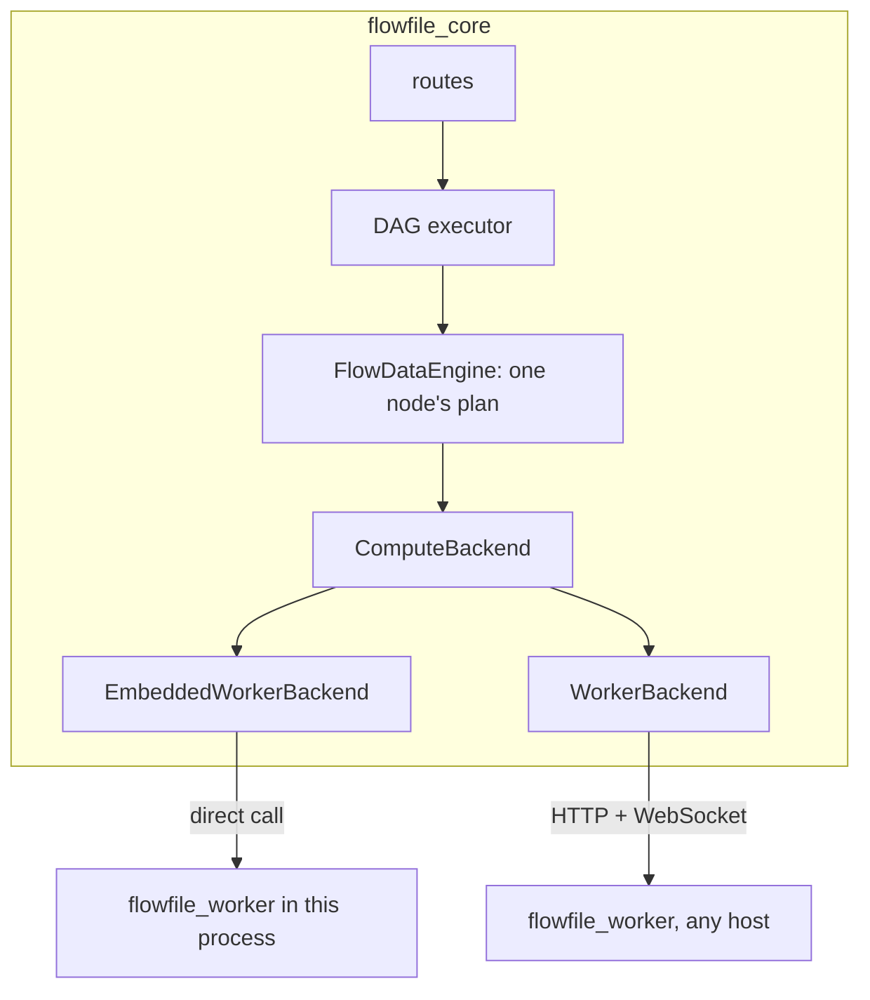

# Compute protocol

The compute protocol is the contract between `flowfile_core` and the compute that runs a flow's nodes. This page is the design reference for contributors who change that path or build a backend: the interface a backend implements and the invariants core relies on. [How compute works](compute-walkthrough.md) tours the same code with diagrams and is the better first read. [Where flows run](../users/deployment/where-flows-run.md) and [Remote workers](../users/deployment/remote-worker.md) cover the user and operator side.

## The idea

Core never holds a dataset. For each node it builds a Polars lazy plan and hands it to a backend, which runs the plan and keeps the result. Core gets back a reference to that result and at most a preview's worth of rows. Nothing else crosses, so core and its compute need no shared disk, host or process.



Three rules carry the design, and each one opens a deployment shape:

| Rule | Lives in | Makes possible |
|---|---|---|
| A result is a reference only the backend that minted it can read | `ResultRef`, `plan_for`, `sample` | compute on any host, with no shared disk |
| One place decides where work runs | `execution/registry.py`, `ExecutionContext` | a choice of compute per run and per node |
| Every node states what it needs, every backend what it offers | `flow_node/requirements.py`, `Capabilities`, `place()` | a node refused before the run when its backend cannot run it |

The protocol is on by default. `FLOWFILE_COMPUTE_PROTOCOL=0` sends core back to the worker's task routes, and every task route core does not call with the protocol on answers with `Deprecation: true`.

| Term | Meaning |
|---|---|
| **core** | the `flowfile_core` process: routes, the DAG executor (`FlowGraph`, `NodeExecutor`), schema prediction |
| **backend** | an adapter object inside core that implements `ComputeBackend` |
| **compute** | what a backend talks to: a `flowfile_worker` process, or the worker embedded in core's own process |
| **plan** | a Polars `LazyFrame`: a tree of operations over scans, with no data in it |
| **result reference** | a `ResultRef`, the only handle core holds to a result |
| **operation** | work that is not a plain Polars plan and needs Flowfile code on the compute |

## Invariants

Every backend and every caller in core keeps these. The conformance suite (`flowfile_core/tests/flowfile/execution/conformance/`) checks them; invariant 4 is checked by `flowfile_core/tests/flowfile/test_cloud_plan_secrets.py` and `flowfile_worker/tests/test_plan_credentials.py`.

1. **Core receives at most `preview_rows` rows of any result.** Only `sample` and the inline sample on `submit` return rows. Core never collects a backend's plan.
2. **Only the minting backend reads a result.** `plan_for(ref)` on another backend raises `ForeignRef`.
3. **Core learns a schema from the reference, never from the file.** Downstream schemas are predicted over an empty frame of it.
4. **Plans carry no credentials.** A plan names a connection by `CredentialRef`, and the process that runs it resolves it.
5. **Anything beyond a plain plan is a declared operation.** `capabilities()` lists what a backend runs, and placement checks it before the run.
6. **Data crosses backends only through `export` and `import_uri`.** Consecutive nodes may run on different backends.
7. **A version mismatch is refused at the handshake.** There is no silent fallback, and an unreachable compute is never reported as a missing result.
8. **The backend decides what to materialise**, except where core marks it required for correctness.

Invariant 1 binds a core that serves: the desktop sidecar, the Docker image, the pip server. A process with no worker beside it (a scheduled run, Flowfile in Python) holds its own results, so a frame's `collect()` there reads every row through `plan_for`. `test_serving_app_ratchet.py` keeps the serving app from doing the same.

## The interface

`ComputeBackend` is a `runtime_checkable` `Protocol` in `flowfile_core/flowfile_core/flowfile/execution/protocol.py`. `Capabilities` and `PROTOCOL_VERSION` live in `shared/compute_protocol.py`, which core and the worker both import.

```python
PROTOCOL_VERSION = 1                         # the worker contract: everything core and a worker exchange

class ComputeBackend(Protocol):
    id: str                                  # "local", "worker", "worker:team"
    protocol_version: int

    def capabilities(self) -> Capabilities: ...
    def submit(self, plan: pl.LazyFrame, inputs: list[ResultRef], hints: SubmitHints, result_id: str, *, flow_id: int, node_id: int | str) -> SubmitResult: ...
    def run_op(self, op: OperationKind, payload: OpPayload) -> OpResult: ...
    def sample(self, ref: ResultRef, n: int) -> bytes: ...          # Arrow IPC stream, at most n rows
    def count(self, ref: ResultRef) -> int: ...
    def exists(self, ref: ResultRef) -> bool: ...
    def release(self, ref: ResultRef) -> None: ...
    def plan_for(self, ref: ResultRef) -> pl.LazyFrame: ...        # a leaf valid on this backend only
    def export(self, ref: ResultRef, uri: str, credential: CredentialRef | None) -> str: ...
    def import_uri(self, uri: str, schema: Schema | None, row_count: int | None, credential: CredentialRef | None, kind: Literal["table", "blob"] = "table") -> ResultRef: ...   # a blob import has no schema
    def status(self, handle: JobHandle) -> JobStatus: ...
    def cancel(self, handle: JobHandle) -> None: ...
```

The plan crosses as the `LazyFrame` itself; a backend that sends it to another process serialises it. `result_id` is the producing node's hash, and `flow_id` and `node_id` file the job and its logs on the compute.

??? info "The value types: `ResultRef`, `SubmitHints`, `SubmitResult`, `OpResult`, `Capabilities`"

    ```python
    Schema = list[FlowfileColumn]

    @dataclass(frozen=True)
    class ResultRef:
        backend_id: str
        result_id: str                           # the node hash, plus a suffix for derived results
        schema: Schema
        row_count: int | None                    # None when unknown without computing the result
        state: Literal["materialised", "deferred"]
        location: bytes                          # opaque to core
        kind: Literal["table", "blob"] = "table" # a blob is a fitted model or another non-tabular result

    @dataclass(frozen=True)
    class SubmitHints:
        must_materialise: bool                   # cache_results
        wide: bool                               # not a narrow transform: join, group_by, sort, pivot, …
        fanout: int                              # downstream consumers that run in this run
        preview_rows: int | None                 # 100 in Development mode; None in Performance mode unless the node caches

    @dataclass(frozen=True)
    class SubmitResult:
        ref: ResultRef
        sample: bytes | None                     # inline when preview_rows was set
        handle: JobHandle

    @dataclass(frozen=True)
    class OpResult:
        refs: dict[str, ResultRef]               # the results by name; empty for an operation that only writes
        metadata: dict[str, Any] = field(default_factory=dict)  # a model's digest, a Delta write's version and counts, Kafka offsets

    class Capabilities(BaseModel):
        app_version: str                         # reported, not compared
        polars_version: str
        python_version: str
        protocol_version: int
        platform: str                            # sys.platform plus platform.machine()
        polars_runtime: str                      # "32" or "64": the index width of the loaded Polars runtime
        plugins: dict[str, str]                  # polars_grouper, polars_simed, polars_ds, deltalake, pl_fuzzy_frame_match, polars_expr_transformer
        plugin_libs: dict[str, str]              # prefix-relative library path per expression plugin, as Polars serialises it
        operations: frozenset[str] = frozenset()  # the OperationKind values it runs
        read_schemes: frozenset[str] = frozenset()  # "file", "s3", "az", "gs", "http", "https"
        write_schemes: frozenset[str] = frozenset()
        credential_resolution: Literal["master_key", "vended", "ambient"]
        submit_socket: bool = True               # takes a submit over WS /v1/ws/submit; False: core posts each one
    ```

Every error is a `ComputeError` (`flowfile/execution/errors.py`): `ComputeUnavailable`, `VersionMismatch`, `ResultMissing`, `PlanRejected`, `OperationUnsupported`, `ForeignRef` or `TaskFailed`. `WorkerBackend` maps the task routes' integer `error_code` onto them. An unreachable compute stays an error all the way out: the published API answers `ComputeUnavailable` with 503 (any other compute error with 500), so do the catalog routes, and core never reads the data itself instead. The run report's `NodeResult.compute_error` names the failure: `"Refusal"` for a node placement refused, else the `ComputeError` subclass that failed it.

## Results

A reference is in one of two states:

- **Materialised**: the backend wrote the result to storage it owns. `plan_for` answers a scan of it, `scan_ipc(path)` on a worker.
- **Deferred**: the backend kept the plan and runs it when something needs rows. `plan_for` answers the plan itself, and `row_count` stays `None` until counted, unless the backend already knows it.

The leaf from `plan_for` may name a path core cannot open. Core only composes the next node's plan on it and sends that back to the same backend.

The `result_id` is the node hash, which folds in the input hashes, the settings, the graph's `parent_uuid` and the cache epoch. The reference is therefore the cache: `exists` says whether the backend still holds it, `release` lets it go, and no reference survives a graph reload.

A node owns every reference it minted (its result, the outputs it stored beside it, its operation's outputs), and `FlowNode.release_result` releases them together: on a rerun under another hash or backend, on removal, when its graph closes, and when it fails after storing part of its outputs. A published API call and a headless run close their flow when they end. A release whose backend cannot be reached is logged and dropped. The worker's age sweep (`CACHE_EXPIRATION_TIME`, 24 hours) is the backstop for a core that died, not how results are meant to go.

### Who materialises

Core marks only what correctness needs. `must_materialise` is set when a node has **Cache Results** on or reads an input that crossed from another backend. Reads whose source can change between calls (a database, Kafka, REST, Google Analytics) and random splits are operations, so the backend holds what each produced once and two consumers never see different answers. `wide`, `fanout` and `preview_rows` are hints.

The worker materialises when `must_materialise or (wide and (preview_rows is not None or fanout > 1))`: a wide result that several consumers read is written once instead of computed again inside each consumer's plan, since each consumer's plan inlines the plans of the deferred results it reads. A narrow result stays deferred whatever its fan-out, so projections and filters keep pushing through it. The embedded worker runs the same `service._materialise`, so this is the one policy wherever the worker runs. Core counts only the consumers that run in the run at hand (a single-node fetch counts none).

| Flow | Hints | Result |
|---|---|---|
| read → filter → one consumer | narrow, fanout 1 | deferred; the preview is a streaming `head(100)` job |
| join → group by | wide, fanout 1 | materialised in Development mode (the preview); deferred in Performance mode, computed once at the sink |
| group by → two writers | wide, fanout 2 | materialised in both modes; each writer scans the file |
| database read → two nodes | an operation | materialised by the read |
| any node with **Cache Results** | required | materialised |
| any node in Performance mode | `preview_rows=None` | no sample job; a wide node stays deferred unless required or read by several consumers |

## Operations

`submit` runs a plain Polars plan. Work that needs Flowfile code on the compute, reads a source that can change between calls, or writes is an `OperationKind`, a closed enum run through `run_op`. A backend declares which kinds it runs, and one `run_op` may run several jobs: a random split is one shuffle with a deferred reference per split over it.

| Kind | Returns |
|---|---|
| `database_read`, `kafka_read`, `google_analytics_read`, `rest_api_read`, `file_read` | one reference; `kafka_read` adds its offsets as `metadata` |
| `fuzzy_join`, `ml_apply` | one reference |
| `polars_code`, `sql_query` | one reference, its schema from running the code on the backend |
| `random_split` | one reference per split |
| `custom_node` | one reference per named output |
| `ml_train` | the model as a `blob` reference, its digest in `metadata` |
| `file_write`, `database_write`, `cloud_write` | nothing |
| `delta_write`, `delta_merge`, `delta_scd2` | the Delta version and counts as `metadata` |
| `viz_session` | the visualisation session's answer as `metadata` |

With the protocol on, every kind except the three Delta kinds and `viz_session` goes to `POST /v1/ops/{kind}`. Those four stay on the worker's task routes (`/submit_query/`, `/catalog/visualize_*`).

**User code runs on the backend, never in core.** A Polars Code node's code is the `polars_code` payload, and a SQL Query node's statement is the `sql_query` payload, its inputs registered as `input_1`, `input_2`, … in a `pl.SQLContext`. The backend that holds the inputs runs it once and answers a reference carrying the resulting schema, so eager code and side effects behave as they would in a script on that host. The designer predicts the schema with the same operation over empty frames. A result over sources is held deferred; one over rows in memory is written and held as a file, so no rows travel to core. With the protocol off, core runs both itself to build a plan.

**A fitted model is a `blob` result**, addressed, checked and released like any reference and never sampled, counted or planned over. Publishing it to the catalog is `export` to the artifact store's upload target; using a catalog model is `import_uri` of its download source. Core writes the catalog row and never carries the bytes. `flowfile_core/artifacts/publish.py` holds the two moves: `publish_result` has the backend `export` the held model to the store's upload target, then writes the version; `fetch_artifact` answers the blob the backend's `import_uri(kind="blob")` holds from the store's download source. The URI is a `file://` path or a presigned URL, never a credential. `plan_for`, `sample` and `count` refuse a blob with `OperationUnsupported`.

### Payloads

Every kind takes one frozen, keyword-only dataclass from `flowfile/execution/payloads.py`, on `OperationPayload` (`flow_id`, `node_id`, `job_id`), wrapped by `op_payload(x)` under the one key `PAYLOAD_KEY`; a backend's `unpack` names the class it expected. Both backends read the same payload, so a call site is `FlowNode.run_op(current_context(graph).backend, kind, op_payload(x), job_id=x.job_id)` with no location branch. A write carries its input as a `pl.LazyFrame`, the settings model, the resolved connection and credentials only as `$ffsec$` ciphertext; a read carries the settings, the connection and the credential as stored; a transform or model carries its frames and settings (`MlApplyPayload.model` is the blob's `ResultRef`). In-process hooks a payload carries (a cancel check, a logger, the Kafka consumer) are core's, and no backend reads them. The Delta writes answer `table_path`, `schema`, `row_count`, `column_count` and `size_bytes` as `metadata`, an SCD2 write adding `version` and `scd2_metrics`, a write that changed nothing `{"skipped": True}`. Job ids come from the node hash, so a rerun's job replaces the last; a schema prediction runs as `<job id>-schema`.

With the protocol on a catalog table is named by identity, not a path: the Delta payload's `table` is a `CatalogTableIdentity` (table id, directory name, the storage root's `base_uri`), the compute answers where it wrote as `table_path`, and the writer refuses an existing table whose answer is not the location its record resolves to before anything is registered or deleted.

## Credentials

A plan carries `CredentialRef(connection_id, user_id)` inside a `CredentialRefProvider`, plus a per-plan nonce that keeps Polars' credential cache to one plan, and no secret. The process that runs the plan resolves it: the worker reads the connection row from the shared catalog, decrypts it with its master key, and exchanges an Azure service-principal secret or a GCS service-account key for a bearer token on the spot. Neither backend attaches anything.

A worker on another host therefore needs core's catalog database (the shared PostgreSQL behind `FLOWFILE_DATABASE_URL`) and the same master key; [Remote workers](../users/deployment/remote-worker.md#the-shared-catalog-and-the-master-key) has the setup. What follows from resolving where the plan runs:

- `aws-cli`, `iam_role`, `env_vars` and `managed_identity` connections authenticate as the executor's host, for reads and writes alike. An `aws-cli` read with no saved connection uses the executor's default credential chain.
- A read naming a credential-holding connection that the catalog does not store for the user it runs as is refused, never resolved in core: `Cloud connection "<name>" is not stored for user <id>: …`.
- Schemas follow the rows: core learns a reader's schema from the backend that runs the read, and resolves no connection for a read it sends elsewhere.
- The catalog's own object-storage work stays in core, with core's identity: the freshness probe at the start of a run, enabling a change feed, scanning an SCD2 result. A deployment's core therefore needs access to the buckets of its object-storage catalogs.
- A GCS connection with a custom endpoint is read on the executor by a native scan too. Core's gcsfs read remains only for the protocol off and for the writers.
- With the protocol off, a plan carries a `$ffsec$` ciphertext in an `EncryptedCredentialProvider` instead, and Azure and GCS secrets travel in its `storage_options`.
- A write to a backend whose verdict declares `credential_resolution: ambient` carries its connection's transport options only: `WorkerBackend` sends the cloud write's and the Delta operations' connection with every credential field `None` (`_transport_only`). Placement already keeps every connection but `env_vars` and `managed_identity` off such a backend, and those hold no secret, so this only keeps ciphertext the backend could not decrypt off the wire.

## Where data lives

Intermediate results are private to the backend that computed them, object storage holds catalog data, and nothing is staged unless a deployment configures it.

- **Catalog tables** are addressed by identity. The storage target (`catalog/storage_backend.py`) resolves the identity to a path or URI for whoever executes. A table stored outside its catalog's root (registered from its own path, left behind by a moved catalog directory, or under a namespace whose storage URI changed) is refused by the catalog writer on every backend, and its data is left untouched.
- **The catalog services** (metadata, previews, history, optimize, vacuum) go to the worker unless the current context's backend is `local` (`catalog/compute.py::uses_worker`); a worker that cannot be reached is `ComputeUnavailable`, never a read in core.
- **The `file` scheme** is offered only to a worker that sees core's disk: the embedded worker; the built-in `worker` at its unconfigured address (neither `FLOWFILE_WORKER_URL` nor `WORKER_HOST` set); a configured row marked `shares_core_disk`; a worker started with `FLOWFILE_WORKER_LOCAL_FILES=1`. Core adds `file` for the first three itself, because what a worker sees of core's disk is core's knowledge. A local path or a local-disk namespace on any other backend is refused before the run: `namespace "sales" is on local disk, not object storage`.
- **Kernel nodes** (Python Script, custom nodes that run on a kernel) read their inputs from the kernel shared volume on core's host, so they run only on a worker that writes there. Under the mixed policy, only the kernel node's own backend must qualify.
- **Artifacts** move between a backend and the artifact store through a `file://` URI on a co-located backend and a presigned `https://` URL anywhere else, and placement checks the scheme against the backend's `read_schemes` or `write_schemes`. An unpublished model stays on the backend that fitted it until a later fit replaces it.
- **The exchange store** is the one place results are staged, and only when a deployment configures it; see [mixed placement](#mixed-placement).

## Placement

Each node derives its requirements from its template and settings alone (`flow_node/requirements.py`). `place()` in `flowfile/execution/placement.py` compares them with what each backend's handshake verdict offers, without calling any backend:

```python
def place(flow: FlowGraph, backends: Mapping[str, Capabilities], policy: PlacementPolicy, *, nodes: list[FlowNode] | None = None) -> Placement

@dataclass(frozen=True)
class Placement:
    assignment: dict[int, str]               # node id -> backend id
    boundaries: list[tuple[int, int]]        # edges whose data must cross through export / import_uri
    refusals: list[Refusal]                  # node, backend, reason in words
    unreachable: dict[str, Exception]        # backend id -> the error its handshake raised; its nodes fail with it when they run
    fallbacks: list[Fallback]                # nodes moved to the fallback backend under the mixed policy
```

| A node needs | When | Refused on a backend that |
|---|---|---|
| a storage scheme | it reads or writes `file`, `s3`, `az`, `gs`, `http` or `https` | does not list it in `read_schemes` or `write_schemes` |
| a plugin | its expressions use one; every formula node needs `polars_ds` and `polars_expr_transformer` | lacks it, has another version, or cannot load it |
| Python functions in its plan | it is a formula node (formula, multi-field formula, advanced filter, formula gate, formula rename) or a cloud or catalog change read | failed the handshake's Python probe |
| an operation kind | it runs one; Explore Data needs `viz_session` | does not declare it |
| the kernel shared volume | it runs on a notebook kernel | does not write `file` |
| a stored connection | it names one whose method holds a credential (anything but `env_vars` and `managed_identity`) | resolves storage with its own identity (`credential_resolution="ambient"`) |

`requirements_for` does no I/O: a catalog node's scheme and connection, and a model node's artifact scheme, come from the target its caller resolves. `place` reads each node's settings with the flow's parameters resolved, through a copy, so `${dir}/x.csv` is placed by what `dir` resolves to, and a node whose needs cannot be read from its resolved settings is refused before the run starts.

Every node saves `execution_location: "auto" | <backend id>` in the flow file, and the flow's own value is the default for its nodes. Ids are `local` (the worker embedded in this process), `worker` (the built-in default) and `worker:<name>` for each configured one. A saved id is permanent, which is why the vocabulary is ids and not role names; `remote` stays an alias of `"auto"` for flow files that carry it.

The designer offers `"auto"` and the configured ids, never `local`: desktop and Docker always compute on a worker, so an out-of-memory node takes down a child rather than core, and cancel is real. A flow saved with `local` loads as `"auto"` wherever the protocol is on, in the designer and `flowfile_frame` alike. A core that serves refuses a run that reaches `local` before any node starts: `cannot run on backend "local": this core serves; compute runs on its worker`.

| | `SingleBackendPolicy` | `MixedPlacementPolicy` |
|---|---|---|
| **Chosen** | by default | when an exchange store is configured (`FLOWFILE_EXCHANGE_URI`) |
| **Assigns** | every node to the flow's backend | each node to its own `execution_location`, the flow's for `"auto"` |
| **A node its backend cannot run** | refuses the run before any node starts | moves to the fallback backend if that one can run it, else is refused with both reasons |

Both policies keep pinned node types where their builders pin them; the Google Analytics reader always runs on the worker. A refused node's row on the run report reads `cannot run on backend "<id>": <reason>`. Placement stays in core because only the DAG executor knows the graph ([Execution Strategy](flowfile-core.md#execution-strategy-how-nodes-decide-where-to-run)); a control plane may fill the backends table, but core places.

A Run Flow node is placed with the flow it runs: the child is built for the call and every node its run would run is placed on the Run Flow node's backend, nested flows in turn up to `subflow.MAX_SUBFLOW_DEPTH`. An Apply Model node is placed with the Train Model node whose model it scores, and a formula gate with the input it probes. A backend whose verdict refuses it whole refuses every node assigned to it; one whose check raised any other `ComputeError` keeps its nodes, unchecked, and each fails with that error when it runs, never running elsewhere; an unknown id refuses its nodes. A refusal ends the run before a node starts: one failed `NodeResult` per refused node, nothing prepared, executed or committed. A single-node fetch places the node and the nodes it reads from the same way.

### Mixed placement

- **Fallback.** `registry.fallback_backend_id()` is the default backend in a core that serves and the embedded `local` in a process that does not. Each move is a `Fallback(node_id, backend_id, fallback_id, reason)` on `Placement.fallbacks`, and a run-report row with `backend_id`, `fallback_from` and `fallback_reason`. A Train Model that falls back takes its Apply Model along. Nodes on a backend refused whole, on an unknown id or on an unreachable backend never move. The policy checks again until no node moves.
- **Crossing.** Each boundary crosses through the exchange store (`execution/exchange.py`) by `export` and `import_uri`, into `<uri>/<flow id>/<run id>/<from>-<handle>-<to>.parquet`. The importing node is submitted with `must_materialise`, so nothing refers to the prefix afterwards, and `run_graph` removes the prefix when the run ends, however it ends. A core that stops mid-run leaves its prefix behind, so the bucket needs a lifecycle rule as a backstop.
- **Identity.** The store's connection belongs to the deployment: an administrator's cloud connection named by `FLOWFILE_EXCHANGE_CONNECTION`, resolved once per run. No user configures it, and no user's connection of the same name shadows it.
- **Size limit.** `FLOWFILE_EXCHANGE_MAX_ROWS` refuses an importing node before the run when core already knows the edge holds more rows. It is priced only from counts core holds (an upstream result's `row_count`, a manual input's frame); nothing is counted to price it, so an edge of unknown size crosses at any size.
- **Configuration.** The environment wins over what the Backends page saved through `GET`/`POST /system/exchange_store` (`configs/exchange_config.py`); a malformed `FLOWFILE_EXCHANGE_MAX_ROWS` refuses each crossing, never a 500.
- **Visibility.** `GET /flow/placement` answers the placement without running, for the designer's badges, and the run report carries `RunInformation.boundaries` for the canvas's edges.
- **Virtual tables.** A catalog reader over a virtual table runs the producer flow on the reader's own backend.

## The handshake

`verify` (`flow_data_engine/subprocess_operations/handshake.py`) checks every backend the same way, through its own interface. It compares `capabilities()` with core's, then runs probe plans as ordinary jobs (`submit` with a one-row preview, `sample`, `release`): one per expression plugin (`polars_grouper`, `polars_ds`) and one carrying a trivial Python function. The resulting `Verdict` is cached per backend. Placement reads it (`verdict_for`), and so does the gate in front of every worker call (`ensure_handshake`). A backend is checked on its first use in each core process, and again after a call could not reach it or a verdict refused it. **Handshake** on **Settings → Execution → Backends** (`POST /compute_backends/{id}/handshake`) runs the same check on demand.

Only what no probe can cover refuses a backend whole:

| Field | Compared | A difference | Because |
|---|---|---|---|
| `polars_version`, `polars_runtime` | exactly | refuses the backend | plan bytes are not stable across Polars versions, and the index width makes `pl.len()` and row indexes `UInt32` on one side and `UInt64` on the other |
| `protocol_version` | exactly | refuses the backend | it is the [worker contract](#the-worker-contract) |
| `python_version` | to the patch | refuses the nodes whose plans may carry a Python function, if the probe fails | Polars refuses to run a Python function serialised under another Python |
| `plugins` | version, plus a load probe for expression plugins | refuses only the nodes that use that plugin | a plugin expression serialises its library path relative to the sender's `sys.prefix`, and its ABI is coupled to the Polars version |
| `app_version`, `platform`, `plugin_libs` | no | nothing; reported only | |

A refusal is a `VersionMismatch`, raised before the backend is sent any work and naming each field with both values: `Backend "<id>" does not match core (<field>: core <a>, backend <b>; …)`. While `FLOWFILE_COMPUTE_PROTOCOL` is off, a backend declaring `credential_resolution: ambient` is refused whole too, with a message naming the flag: with the flag off core's plans carry their credentials encrypted and placement's ambient rule does not run, so a backend that resolves no credential of core's must not be sent any plan. Both Docker images build from one exact Python tag, so a core and worker image of one release match. They also install the lock's exact Polars build with its 64-bit index runtime, as the desktop bundle does, while the `flowfile` package itself takes a Polars range: a `pip install flowfile` core matches those workers, or a Polars cluster, only on the same Polars build and runtime, which the handshake compares exactly. Plugin paths differ between a PyInstaller desktop, a Windows core and a Linux container even on one Polars version, so a desktop core keeps plugin nodes, formulas included, off a remote Linux worker until plugins are resolved by name.

### The worker contract

`PROTOCOL_VERSION` (`shared/compute_protocol.py`) versions everything core and a worker exchange: every request and answer per route, socket and operation kind, and the catalog columns a worker reads.

- `shared/tests/test_worker_contract.py` fingerprints it against `worker_contract.json` and fails on a changed or removed entry until the number is bumped and the pin rewritten with `python shared/tests/test_worker_contract.py`. A new operation kind needs no bump, since a worker that does not declare it is refused only that kind's nodes.
- Every request model a worker route validates refuses unknown fields with 422 (`extra="forbid"`; `FuzzyMapping`, a third-party dataclass, is the one exception). A field the worker does not know fails the request instead of being dropped.
- Every `/v1/*` request carries `X-Protocol-Version`, and a worker answers a different one with 426.
- A capabilities answer this release cannot read is a `VersionMismatch` when it carries an `app_version` (a worker of another release). Without one, the URL is not a Flowfile worker.

Core and a worker of different app releases work together while they speak one contract. Workers upgrade when the number changes, and when Polars does.

The worker serves its capabilities at `GET /capabilities` and `GET /v1/capabilities`. `POST /shutdown` takes the internal token like every other route; without it, the worker answers only a loopback peer while the desktop shell supervises it (`FLOWFILE_SUPERVISOR_PID`).

## Bounded reads

A backend provides rows; core renders them. `sample` answers an Arrow IPC stream, and with `preview_rows` set, `submit` returns it inline on every backend. The common case costs no second round trip, and a plan that cannot run fails its node in Development mode on every backend alike. Reopening a flow, another row count or an on-demand probe calls `sample(ref, n)`, and core caches the bytes per node hash. A read of a node whose last run failed raises that run's error (`FlowNode.get_resulting_data`).

A worker caps `sample` at 10 000 rows and refuses a larger request rather than truncating it. Above 1 000 rows of a materialised result, it reads in a child, not in its serving process. Every read core makes of a result is one of these:

| Read | How core makes it |
|---|---|
| a node's preview | the inline sample on `submit` |
| the first row for the formula editor | `sample(ref, 1)` |
| pivot unique values | `submit(plan.select(col).unique().head(200))`, then `sample` |
| column stats, null profile, dynamic-rename first row | an aggregate plan, then `sample` |
| the formula-gate probe | `sample(plan.filter(pred), 1)` |
| CSV export | `bounded.head_rows` of at most 10 000 rows on the backend that holds the result, written by that backend's `file_write` |
| the published API runner | `sample(ref, max_rows)`, with `max_rows` clamped to the worker's cap |
| the custom-node dry run's outputs, the AI agent's samples | `sample` through the backend |
| whether a result is still held | `exists(ref)` |
| a kernel node's input parquet | a parquet `file_write` on the run's backend (`kernel/execution.py::write_parquet_for_kernel`, the path pinned on its settings), which needs `file` among the backend's write schemes |
| a catalog virtual-table preview | `sample` on the producer run's output reference |

## Backends

The worker is the only compute. Flowfile runs it in two shapes ([Which process computes](../users/deployment/where-flows-run.md#which-process-computes) has the table per way of running):

- **Core + Worker.** The desktop app and Docker run core and a worker as separate processes. Core serves and reaches its worker through `WorkerBackend`.
- **Core(Worker).** A scheduled run, `flowfile run flow` and Flowfile in Python embed the worker and call it through `EmbeddedWorkerBackend`. Nothing of the worker is imported or started until the first submit, and `import flowfile` sets neither the worker's port nor single-file mode. The pip server (`flowfile run ui`) serves too, on the worker embedded in it.

| | `WorkerBackend` | `EmbeddedWorkerBackend` |
|---|---|---|
| **File** | `backends/worker.py` | `backends/embedded.py` |
| **Ids** | `worker`, `worker:<name>` | `local`, and the pip server's `worker` |
| **Reaches the worker** | over HTTP and WebSocket, one `/v1` route per method | by a direct call to the `/v1` route bodies in `flowfile_worker/service.py`, with no token, header, socket or port |
| **Jobs run in** | a pooled child under `FLOWFILE_WORKER_TASK_TIMEOUT`, cancellable | this process in Flowfile in Python; a child under the same limit in a headless run (a pool of one, `registry.headless_run`) and in the pip server (the worker's pool) |

`EmbeddedWorkerBackend` passes the plan as serialised bytes, so the worker loads it exactly as one sent over the wire, and maps the `HTTPException` a body raises to the typed errors. Running a job in the process itself gives up cancel, the time limit and the isolation of a child that runs out of memory, in exchange for the rows landing where they are wanted, which is why only Flowfile in Python does: its `collect()` reads the rows in its own process. A headless runner's children cost a spawn each, about 0.2 s on macOS and 0.4 s or more on Windows, except for the jobs its one warm member takes, and they move no memory: in Docker a scheduled run's jobs still compute in core's container, and only a worker backend moves them out. A SIGTERM, the run's cancel, terminates the children and ends the runner; the children post no log to core (`flow_logger.HEADLESS_RUN_ENV_VAR`), so their lines reach the runner's stderr only. An `HTTPException` a body raises maps to the typed errors: 404 `ResultMissing`, 422 `PlanRejected`, 500 through `errors.worker_failure`, any other code `TaskFailed`.

`WorkerBackend`'s wire maps each method to one route; `submit` uses `WS /v1/ws/submit` and falls back to `POST /v1/submit`. [How compute works](compute-walkthrough.md#one-worker-two-adapters) has the full mapping. The worker publishes it as `openapi.json`; it is private to this backend and versioned by the handshake.

`WorkerBackend(url, *, backend_id, token, ca_cert, shares_core_disk)` sends its token as `X-Flowfile-Internal` on every `/v1` request and the submit socket; a token that is no HTTP header value fails the call naming `TOKEN_RULE`, never the token. `submit` falls back to `POST /v1/submit` when the worker declares no socket or the upgrade fails, but a 426 is `VersionMismatch` with no fallback; once the plan is sent nothing is resent, silence past `FLOWFILE_WORKER_WS_TIMEOUT` is `TaskFailed`, a closed socket `ComputeUnavailable`; the worker, for its part, stops a submit whose client left and releases a result it completed for one, since core never reads it. `capabilities` is the one call outside the handshake gate. With the protocol off the same class uses the task routes and reads the worker's files over the shared disk.

A worker's serving process does nothing but bounded reads of the results it holds. A deferred submit's columns, a sample above 1 000 rows, a count that runs a plan, an export and an import all run in a pooled child under the time limit, so a hanging source or a crashing plugin cannot take down the worker or what it holds. This holds for every worker that serves, the pip server's embedded one included.

### Configuration and trust

- Backends register through the `flowfile.compute_backends` entry-point group. Configured workers live in the `compute_backends` table in core's catalog database: id, URL, bearer token (stored through the secret manager) and an optional `ca_cert`. An administrator fills it on **Settings → Execution → Backends**, or a control plane through `/compute_backends`. Core does not host, register, lease or scale workers; that is the control plane's job.
- A running core reads a row the first time it uses that id and keeps the backend it built, so a row edited directly in the database takes effect on restart; removing one on the settings page drops it at once. `GET /compute_backends` shows every user the ids and their last verdicts, and only administrators the URLs.
- A configured backend's own token signs its `/v1` requests, its submit socket and its `capabilities()`, handshake probes included. The task routes core still calls (the Delta operations, the visualisation session, the catalog services, the custom-node dry run) sign with core's `FLOWFILE_INTERNAL_TOKEN`, so a configured worker is started with core's token.

!!! warning "A worker token grants code execution"
    Plans carry user code and operations run it, so whoever holds a worker's token can run code on that worker. The worker serves TLS itself when `FLOWFILE_WORKER_TLS_CERT` and `FLOWFILE_WORKER_TLS_KEY` name a certificate and key, and a row's `ca_cert` names the CA core trusts for that URL on every call. Plans are not signed; TLS carries their integrity. The Backends page warns while a worker's URL is plain `http` to a host other than loopback. [TLS](../users/deployment/remote-worker.md#tls) has the setup.

### The registry

`flowfile/execution/registry.py` is the one module outside `configs/settings.py` that reads `OFFLOAD_TO_WORKER` or `WORKER_URL`; everything else asks it, and `test_inline_location_branches.py` keeps it so. `backend(id)` builds a backend once per process and caches it; an unknown id is a `LookupError`, and `forget(id)` drops an instance so its row is read again. `default_backend_id()` is the process-wide override when set (`set_default_override`, which the headless runners use), else `FLOWFILE_COMPUTE_BACKEND`, else the legacy `FLOWFILE_OFFLOAD_TO_WORKER` flag, and never `local` in a process that `mark_serving()` marked (`main.run`); `fallback_backend_id()` is the default backend there and `local` elsewhere. `child_env()` is what a child process needs to compute on its own embedded worker.

### The execution context

Core reaches a backend through an `ExecutionContext(backend_id, parallelism, preview_rows)` owned by the `FlowGraph`, derived from the flow's settings on each access (`ExecutionContext.for_flow`: `"auto"` or `"remote"` the default backend, any other id that backend; parallelism 1 on `local`; preview rows 100 in Development mode, `None` in Performance mode). `run_graph` captures it once and runs under `use_context`, each stage thread under a copy, so a `run_flow` child keeps its parent's. A call made with no run active (a preview re-read, the formula editor's first row, a catalog preview, a dry run) resolves `current_context(graph)` from the graph it was given, or uses the default backend when there is none, which is never `local` in a process that serves.

## Headless runs

`flowfile run flow` (`--run-flow` in a packaged build), and the scheduler, which spawns it, compute on the worker embedded in the runner's own process unless a backend is named. To a headless run, `"auto"` and `"remote"` mean its own process, so a scheduled run in Docker computes in core's container, with that container's memory and CPU. A backend is named by `--backend <id>`, else by a specific backend id saved in the flow, else by `FLOWFILE_COMPUTE_BACKEND` in the runner's environment, which a scheduled run inherits from core, so a deployment that sets the variable sends every scheduled run to that backend; the runner makes it the process's default (`registry.set_default_override`) and the run goes there through the same `ExecutionContext` the designer uses; if it cannot be reached, the nodes fail with `ComputeUnavailable` and nothing computes locally instead. The Google Analytics reader always runs on the default worker. The scheduler stays free of core imports and only spawns `flowfile run flow`, which reads the flow's setting from its YAML. [Headless runs](../users/deployment/cli.md) covers the CLI.

## Where it is tested

Paths are under `flowfile_core/tests/flowfile/execution/` unless given in full.

| What | Test |
|---|---|
| the invariants, over both backends | `conformance/` |
| placement and its refusals before any node starts | `test_placement.py` |
| one run's nodes on several backends; the exchange store, its errors and its cleanup | `test_mixed_placement.py`, `test_exchange_store.py` |
| an input above `FLOWFILE_EXCHANGE_MAX_ROWS` refused before the run | `test_edge_cost.py` |
| a result crossing between the embedded worker and a worker, both ways | `test_two_backend_chain.py` |
| the handshake, refusing whole or narrowing what a backend offers | `test_handshake.py` |
| the worker contract pin and unknown-field refusal | `shared/tests/test_worker_contract.py` |
| a worker over TLS with a self-signed certificate | `test_worker_tls.py` |
| no inline `execution_location` branch, no worker-setting read outside the registry | `test_inline_location_branches.py` |
| no collect over a `plan_for` leaf in core or the pip server's app | `test_serving_app_ratchet.py` |
| the embedded worker's typed errors and in-process jobs, with no port | `test_embedded_backend.py`, `test_local_backend.py` |
| flows over results core cannot read, a Polars Code node among them | `test_unreadable_location.py` |
| Explore Data and catalog virtual tables on their reader's backend | `test_explore_data_placement.py`, `test_catalog_reader_placement.py` |
| headless runs on the embedded worker, and an unreachable saved worker | `flowfile_core/tests/test_run_flow_cli.py` |
| `import flowfile` starts nothing; `collect()` answers every row; a read after a failed run | `flowfile_frame/tests/test_lazy_start.py`, `test_deferred_frames.py`, `test_read_after_failed_run.py` |
| the pip server on its embedded worker's pool, with no worker port | `flowfile/tests/test_single_file_embedded.py` |
| core and a worker on separate storage directories | `tests/remote_worker/test_two_storage_dirs.py` |
| core and a worker in containers that share no volume | `tests/remote_worker/test_zero_volumes.py`, run by `test-remote-worker.yml` |

!!! note "Future direction"
    Designed, not built:

    - **A Polars cluster**, reached through a connector outside this repository that speaks the worker's wire. Core adds it as a `worker:<name>` row, and its handshake declares no operations, `s3` and `ambient` credentials, so placement keeps every node that is not a plain plan on a worker. Core holds nothing specific to Polars Cloud.
    - **Team workers**, with short-lived credentials from a deployment's control plane and its own node registry, leases and failover. A worker that dies mid-run loses its references, and the run restarts elsewhere with a cold cache.
    - **Staged local inputs**: a local file uploaded once, keyed by content hash, to a worker that declares `file` for staging only.
    - **A generic `HttpBackend`** for any other compute that speaks the worker's wire.

Out of scope for now: a worker fleet registry and fleet page (control-plane work), durable intermediate results across a compute restart, kernels as a backend, fusing a chain into one job on a cluster, Arrow Flight, pull transport, and a load balancer in front of workers, which stays forbidden because a worker holds state.
