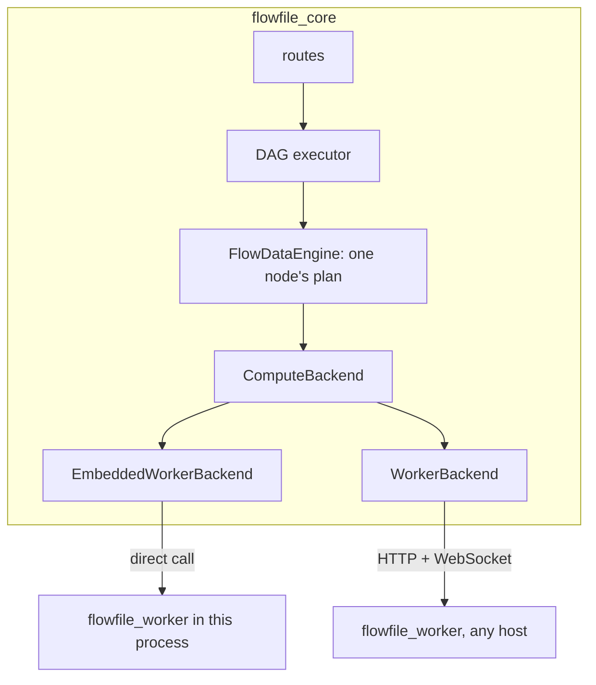

# Compute protocol

This page is the design for how `flowfile_core` hands work to compute: a worker beside core, on the same machine or on another host, or the worker embedded in the process when none runs beside it. It is written for contributors who work on it or build a backend against it. After reading it you know the interface a backend implements, the guarantees core relies on, what ships, and which decisions are settled.

The protocol is on by default (`FLOWFILE_COMPUTE_PROTOCOL`). With it off, core uses the worker's task routes, and those the protocol's `/v1` routes replaced answer with `Deprecation: true`. [Remote workers](../users/deployment/remote-worker.md) lists what a worker on another host needs; the roadmap's [Remote workers](../roadmap-details.md#remote-workers) section says what comes next.

## Why a protocol

Core never holds a dataset. Before the protocol, for each node it built a Polars lazy plan, serialised it, and posted the bytes to `flowfile_worker`. The worker ran the plan in a spawned child, wrote the result to `cache/<flow>/<node hash>.arrow` on its own disk, and answered with another plan, `scan_ipc("<that path>")`. Core treated that plan as the node's result.

That worked on one machine because both services saw one disk. Core opened the worker's file itself for the 100-row preview, the first-row probe behind the formula editor, the dynamic-rename and null-profile probes, pivot unique values, column stats, the published API runner, the REST sample, the CSV export, custom-node outputs, the catalog's virtual-table preview, and the check that asked whether a cached result still existed (`os.path.exists`). On another host every one of those reads failed, and the existence check reran every node on every run. Before the protocol (counted in 2026-10) there were eleven such read sites; 18 inline `execution_location` branches across `flow_graph/`, `builders/`, `flow_node/` and `flow_data_engine/`, not counting the two comparisons that only detect a settings change; 14 files outside `configs/settings.py` that read `OFFLOAD_TO_WORKER` or `WORKER_URL`; and about 20 worker calls with no local branch at all. The published API runner had a fallback of its own: when the worker was unreachable or rejected the plan, it collected the response in core.

Three habits underlay that, and each one blocked a different deployment shape:

| Habit | Where it showed | Blocked |
|---|---|---|
| A result was a path | `Status.file_ref`, `scan_ipc(path)` plans, `CatalogTable.file_path` | any second host |
| The decision lived in globals | `OFFLOAD_TO_WORKER`, the module-level `WORKER_URL`; the CLI and scheduler forced both off | a per-run choice of compute, scheduled runs on a worker |
| Nothing could say "this cannot run there" | plugin `.so` paths inside plans, local output paths, nodes that need a secret the executor lacks | team workers, clusters |

The protocol replaces all three with one interface. Backends implement it; core calls only it.

## Vocabulary

| Term | Meaning |
|---|---|
| **core** | the `flowfile_core` process: routes, the DAG executor, schema prediction |
| **DAG executor** | `FlowGraph` and `NodeExecutor`: what runs, in what order, skip and cache decisions |
| **backend** | a Python object inside core implementing `ComputeBackend`; the adapter |
| **compute** | whatever the backend talks to: a `flowfile_worker` process beside core, or the worker embedded in this process; never core's own code |
| **plan** | a Polars `LazyFrame`: a tree of operations whose leaves are scans; no data. A backend that sends it to another process serialises it |
| **result reference** | what a backend answers for a result; the only handle core ever holds |
| **operation** | work that is not a plain Polars plan and needs Flowfile code on the compute |



## Invariants

Every backend and every caller in core keeps these. The conformance suite (`flowfile_core/tests/flowfile/execution/conformance/`) checks them, invariant 4 by the plan-credential tests (`flowfile_core/tests/flowfile/test_cloud_plan_secrets.py`, `flowfile_worker/tests/test_plan_credentials.py`).

1. **Core receives at most `preview_rows` rows of any result.** `sample` and the inline sample on `submit` are the only calls that return rows. `count` returns an integer, `export` returns a URI, `plan_for` returns a plan. Core never collects a backend plan.
2. **Only the minting backend can read a result.** A `ResultRef` carries its backend id and an opaque location. `plan_for(ref)` on another backend raises `ForeignRef`.
3. **Core learns a schema from the reference, never from the file.** A backend returns `schema` with every table result; a blob result has no rows and is never sampled, counted or planned over. Core predicts downstream schemas with Polars over an empty frame of that schema. `collect_schema()` is never called on a plan that scans a backend's storage.
4. **Plans carry no credentials.** A plan references a connection by `CredentialRef`; the executor's identity resolves it. This holds for reads and writes alike.
5. **Every backend runs plain plans; everything else is a declared operation.** `capabilities()` names the operations, URI schemes, plugins and versions a backend supports, and placement checks them before a run starts.
6. **Any node may run on any backend that satisfies its requirements.** Consecutive nodes may run on different backends. Data crosses a backend boundary only through `export` and `import_uri`, never implicitly.
7. **A version mismatch is refused at the handshake.** No silent fallback to in-process execution, and "compute unreachable" is never reported as "result missing".
8. **Materialising is the backend's choice**, except where core marks it required for correctness.

Invariant 1 is a rule about a core that serves (the desktop sidecar, the Docker image, the pip server): it executes nothing and receives at most `preview_rows` rows from its worker. A process with no worker beside it, a scheduled run or Flowfile in Python, holds its results itself, so a frame's `collect()` reads every row through `plan_for` and a collect in that process, never through the sample cap. `test_serving_app_ratchet.py` keeps the serving app from collecting that way.

## The interface

`ComputeBackend` is a `runtime_checkable` `Protocol` in `flowfile_core/flowfile_core/flowfile/execution/protocol.py`; `Capabilities` and `PROTOCOL_VERSION` live in `shared/compute_protocol.py`, which core and the worker both import.

```python
PROTOCOL_VERSION = 1                         # the worker contract: everything core and a worker exchange

class ComputeBackend(Protocol):
    id: str                                  # "local", "worker", "worker:team"
    protocol_version: int

    def capabilities(self) -> Capabilities: ...
    def submit(self, plan: pl.LazyFrame, inputs: list[ResultRef], hints: SubmitHints, result_id: str, *, flow_id: int, node_id: int | str) -> SubmitResult: ...
    def run_op(self, op: OperationKind, payload: OpPayload) -> OpResult: ...
    def sample(self, ref: ResultRef, n: int) -> bytes: ...          # Arrow IPC stream, at most n rows
    def count(self, ref: ResultRef) -> int: ...
    def exists(self, ref: ResultRef) -> bool: ...
    def release(self, ref: ResultRef) -> None: ...
    def plan_for(self, ref: ResultRef) -> pl.LazyFrame: ...        # a leaf valid on this backend only
    def export(self, ref: ResultRef, uri: str, credential: CredentialRef | None) -> str: ...
    def import_uri(self, uri: str, schema: Schema | None, row_count: int | None, credential: CredentialRef | None, kind: Literal["table", "blob"] = "table") -> ResultRef: ...   # a blob import has no schema
    def status(self, handle: JobHandle) -> JobStatus: ...
    def cancel(self, handle: JobHandle) -> None: ...
```

A plan crosses the interface as the `pl.LazyFrame` itself; a backend that runs it in another process serialises it when it sends it. `result_id` is the producing node's hash, and the compute files the job and its logs under `flow_id` and `node_id`.

```python
Schema = list[FlowfileColumn]

@dataclass(frozen=True)
class ResultRef:
    backend_id: str
    result_id: str                           # the node hash, plus a suffix for derived results
    schema: Schema
    row_count: int | None                    # None when unknown without computing the result
    state: Literal["materialised", "deferred"]
    location: bytes                          # opaque to core
    kind: Literal["table", "blob"] = "table" # a blob is a fitted model or another non-tabular result

@dataclass(frozen=True)
class SubmitHints:
    must_materialise: bool                   # cache_results
    wide: bool                               # not a narrow transform: join, group_by, sort, pivot, …
    fanout: int                              # downstream consumers
    preview_rows: int | None                 # 100 in Development mode; None in Performance mode unless the node caches

@dataclass(frozen=True)
class SubmitResult:
    ref: ResultRef
    sample: bytes | None                     # inline when preview_rows was set
    handle: JobHandle

@dataclass(frozen=True)
class OpResult:
    refs: dict[str, ResultRef]               # the results by name; empty for an operation that only writes
    metadata: dict[str, Any] = field(default_factory=dict)  # a model's digest, a Delta write's version and counts, Kafka offsets

class Capabilities(BaseModel):
    app_version: str                         # reported, not compared
    polars_version: str
    python_version: str
    protocol_version: int
    platform: str                            # sys.platform plus platform.machine()
    polars_runtime: str                      # "32" or "64": the index width of the loaded Polars runtime
    plugins: dict[str, str]                  # polars_grouper, polars_simed, polars_ds, deltalake, pl_fuzzy_frame_match, polars_expr_transformer
    plugin_libs: dict[str, str]              # prefix-relative library path per expression plugin, as Polars serialises it
    operations: frozenset[str] = frozenset()  # the OperationKind values it runs
    read_schemes: frozenset[str] = frozenset()  # "file", "s3", "az", "gs", "http", "https"
    write_schemes: frozenset[str] = frozenset()
    credential_resolution: Literal["master_key", "vended", "ambient"]
```

Errors are typed, each a `ComputeError` (`flowfile/execution/errors.py`): `ComputeUnavailable`, `VersionMismatch`, `ResultMissing`, `PlanRejected`, `OperationUnsupported`, `ForeignRef`, `TaskFailed`. The integer `error_code` of the worker's task routes is mapped onto them inside `WorkerBackend`.

## Result references

A reference is **materialised** when the backend wrote the result somewhere it owns (a file in the worker's storage) and **deferred** when the backend kept the plan and will run it when something downstream needs rows. Both carry `schema`; a deferred reference has no `row_count` until `count` is asked, unless the backend already knows it.

`plan_for(ref)` returns the leaf for composing the next node's plan: `scan_ipc(path)` on a worker, the deferred plan itself for a deferred reference. The leaf may name a path core cannot open; core only composes on it and sends the result back to the same backend.

The `result_id` is the node hash, which folds input hashes, settings, the graph instance's `parent_uuid` and the cache epoch, so cache semantics are unchanged: a reference is the cache, `exists(ref)` replaces `results_exists`, and references do not survive a graph reload. `release(ref)` replaces `clear_task`.

A node owns every reference it minted and releases them together (`FlowNode.release_result`): its result, the other outputs it stored beside it, and its operation's outputs (a read's result, a fuzzy join's, a random split's per split, a custom node's per output, the model a Train Model node fitted). It releases them on a rerun under another hash or on another backend, on removal, when its graph closes, and when it fails after storing part of its outputs; a published API call and a headless run close their flow when they end, so neither leaves a result behind. A release whose backend cannot be reached is logged and the reference dropped. The worker's age sweep, which forgets a result `CACHE_EXPIRATION_TIME` (24 hours) after its submit ended, the next time the worker receives work, is the backstop for a core that died, never the way a result is meant to go.

## Materialisation

Core separates what it needs from what it knows:

- `must_materialise` is set only for correctness: the user set `cache_results`. The reads whose source is not deterministic (a database, Kafka, REST, Google Analytics) and a random split are operations, not plans: the backend holds what each one read or shuffled, computed once, so two consumers never get two different answers. A sink is a write operation.
- `wide`, `fanout` and `preview_rows` are hints. The backend applies its own policy.

| Backend | Policy |
|---|---|
| `WorkerBackend` | `must_materialise or (wide and preview_rows is not None)`; `fanout` is carried in the hints and read by no policy in version 1 |
| `EmbeddedWorkerBackend` | the worker's: it calls the worker's own submit (`funcs.submit_result`), so the row above applies, whether its jobs run in this process or in the worker's pool |

| Flow | Hints | Worker |
|---|---|---|
| read → filter → one consumer | narrow, fanout 1 | deferred; the preview is a streaming `head(100)` job |
| join → one group_by | wide, fanout 1 | materialised |
| group_by → two writers | wide, fanout 2 | materialised |
| database read → two nodes | an operation | materialised by the read |
| any node with `cache_results` | required | materialised |
| Performance mode | `preview_rows=None` | no sample job at all; a wide node stays deferred unless required |

## Operations

`submit` is the plain-Polars path. Everything that needs Flowfile code on the compute is an `OperationKind`, a closed enum that grows with node types:

| Operation | Task route | Returns |
|---|---|---|
| `database_read`, `kafka_read`, `google_analytics_read`, `rest_api_read` | `/store_*_read_result` | one reference |
| `database_write`, `cloud_write`, `file_write` | `/store_database_write_result/`, `/write_data_to_cloud/`, `/write_results/` | none |
| `file_read` | `/create_table/{type}` (Excel, JSON, Avro, non-UTF-8 CSV) | one reference |
| `fuzzy_join` | `/add_fuzzy_join` | one reference |
| `custom_node` | `/execute_custom_node` | named references |
| `random_split` | none: one stored shuffle, sliced | one reference per split, by name |
| `ml_train`, `ml_apply` | `/train_ml_model`, `/apply_ml_model` | the model as a blob reference with its digest as metadata; one reference |
| `delta_write`, `delta_merge`, `delta_scd2` | `/submit_query/` with operation type `write_delta`, `merge_delta`, `scd2_delta` | metadata |
| `viz_session` | `/catalog/visualize_*` | session id |
| `polars_code` | none: `POST /v1/ops/polars_code` in either protocol state | one reference, its schema from the code run on the backend |
| `sql_query` | none: `POST /v1/ops/sql_query` in either protocol state | one reference, its schema from the query run on the backend |

With the protocol on, the kinds whose result core samples (the reads, `fuzzy_join`, `random_split`, `custom_node`, `ml_train`, `ml_apply`, `polars_code` and `sql_query`) go to `POST /v1/ops/{kind}`, and the task routes those replaced answer with `Deprecation: true`; `/execute_custom_node` does not, as the custom-node dry run still uses it. The writes, the Delta kinds and `viz_session` stay on the task routes.

A backend declares the subset it supports. `run_op` may run any number of jobs on the compute: a random split is one shuffle and a deferred reference per split over it; a custom node is one `process()` call and as many results as it named.

With the protocol on, core runs no user code for a Polars Code node. The code is the `polars_code` operation's payload, run once by the node's backend over the plans its inputs hold, which answers a reference with the schema the code produced, so eager code and a side effect behave as they would in a script on that host. The designer's schema prediction is the same operation over empty frames of the inputs' predicted schemas, which answers the columns and no rows. With the protocol off, the code runs in core to build the plan.

A SQL Query node's statement is the `sql_query` operation's payload in the same way: translated once by the node's backend, which registers the plans its inputs hold as `input_1`, `input_2`, … in a `pl.SQLContext` and answers a reference with the schema of the query's result. The designer's prediction is the same operation over empty frames, and with the protocol off the statement is translated in core.

An operation may return a blob result (a fitted model) under a name: a `ResultRef` of kind `blob`, addressed, checked and released like any result and never sampled, counted or planned over. Publishing it to the catalog is `export` of that reference to the artifact store's upload target; a catalog artifact reaches a backend through `import_uri` of its download source. Core prepares and finalises the catalog row and never carries the bytes.

## Credentials

A plan carries `CredentialRef(connection_id, user_id)` and no secret: the Polars credential provider that holds it (`CredentialRefProvider`) adds only a random per-plan nonce, which keeps Polars' credential cache to one plan. Each backend prepares the plan for its compute:

| Backend | Resolution |
|---|---|
| `WorkerBackend` | attaches nothing: the worker resolves the `CredentialRef` against the shared catalog with its master key at execution, exchanging an Azure service-principal secret or a GCS service-account key for a bearer token there, and hands delta-rs the resolved options. With the protocol off, core's task routes carry a `$ffsec$` ciphertext in an `EncryptedCredentialProvider` instead |
| `EmbeddedWorkerBackend` | attaches nothing, as `WorkerBackend` does: the worker embedded in this process resolves the `CredentialRef` against the same catalog with this process's master key |

A worker therefore reads the catalog database: co-located, the same SQLite file as core; on another host, the deployment's shared PostgreSQL catalog (`FLOWFILE_DATABASE_URL`), a requirement [Remote workers](../users/deployment/remote-worker.md) states. The connection row, the master key and the user id in the reference are all it needs; no secret travels in a plan in any form.

Schemas follow the same rule: core learns a reader's schema from the backend that runs the read and resolves no connection for a read it sends elsewhere. A cloud storage reader given its backend holds its scan there as a deferred result with no preview, takes the reference's schema and releases it, so core reads no file of the source; a catalog table reader takes its schema from the backend that reads it the same way. The catalog's own reads and commits on object storage (the freshness probe at the start of a run, enabling the change feed, scanning an SCD2 result) stay in core with core's identity, through the storage target: the catalog is core's, as its connections are, so a deployment's core needs access to the buckets of its object-storage catalogs, which credentials held by the workers alone do not give it.

Consequences of resolving at the executor:

- `aws-cli`, `iam_role`, `env_vars` and `managed_identity` connections use the **executor's** profile or role. Before the protocol, reads resolved them as core's identity and froze the resulting token into the plan, while writes already resolved on the worker; with the protocol on, reads resolve on the executor too.
- A GCS service-account key or an Azure service-principal secret is not among `PROVIDER_CREDENTIAL_KEYS`, so before the protocol it travelled in a plan's `storage_options` as plain text. With the protocol on, the worker exchanges it for a bearer token where the plan runs, and it travels in no plan; with the protocol off, it still travels in the options.
- With the protocol on, an `aws-cli` read with no saved connection carries no credential and no provider, so Polars' default provider resolves the default credential chain of whichever process runs the plan.
- A GCS connection with an endpoint is read on the executor like any other cloud read: a Polars-native scan naming the connection by its reference, the endpoint reached through object_store's `gcs_base_url` in a service-account key with no key material. The gcsfs read in core stays for the protocol off and for the writers.
- With the protocol on, a read that names a connection whose method holds a credential (any but `env_vars` and `managed_identity`, which carry no provider) and that the catalog does not hold for the user it runs as, or that runs as no user, is refused, never resolved in core: `Cloud connection "<name>" is not stored for user <id>: a read names a connection stored for the user it runs as`.

## Data locations

- Catalog table data is addressed by table identity. The storage target (`catalog/storage_backend.py`) resolves it to a path or URI for whoever executes. Core's reads after a write (enabling the change feed, scanning the SCD2 result, the freshness probe) go through the storage target, which already works for object-storage namespaces.
- `file` is a read and write scheme only a worker that sees core's files is offered: the embedded worker always; the built-in `worker` at its unconfigured address (neither `FLOWFILE_WORKER_URL` nor `WORKER_HOST` set, so it is the worker beside core on this host); a configured worker whose row is marked `shares_core_disk`; and any worker that declares it itself with `FLOWFILE_WORKER_LOCAL_FILES=1`. Core adds `file` to the first three's declared capabilities (`WorkerBackend(shares_core_disk=True)`), because what a worker sees of core's disk is core's knowledge, not the worker's. A flow that touches a local-disk namespace, a local input file or a local output path therefore cannot be placed on a remote backend, and placement says so: `namespace "sales" is on local disk; remote execution needs an object-storage namespace`.
- A Python Script node or a kernel custom node needs its input parquet in the kernel shared volume, which is a `file` location on core's Docker host. A flow with a kernel node therefore runs only on a worker co-located with core, the embedded one included, and placement refuses a remote backend with that reason. Under the mixed policy (see Placement) placement checks only the kernel node's own backend, so the rest of its flow may be placed elsewhere.
- Nothing is staged silently: object storage is for catalog data, and intermediate results are private to the backend that computed them. The one exception is the exchange store (`execution/exchange.py`): `FLOWFILE_EXCHANGE_URI`, an `s3://` root, and `FLOWFILE_EXCHANGE_CONNECTION`, the name of the stored cloud connection that opens it, with `FLOWFILE_EXCHANGE_MAX_ROWS` as an optional limit on the rows an input may cross with. A run's boundary edges export to `<uri>/<flow id>/<run id>/<from>-<handle>-<to>.parquet`, the importing node is submitted with `must_materialise` so nothing refers to that prefix after the run, and `run_graph` removes the prefix when the run ends, however it ends; a failed removal is a warning on the flow log. A core process that stops mid-run leaves its prefix, so a deployment gives the bucket a lifecycle rule as the backstop. The store's connection is the deployment's, never a node's user's: in multi-user mode the lowest-id cloud connection of that name an administrator owns, looked up once per run and named to every backend by its `CredentialRef`, so no user configures anything and no user's own connection of that name shadows it.
- An artifact's bytes travel between a backend and the artifact store through the store's upload target or download source: a `file://` URI on a backend co-located with core, a presigned `https://` URL anywhere. The target's scheme must be among the backend's `write_schemes` (publishing) or `read_schemes` (fetching), which placement checks before the run, so a filesystem artifact store refuses a remote worker with the reason in words. A flow-scoped model that is not published is an intermediate result: it lives on the backend that fitted it until a later fit replaces it.
- A catalog table written by identity lives under its catalog's root, as `<root>/<table directory>`, which is what the executor resolves from the identity. A table stored anywhere else (registered from a file at its own path, left behind when the catalog directory moved, or under a namespace whose storage URI changed) is refused by the catalog writer with the reason in words, on every backend; its data is never touched. Adopting such a table into the catalog is a catalog action, not a write.

## Placement

Each node derives its requirements from its settings (`flow_node/requirements.py`): the operation kind, the schemes it reads and writes, the plugins its expressions use, and the credentials it names. Placement compares them with the capabilities each backend's handshake verdict offers (see [Versions and the handshake](#versions-and-the-handshake)), so a plugin a backend lacks refuses there only the nodes that use it, and a node whose plan may carry a Python function (the formula family, a cloud change read) is refused where core's Python functions do not run. The formula family (formula, multi-field formula, advanced filter, formula gate, formula rename) needs `polars_ds` and the formula library `polars_expr_transformer`. Stored connections are compared only on a backend whose `credential_resolution` is `ambient`, which reaches storage with its own identity: a cloud or catalog node naming a connection whose auth method is not `env_vars` or `managed_identity` is refused there, while a backend declaring `master_key` resolves the connection itself. An Explore Data node needs `viz_session` only on a configured worker (`worker:<name>`); on a backend without one its chart's session runs on the default worker. Placement is one function in `flowfile/execution/placement.py`, which asks no backend anything:

```python
def place(flow: FlowGraph, backends: Mapping[str, Capabilities], policy: PlacementPolicy, *, nodes: list[FlowNode] | None = None) -> Placement

@dataclass(frozen=True)
class Placement:
    assignment: dict[int, str]               # node id -> backend id
    boundaries: list[tuple[int, int]]        # edges whose data must cross through export / import_uri
    refusals: list[Refusal]                  # node, backend, reason in words
```

- Every node has `execution_location: "auto" | <backend id>` in its settings, saved in the flow file. `"auto"` is the default and runs the node on its flow's backend; the version 1 policy places every node on its flow's backend whatever the node's own value, and the mixed policy reads it.
- The saved vocabulary is a backend id, never a role name, because a saved value is permanent. A deployment's control plane maps its own names onto ids: its team node is `worker:team`. `remote` stays an alias of the default worker for flow files written before the protocol.
- The flow's own `execution_location` becomes the default backend for its nodes. The designer offers `"auto"` (the configured default worker) and the ids of the backends table, each with its last handshake verdict beside it, never `"local"`: desktop and Docker always run on a worker, on the same machine by default, so an out-of-memory node takes a child down and not core, and cancel is real. A flow saved with `"local"` loads as `"auto"` wherever a file is opened with the protocol on, the designer and `flowfile_frame` alike. `"remote"` is an alias of `"auto"`. Headless runs, a `flowfile_frame` graph built in code and the conformance suite run on the worker embedded in their own process, whose id is `local`. The id is permanent and keeps resolving to that worker in a process with no worker beside it. In a core that serves, a run that reaches `local` is refused with the protocol on before any node starts, each node's row on the run report saying `cannot run on backend "local": this core serves; compute runs on its worker`.
- **Version 1 policy** (`SingleBackendPolicy`) assigns one backend per flow, except the node types whose builders pin them to a backend of their own (the Google Analytics reader runs on the worker), and refuses a node whose requirements that backend does not meet: the run starts no node, and each refused node's row on the run report says `cannot run on backend "<id>": <reason>`. Mixed assignments are legal in the protocol from the first release.
- **Mixed policy** (`MixedPlacementPolicy`), chosen when `FLOWFILE_EXCHANGE_URI` is set, assigns each node the backend its own `execution_location` names, the run's backend for `"auto"`, and keeps the pinned types where their builders pin them. Each boundary crosses through the exchange store by `export` and `import_uri`. Before any node starts, the importing node is refused when core cannot use the store, with the store's reason, and when core knows before the run that the edge's output holds more rows than `FLOWFILE_EXCHANGE_MAX_ROWS`, naming the rows, the columns and the limit. That limit is priced from what core holds before the run (the upstream's held result's `row_count`, the known count of the engine core holds for that output, a manual input's frame); nothing is counted, sampled or collected to price it, so an edge whose count is unknown crosses at any size. The run report carries the placement's boundaries as `RunInformation.boundaries`, a refused run's included, which the canvas marks on its edges. A catalog reader over a virtual table that resolves by running its producer flow runs that flow on the reader's own backend. The node drawer offers `"auto"`, `worker` and the ids of the backends table, never `"local"`.
- A deployment's control plane may fill the backends core places on (see Backends). Placement itself stays in core because only the DAG executor knows the graph ([Execution Strategy](flowfile-core.md#execution-strategy-how-nodes-decide-where-to-run)).

## Versions and the handshake

Core checks each backend through its own interface, the same for every kind (`subprocess_operations/handshake.py`, `verify`): `capabilities()` compared with core's own, then one probe plan per expression plugin (`pl.LazyFrame(schema=…).select(<plugin expression>)`, for `polars_grouper` and `polars_ds`) and one carrying a trivial Python function, each run as an ordinary job (`submit` with a one-row preview, `sample` when no sample came inline, `release`). The answer is a `Verdict`, kept per backend: placement reads it (`verdict_for`), and so does the gate in front of every worker call (`ensure_handshake`). A backend is checked once per core process, on its first use, and again after a call could not reach it; a verdict that refuses it is checked again on its next use. The **Handshake** button on **Settings → Execution → Backends** (`POST /compute_backends/{id}/handshake`) runs the same check on demand, the probes included. `GET /compute_backends` answers every user each configured id with its last verdict, which the node picker and the Flow Settings dialog show beside the id; the URL is an administrator's only.

Only what no probe can cover refuses a backend whole. Each field, by what breaks when it differs:

- `polars_version` and `polars_runtime`, compared exactly. Polars plan bytes are not stable across versions, and the index width makes `pl.len()` and row indexes `UInt32` on one side and `UInt64` on the other.
- `protocol_version`, compared exactly: the worker contract (below).
- `python_version`, compared to the patch and listed among the verdict's differences, without refusing the backend. Polars refuses to run a Python function serialised under another Python, so the probe plan carrying one decides: where core's Python functions do not run, the nodes whose plans may carry one (the formula family, a cloud change read) are refused there with the reason, and every other node runs. Both Docker images build from one exact Python tag, so core's image and the worker's match.
- `plugins`: a package of `PLUGIN_PACKAGES` that core has is offered where the backend has it in core's version and, for an expression plugin, its probe plan loads it from the path core's plans carry; a package with no probe plan, such as `polars_expr_transformer`, is decided by its version alone. One missing, in another version or not loadable is absent from the verdict's `offered` capabilities, with the reason naming which, so placement refuses only the nodes that need it. A plugin expression serialises its library path relative to the sending process's `sys.prefix` (`polars/plugins.py::_resolve_file_path`) and the compute resolves it against its own, so a PyInstaller desktop, a Windows core and a Linux container disagree even on one Polars version; and a plugin's version matters apart from its path, since a PyPI core and a venv worker can resolve different `>=` pins and a plugin's ABI is version-coupled to Polars.
- `app_version`, `platform` and `plugin_libs`: reported in the verdict, not compared.

A difference that refuses a backend is a `VersionMismatch`, raised by the gate before the backend is sent any work and naming each such field with both sides: `Backend "<id>" does not match core (<field>: core <a>, backend <b>; …)`.

`PROTOCOL_VERSION` (`shared/compute_protocol.py`) is the worker contract: the shape of every request and answer between core and a worker, per route, socket and operation kind, and the catalog columns a worker reads. `shared/tests/test_worker_contract.py` fingerprints it against `worker_contract.json` beside it and fails on a changed or removed entry until the number is bumped and the pin rewritten (`python shared/tests/test_worker_contract.py`); a new operation kind passes without a bump, since a worker that does not declare it is refused only that kind's nodes. Every request model a worker route validates refuses an unknown field with 422 (`extra="forbid"`), `FuzzyMapping`, a third-party dataclass, the one exception, so a field core sends that a worker does not know fails the request instead of being dropped. A capabilities answer this release cannot read is a `VersionMismatch` when it carries an `app_version`, a worker of another release, naming both contract numbers when they differ and both app versions; one with no `app_version` means the URL is no Flowfile worker. Workers are upgraded when the number changes, and when Polars does.

The guarantee is two-sided: a compute rejects a `/v1/*` request whose `X-Protocol-Version` differs from its own with 426.

The worker exposes its capabilities as `GET /capabilities` and `GET /v1/capabilities`. The unauthenticated `POST /shutdown` stays reachable from loopback only, because the desktop shell posts to it without a token.

## Previews and other bounded reads

A backend provides rows; core does everything else. `sample` returns an Arrow IPC stream and core keeps the rendering it had. With `preview_rows` set, `submit` returns the sample inline on every backend, the embedded worker's from the worker's own submit, so the common case costs no second round trip and a plan that cannot run fails its node in Development mode on every backend alike. A read of a node whose last run failed raises the error that run failed with (`FlowNode.get_resulting_data`), never a frame built in the caller's process before the failure. Reopening a flow, a different row count, or an on-demand probe calls `sample(ref, n)`, and core caches the bytes per node hash.

A worker caps `sample` at 10 000 rows and reads a sample of more than 1 000 rows of a materialised result in a child, never in its serving process; a larger request is refused, not truncated. A process with no worker beside it reads every row of a result it holds through `plan_for` and a collect in its own process, never through the cap. Every core-side read of a worker file collapsed into "submit a bounded plan, then sample it":

| Before the protocol | In the protocol |
|---|---|
| preview, `get_read_top_n(file_ref, 100)` | inline sample on `submit` |
| first row for the formula editor | `sample(ref, 1)` |
| pivot unique values | `submit(plan.select(col).unique().head(200))`, then `sample` |
| column stats, null profile, dynamic-rename first row | an aggregate plan, then `sample` |
| formula-gate probe | `sample(plan.filter(pred), 1)` |
| CSV export | `sample(ref, 10_000)` streamed |
| the published API runner | `sample(ref, max_rows)`, `max_rows` clamped to the worker's sample cap |
| `artifact_is_missing` | `exists(ref)` |
| kernel input parquet | `export(ref, <kernel shared volume uri>)`; needs `file` among the backend's write schemes, see Data locations |
| catalog virtual-table preview | `sample` on the producer run's output reference |

## Backends

The worker is the only compute, and Flowfile runs it in two shapes:

- **`Core + Worker`**: the desktop app and Docker run core and a worker as separate processes, the desktop's worker a sidecar beside core and Docker's a container of its own. Core serves, and reaches its worker over HTTP through `WorkerBackend`.
- **`Core(Worker)`**: a scheduled run, `flowfile run flow` and Flowfile in Python (a script, a notebook, a FlowFrame) have no worker beside them, so they run the worker embedded in their own process and reach it by a direct call through `EmbeddedWorkerBackend`, with no port.

The pip server (`flowfile run ui`) serves and has no worker beside it: its flows compute on the worker embedded in it, whose jobs run in the worker's pool.

- **`EmbeddedWorkerBackend`** (`backends/embedded.py`): the adapter to the worker embedded in this process, id `local`. It calls the bodies of the worker's `/v1` routes (`flowfile_worker/service.py`) directly with the worker's own request models and maps the `HTTPException` a body raises to the typed errors; there is no token, no version header, no socket and no port. The plan crosses as serialised bytes, so the worker loads it as it loads a plan sent over the wire, and `plan_for` and the `ResultRef` shape are the protocol's. Where its jobs run is the host's choice: a process that does not serve (a headless run, Flowfile in Python) runs them itself, where the rows are wanted, giving up cancel, the task time limit and the isolation of a child that runs out of memory; a process that serves leaves them to the worker's pool or a child, never the serving process, `FLOWFILE_WORKER_POOL_SIZE` sizing the pool. Nothing of the worker is imported or started until the first submit. In the pip server the built-in `worker` is this adapter too.
- **`WorkerBackend`**: the HTTP and WebSocket client to `flowfile_worker`. Its wire mirrors the interface one method to one route (`submit` → `WS /v1/ws/submit`, with `POST /v1/submit` when the socket cannot be opened; `sample` → `GET /v1/results/{id}/sample`; `run_op` → `POST /v1/ops/{kind}`; `export` → `POST /v1/results/{id}/export`; `capabilities` → `GET /v1/capabilities`), and the worker publishes it as `openapi.json`. The wire is private to this backend and versioned by the handshake. The worker's serving process does nothing but bounded reads of held results: a deferred submit's columns, a sample above 1 000 rows, a count that runs a plan, an export and an import run in a pooled child (`funcs.submit_result` for a submit) under the task time limit (`FLOWFILE_WORKER_TASK_TIMEOUT`) and cancel, so a hanging source or a crashing plugin does not take the worker, or what it holds, down. That holds for every worker that serves, the pip server's embedded one included.

Backends register through the `flowfile.compute_backends` entry-point group and are configured by name. Configuration is a backends table in core's catalog database (`compute_backends`): one row per backend with its id, its URL, its bearer token, the token stored through the secret manager, and the CA certificate to trust for an `https` worker whose certificate is not public (`ca_cert`, optional). An administrator fills the table on **Settings → Execution → Backends**; a deployment's control plane fills it over core's admin routes (`/compute_backends`). A running core reads a row the first time it uses that id and keeps the backend it made, so a row changed in the database directly after that takes effect when core restarts; removing a worker on the settings page drops it at once. `GET /compute_backends` answers every user the configured ids, each with its last handshake verdict, and the URLs to an administrator only; adding, removing and the handshake are an administrator's. Ids are `local` (the worker embedded in this process), `worker` (the built-in default worker) and `worker:<name>` for every configured one; a saved id is permanent. Core offers no management of the workers themselves: how a worker is hosted, registered in a fleet, leased to a run or scaled is the control plane's.

Each configured backend carries its own bearer token, which signs its `/v1` requests, its submit socket and its `capabilities()`, so the handshake's capabilities read and probe jobs sign with it too. The task routes core still uses (the writes, the Delta operations, the visualisation session, the catalog services, the custom-node dry run) sign with core's `FLOWFILE_INTERNAL_TOKEN`, so a configured worker is started with core's token. A desktop core may configure a remote worker over `https` and `wss`.

A worker is a code-execution service for whoever holds its token, because plans carry user code and operations run it; the protection is the transport and the token's custody. The worker serves TLS itself when `FLOWFILE_WORKER_TLS_CERT` and `FLOWFILE_WORKER_TLS_KEY` name a certificate and its key, and a backends row's `ca_cert` names the CA to trust for a certificate that is not public, a self-signed one being its own: `WorkerBackend` hands it to the transport (`trust_ca`) for its URL, so the handshake, the task routes, the `/v1` routes and the submit sockets all verify that worker against it. The Backends page warns while a worker's URL is plain `http` to a host other than loopback; the single-host compose stays plain inside its own network. Plans are not signed, since TLS carries integrity.

Core reaches a backend through an `ExecutionContext` that the `FlowGraph` owns: derived from the flow's settings (its `execution_location`, execution mode and parallelism), set for the run, and copied into every stage thread of a run. A call made with no run active (a preview re-read, the formula editor's first row, a catalog preview, a dry run) resolves the context from the graph it was given, or uses the default backend when there is no graph, which is never `local` in a process that serves. A `run_flow` child graph inherits its parent's context.

## Headless runs

The CLI (`flowfile run flow`, or `--run-flow` in a packaged build) and the scheduler, which spawns it, run a flow in the runner's own process unless a backend is named: a run with no backend named computes on the worker embedded in that process, each job in the process itself, whatever the flow's `"auto"` or `"remote"` says, since to the headless runner `"auto"` is its own process. A run a schedule or the catalog starts is such a child wherever core runs, so it never waits on the worker beside core and does not use it: on the desktop it computes beside the app's sidecar worker, and in Docker inside core's container, with that container's memory and CPU rather than the worker container's. A Google Analytics reader is the exception: its builder pins it to the default worker in every run. An explicit `--backend` on the run, or a specific backend id in the flow's setting, names a backend, and the headless runner then uses it through the same `ExecutionContext` the designer uses; a named worker that cannot be reached fails the run's nodes with `ComputeUnavailable`, and the run does not compute in its own process instead. The scheduler itself is core-import-free and only spawns `flowfile run flow`, which reads the flow's setting from the YAML, so no schedule changed behaviour with the protocol.

## What ships

These behaviours changed with the protocol:

- An out-of-memory-killed worker child fails its node instead of the dataset moving into core.
- A published API answers 503 when its compute cannot be reached, instead of collecting the response in core.
- `aws-cli` and `iam_role` reads resolve on the executor (see Credentials).
- A flow with a kernel node is refused on a remote backend, with the reason.
- The protocol is on by default; `FLOWFILE_COMPUTE_PROTOCOL=0` switches core back to the worker's task routes.
- With an exchange store configured, a flow's nodes run on several backends, each boundary crossing through the store.
- Each backend is checked on its first use, through its own interface. Only the worker contract, the Polars version and its runtime refuse a backend whole; a plugin it lacks, and core's Python functions where they do not run there, refuse only the nodes that need them.
- Core and a worker of different app releases work together while they speak one worker contract, and every worker request refuses a field the worker does not know.
- A worker serves TLS from a certificate it is given, and a backends row names the CA to trust.
- A node releases every result it minted together, and a published API call and a headless run hold nothing after they end.
- Every backend answers the preview inline, so a plan that cannot run fails its node in Development mode, and with the protocol on a Polars Code node's code and a SQL Query node's statement run as operations on their backend, never in core.
- The worker is the only compute. A scheduled run, `flowfile run flow` and Flowfile in Python compute on the worker embedded in their own process, `local` being its id, and a core that serves refuses `local` before any node starts.
- The pip server's flows compute on the worker embedded in it, its jobs in the worker's pool, with no request to itself; `import flowfile` sets neither the worker's port nor single-file mode.
- A catalog read whose worker cannot be reached answers `ComputeUnavailable` (503 on the catalog routes) instead of reading the table in core.
- The custom-node dry run reads its outputs, and the AI agent its samples, through the backend instead of collecting them in core.

| Check | Where |
|---|---|
| the invariants, over the embedded worker and `WorkerBackend` | `flowfile_core/tests/flowfile/execution/conformance/` |
| core and a worker on storage directories of their own, with previews, a model trained and applied, and a model published to the artifact store | `tests/remote_worker/test_two_storage_dirs.py` |
| core and a worker in containers that share no volume: a database read, a model trained and applied on the worker and a catalog write; the elaborate integration flow whole on the worker; a scheduled run computing in core's container while the worker serves nothing; and flows that put nodes on `local`, which core, serving, refuses before any node runs | `tests/remote_worker/test_zero_volumes.py`, run by `.github/workflows/test-remote-worker.yml` |
| a result crossing between the embedded worker and the worker beside core through `export` and `import_uri`, in both directions | `flowfile_core/tests/flowfile/execution/test_two_backend_chain.py` |
| placement and its refusals before any node starts | `flowfile_core/tests/flowfile/execution/test_placement.py` |
| the exchange store: a result crossing through it, a misconfigured store refused with what is wrong, and a run's prefix removed when the run ends | `flowfile_core/tests/flowfile/execution/test_exchange_store.py` |
| one run's nodes on different backends, their data crossing through the exchange store | `flowfile_core/tests/flowfile/execution/test_mixed_placement.py` |
| an input above `FLOWFILE_EXCHANGE_MAX_ROWS` refused before any node starts | `flowfile_core/tests/flowfile/execution/test_edge_cost.py` |
| no inline `execution_location` branch and no worker-setting read outside the backend registry | `flowfile_core/tests/flowfile/execution/test_inline_location_branches.py` |
| no collect over a `plan_for` leaf in core or the pip server's app | `flowfile_core/tests/flowfile/execution/test_serving_app_ratchet.py` |
| the embedded worker's errors mapped to the typed ones, and its jobs run in this process with no port opened | `flowfile_core/tests/flowfile/execution/test_embedded_backend.py`, `flowfile_core/tests/flowfile/execution/test_local_backend.py` |
| a headless run on the worker embedded in its process, and a saved worker that cannot be reached failing with `ComputeUnavailable` | `flowfile_core/tests/test_run_flow_cli.py` |
| `import flowfile` and building a frame start nothing of the worker, and a frame's `collect()` answers every row | `flowfile_frame/tests/test_lazy_start.py`, `flowfile_frame/tests/test_deferred_frames.py` |
| the pip server's flows on its embedded worker's pool, with no worker port open | `flowfile/tests/test_single_file_embedded.py` |
| each backend checked once through its own interface, refused whole or narrowed by what it offers | `flowfile_core/tests/flowfile/execution/test_handshake.py` |
| the worker contract pinned, and unknown fields refused | `shared/tests/test_worker_contract.py` |
| a worker served over TLS with a self-signed certificate, trusted through its row's CA | `flowfile_core/tests/flowfile/execution/test_worker_tls.py` |
| flows over results stored where core cannot read them, a Polars Code node among them | `flowfile_core/tests/flowfile/execution/test_unreadable_location.py` |
| an Explore Data node charted on the backend that holds its result | `flowfile_core/tests/flowfile/execution/test_explore_data_placement.py` |
| a catalog reader's virtual table resolved on the reader's backend | `flowfile_core/tests/flowfile/execution/test_catalog_reader_placement.py` |
| a read of a node whose last run failed answers that run's error | `flowfile_frame/tests/test_read_after_failed_run.py` |

!!! note "Future direction"
    Designed and not built:

    - **A Polars cluster.** Reached through a connector outside this repository that speaks this wire: core adds it as a `worker:<name>` row and the handshake reads what it declares (no operation, `s3`, `ambient` credential resolution), so placement keeps every node that is not a plain Polars plan on a worker. The connector hands each plan to the cluster with `LazyFrame.remote`, holds results as plan locations (a deferred plan, or a scan of the object a cached result was sunk to under the exchange URI), and the cluster reads and writes storage with its own identity; a cloud read core builds for such a backend carries no Python credential provider. Core contains nothing specific to Polars Cloud.
    - **Team workers.** A backend that attaches short-lived credentials issued by the deployment's control plane, and a control plane with its own compute-node registry, leases, placement policy and failover: a worker that dies mid-run loses its references, and the run restarts on another backend with a cold cache.
    - **Staged local inputs.** A local input file uploaded once, keyed by content hash, to a worker that declares `file` for staging only.
    - **A generic `HttpBackend`** that serves any other compute choosing to speak the worker's wire.

## Out of scope for now

A worker fleet registry with leases and a fleet page (control-plane work). Durable intermediate results across a compute restart. Kernels as a backend (`KernelBackend`): under the mixed policy placement checks only a kernel node's own backend, so the rest of its flow may run elsewhere without one. Fusing a chain into one job on a cluster (falls out of deferred references and the backend's materialisation policy). Arrow Flight. Pull transport. A load balancer in front of workers, which remains forbidden because a worker is stateful.

## Decision record

| Decision | Choice | Alternatives considered |
|---|---|---|
| Result addressing | backend-scoped references with an opaque location; `export` to cross a boundary | universal URIs (needs a reachability check before every use or object storage for every result); keep paths |
| Who materialises | the backend, from hints; core marks only correctness requirements | core decides by node type; always materialise |
| Unit of submission | one plan, one reference; `run_op` returns named references | multi-output `submit` (every backend would execute one plan to N sinks) |
| Credential resolution | the executor's identity, always | core for reads and the executor for writes (before the protocol); per-connection choice |
| Operations | a closed enum with declared support | open string names (support discovered at run time); everything as a plan (needs Flowfile code on every compute) |
| Version skew | a backend offers what its handshake shows it can do, and a difference refuses only the nodes that depend on it; only what no probe can cover refuses the whole backend: the Polars version with its index-width runtime, and the worker contract number (`PROTOCOL_VERSION`); Python compared to the patch, a backend whose Python differs refusing there only the nodes whose plans can carry a Python function, which a probe decides; a plugin or plan-side package offered where the backend has core's version and its probe loads it from core's path, its nodes refused there otherwise; `platform` and `plugin_libs` reported, not compared; `app_version` not compared | app version may differ with nothing in its place (operation payloads are hand-copied and pydantic drops unknown fields silently, which the contract fingerprint and the refusal of unknown fields now cover); the exact app version (every release would make every worker upgrade though nothing it exchanges changed); a backend refused whole for a plugin or Python difference (a worker refused for one plugin's layout, plugin nodes or not); one Polars minor of skew |
| Protocol definition | a Python interface with entry-point plugins; the worker's wire mirrors it | wire-first OpenAPI (every backend a service; `plan_for` cannot cross a wire) |
| Placement | per-node capable from the first release; version 1 policy is one backend per flow | per-node policy in version 1 (needs the exchange store first) |
| Headless runs | local by default: a run with no backend named computes in the runner's own process, a flow's `"auto"` or `"remote"` included, on the worker embedded there; an explicit `--backend` or a specific backend id saved in the flow is honoured | default to the configured worker (every existing schedule would move onto it, and a desktop schedule would fail whenever the app and its worker are closed) |
| Designer compute | the designer offers no `"local"`: desktop and Docker always run on a worker, on the same machine by default; `"local"` in a saved flow loads as `"auto"` wherever the file is opened, the designer and `flowfile_frame` alike; headless runs, a `flowfile_frame` graph built in code and the conformance suite run on the worker embedded in their own process | keep `"local"` in the designer (an out-of-memory node takes core down, no real cancel, two everyday paths) |
| Local-disk namespaces on a remote backend | refused with the reason | staged automatically |
| Authentication | one token per configured backend, which signs its `/v1` routes, its submit socket and its capabilities; the task routes core still calls sign with core's `FLOWFILE_INTERNAL_TOKEN` | one service token for a fleet |
| Backend configuration | a backends table in core (id, URL, token), filled on the Backends settings page or by a control plane over the API; ids `local`, `worker`, `worker:<name>`; no fleet management in core | environment variables only (no second worker without a restart); a management page in core (the control plane's job) |
| Desktop to remote worker | in scope; a desktop core uses a remote worker whatever its plugin layout and Python: a plugin the worker cannot load from the path core's plans carry is absent from what placement sees there, and a Python that differs refuses there the nodes whose plans can carry a Python function, each refused with the reason while every other node runs; a desktop core against a remote Linux worker is still blocked by the plugin library paths, so formulas stay off that worker until plugins are resolved by name | docker-mode team servers only; the worker refused as a whole when the plugin layout differs; one Python for every shipped build now |
| API runner fallback | deleted with the node-level continuation; `ComputeUnavailable` answers 503, every other compute error 500 with the typed message | keep the degrade as an explicit fallback backend on the context (a placement policy) |
| Context ownership | the `FlowGraph` owns the `ExecutionContext`; stage threads run under a copied context; graph-less calls use the default backend; a subflow inherits its parent's | a ContextVar set only by `run_graph` (invisible to the stage thread pool and to routes) |
| Per-node setting vocabulary | `"auto"` or a backend id; a control plane maps its own names onto backend ids from its own registry | `local`, `team`, `cloud` with `remote` as an alias (less general, and a saved value is permanent) |
| Kernel nodes on a remote backend | refused: `needs_kernel` requires `file` co-located with core; under the mixed policy only the kernel node's own backend must meet it | a `KernelBackend` |
| Exchange-store cleanup | per run: the run's prefix under `FLOWFILE_EXCHANGE_URI` is removed when the run ends, and the first node on the importing side materialises so no result refers to the prefix afterwards | per flow, removal at the graph's release (every run's data held while the flow is open); a size watermark |
| Single-file mode | the pip server computes on the worker embedded in its process by a direct call, its jobs in the worker's pool, with no request to itself; the worker's routes stay mounted under `/worker`, `/v1/ws/submit` beside the `/v1` REST router, for the callers that still post to a worker URL | the co-hosted worker reached over HTTP on core's own port (a request to itself for every node); REST polling only in single-file mode |
| Credentials on the worker | the plan carries only a `CredentialRef`; the worker resolves it against the shared catalog with its master key at execution, bearer tokens for Azure and GCS made there, delta-rs given the resolved options; a remote worker needs the shared PostgreSQL catalog | `$ffsec$` ciphertext inside the plan in a credential provider (the task routes' way; it cannot carry a bearer-token exchange for every operation); refusing Azure and GCS methods on remote backends |
| Schemas of derived frames | inside a node function, the schema of a frame derived from the input is computed over an empty frame of the input's cached schema, never by resolving through a backend's leaf | reading the leaf, which opens the worker's file |
| Operations over the `/v1` wire | `POST /v1/ops/{kind}` answers wire references for every kind whose result core samples, so a custom node's outputs, a fuzzy join, a random split and the reads are references like a submit's | operations stay on the task routes until the task routes go |
| Materialisation in core | none: the embedded worker is the worker's code and its submit the worker's, so the worker's policy, `must_materialise or (wide and preview_rows is not None)`, is the one policy wherever the worker runs, as the hints are the backend's choice | a backend of core's own honouring `must_materialise` by a streaming sink to core's storage directory (a second policy for one compute); exempting such a backend from invariant 8 (a hole in the one rule a backend author needs); collecting the result in core (unbounded memory) |
| Sample size | the worker caps `sample` at 10 000 rows, reads above 1 000 rows in a child, and the API runner's `max_rows` and the CSV export are bounded by the cap | unbounded, collected in the worker's serving process |
| Virtual-table preview | the producer run's output reference, sampled through its backend; `/catalog/materialize` keeps the stored form | a path answered by `resolve_virtual_table` |
| Catalog writer by identity | a table lives under its catalog's root; one stored elsewhere is refused with the reason, on every backend, and its data is never touched | the payload carries the stored location (an absolute path to a remote worker); refusing on remote backends only (two write paths to keep) |
| Artifacts on a backend | a fitted model is a held result of kind `blob`; publishing is `export` to the artifact store's upload target and fetching is `import_uri` of its download source; core prepares and finalises the row and never carries the bytes; a flow-scoped model is held where it was fitted until a later fit replaces it | an upload target inside the train payload (one node's path, nothing reused); a separate artifact reference type (a second path through `exists`, `release` and `ForeignRef`); a hidden catalog artifact per run for flow-scoped models (needs a registered flow, fills the store with scratch versions) |
| Credentials for a schema | the executor resolves for schemas as for rows: core learns a reader's schema through the backend (a deferred submit with no preview, or the read operation's answer) and resolves no connection for a read it sends elsewhere; the catalog's own reads and commits on object storage stay in core with core's identity, the catalog being core's as its connections are, so a deployment's core needs access to the buckets of its object-storage catalogs; a GCS connection with an endpoint is read on the executor by a native scan over its reference, the gcsfs read kept only for the protocol off; placement refuses a node whose connection method an `ambient` backend cannot serve | core resolves to learn a schema and the executor to move rows (every core, a desktop included, must reach every bucket and hold every key); the catalog's own reads as bounded reads on the backend (a Delta log read and a table-property commit have no surface in the interface); gcsfs built on the executor as a Python source in the plan (Flowfile code in a plain plan, which invariant 5 makes an operation) or as a GCS read operation (a new backend surface) |
| The wire's trust model | a worker is a code-execution service for whoever holds its token; the worker serves TLS from a certificate it is given, a backends row names the CA to trust, the backends page warns on plain `http` off loopback, the deployment page says it in words | plain HTTP as the deployer's problem (easy to get wrong); plan signing (integrity without confidentiality); refusing plain `http` off loopback (breaks the single-host compose) |
| Who releases results | a node releases every reference it minted together: on a rerun, on removal, at graph close, when a published-API call ends, when it fails after storing part of its outputs; the age sweep is the backstop for a dead core, its horizon a worker setting | the sweep as the contract (a shared worker's disk fills at the pace of use and nothing says when a result may go) |
| User code | a Polars Code node's code is the `polars_code` operation and a SQL Query node's statement the `sql_query` operation, each run by the backend that holds the input and answering a reference with its schema; core never executes either, the designer's prediction being the same operation over empty frames; a backend without the operation refuses the node | guard the derive and document that the code must be lazy (a rule learnt by breakage); keep executing user code in core to build the plan (core as a code-execution surface in a multi-user deployment) |
| Previews validate the plan | with `preview_rows` set every backend answers the inline sample, the embedded worker from the worker's own submit, so a plan that cannot run fails in Development mode on every backend alike; a read of a node that did not complete in its last run answers that run's error | a backend lazy through the preview (a broken node reports success until something consumes it, and one flow gives two run reports) |
| The serving process | nothing but bounded reads of held results in the worker's serving process; schema resolution, large samples, counts, exports and imports in a pooled child under the time limit and cancel; that holds for every worker that serves, the pip server's embedded one included, while the embedded worker of a process that does not serve runs its jobs in that process | resolving in process for speed (the warm pool makes a child as cheap) |
| Handshake scope | once per backend per core process, re-armed when that backend could not be reached; one handshake for every backend kind, through `capabilities()` and the probe plans run as ordinary jobs (`submit`, `sample`, `release`), the verdict cached per backend id for placement and the worker gate; the Handshake button runs the probe; Python compared to the patch, both Docker images built from one exact Python tag, a mismatch narrowing what the backend offers; the Polars runtime flavour carried and compared; ids and verdicts readable by every user, shown in the picker and the dialog, URL and token the administrator's | once per process (a second worker never checked); Python at major and minor (Polars refuses to run a Python function serialised under another Python patch, so two images from one floating base would pass the handshake and fail their formula nodes at run time); a handshake path of its own per backend kind |
| Exchange store identity | the store's connection is the deployment's, resolved once per run as an administrator's connection of that name, never per user | per upstream user (every user needs a connection of that name, and a user's own shadows the operator's); once per run as the running user (the same per-user setup) |
| The worker contract | `PROTOCOL_VERSION` is the worker contract, everything core and a worker exchange: the shape of every request and answer per operation kind and the catalog columns a worker reads, fingerprinted by a test in `shared/` that fails on a change without a bump, a new operation kind an entry without a bump; every worker request body refuses unknown fields; the handshake does not compare `app_version`; workers are upgraded when the number changes, and when Polars does | the exact app version (every release makes every worker upgrade even when nothing in the worker changed); the app version compared only against a backend that runs Flowfile code or reads the catalog (every worker still upgraded with every release) |
| The formula library | declared, no library change: `polars_expr_transformer` in `PLUGIN_PACKAGES`, so every compute reports its version and the handshake compares it where both sides have it, and named by the formula family's requirements beside `polars_ds`, every formula node counting as needing it since placement cannot tell from settings which formulas carry a Python function | the library change now, string conversion decided at build time from a schema; one Python for every shipped build |
| Core(Worker) | the worker is the only compute: the desktop and Docker run core and a worker as separate processes (`Core + Worker`); a scheduled run and Flowfile in Python run the worker embedded in their own process (`Core(Worker)`), reached by a direct call to the worker's route bodies with their errors mapped to the typed ones and no port; `local` stays as the embedded worker's id, a saved id being permanent, and is refused at placement in a core that serves; a process that does not serve runs the embedded worker's jobs itself, one that serves (the pip server) in the worker's pool, never in the serving process; a frame's `collect()` is `plan_for` and a collect in that process; nothing of the worker is imported or started until the first submit; a catalog read whose worker cannot be reached is a typed error, never a read in core | a backend of core's own kept for those processes (two implementations of one compute, two materialisation policies, two sample paths, and a conformance suite proving a compute nothing ships); a worker process started by every script (a server and a port per process); the embedded worker's jobs always in the pool (a child buys nothing where the rows are wanted in this process); an in-process HTTP transport to the worker's routes (every JSON round trip kept); `export` to a `file://` URI or a raised sample cap for a frame's full collect (a write and a read for nothing, or a large read in a serving process); `embedded` as the id, with `local` an alias |

Earlier decisions this design keeps: core dials the compute (push); intermediate results are compute-private; object storage holds catalog data only; a dead compute fails a run loudly, never silently; the handshake carries app, Polars and protocol versions; a load balancer never fronts a worker.
