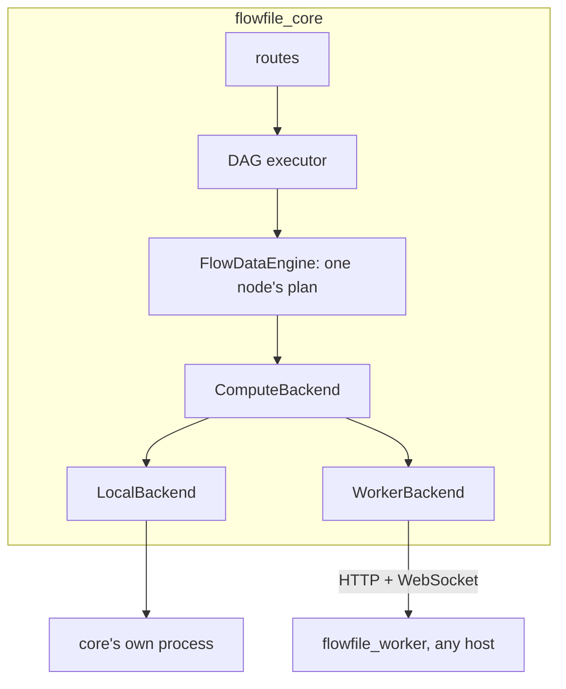

# Compute protocol

This page is the design for how `flowfile_core` hands work to compute: core's own process, or a worker on the same machine or on another host. It is written for contributors who work on it or build a backend against it. After reading it you know the interface a backend implements, the guarantees core relies on, what ships, and which decisions are settled.

The protocol is on by default (`FLOWFILE_COMPUTE_PROTOCOL`). With it off, core uses the worker's task routes, and those the protocol's `/v1` routes replaced answer with `Deprecation: true`. [Remote workers](../users/deployment/remote-worker.md) lists what a worker on another host needs; the roadmap's [Remote workers](../roadmap-details.md#remote-workers) section says what comes next.

## Why a protocol

Core never holds a dataset. Before the protocol, for each node it built a Polars lazy plan, serialised it, and posted the bytes to `flowfile_worker`. The worker ran the plan in a spawned child, wrote the result to `cache/<flow>/<node hash>.arrow` on its own disk, and answered with another plan, `scan_ipc("<that path>")`. Core treated that plan as the node's result.

That worked on one machine because both services saw one disk. Core opened the worker's file itself for the 100-row preview, the first-row probe behind the formula editor, the dynamic-rename and null-profile probes, pivot unique values, column stats, the published API runner, the REST sample, the CSV export, custom-node outputs, the catalog's virtual-table preview, and the check that asked whether a cached result still existed (`os.path.exists`). On another host every one of those reads failed, and the existence check reran every node on every run. Before the protocol (counted in 2026-10) there were eleven such read sites; 18 inline `execution_location` branches across `flow_graph/`, `builders/`, `flow_node/` and `flow_data_engine/`, not counting the two comparisons that only detect a settings change; 14 files outside `configs/settings.py` that read `OFFLOAD_TO_WORKER` or `WORKER_URL`; and about 20 worker calls with no local branch at all. The published API runner had a fallback of its own: when the worker was unreachable or rejected the plan, it collected the response in core.

Three habits underlay that, and each one blocked a different deployment shape:

| Habit | Where it showed | Blocked |
|---|---|---|
| A result was a path | `Status.file_ref`, `scan_ipc(path)` plans, `CatalogTable.file_path` | any second host |
| The decision lived in globals | `OFFLOAD_TO_WORKER`, the module-level `WORKER_URL`; the CLI and scheduler forced both off | a per-run choice of compute, scheduled runs on a worker |
| Nothing could say "this cannot run there" | plugin `.so` paths inside plans, local output paths, nodes that need a secret the executor lacks | team workers, clusters |

The protocol replaces all three with one interface. Backends implement it; core calls only it.

## Vocabulary

| Term | Meaning |
|---|---|
| **core** | the `flowfile_core` process: routes, the DAG executor, schema prediction |
| **DAG executor** | `FlowGraph` and `NodeExecutor`: what runs, in what order, skip and cache decisions |
| **backend** | a Python object inside core implementing `ComputeBackend`; the adapter |
| **compute** | whatever the backend talks to: a `flowfile_worker` process or core's own process |
| **plan** | a Polars `LazyFrame`: a tree of operations whose leaves are scans; no data. A backend that sends it to another process serialises it |
| **result reference** | what a backend answers for a result; the only handle core ever holds |
| **operation** | work that is not a plain Polars plan and needs Flowfile code on the compute |



## Invariants

Every backend and every caller in core keeps these. The conformance suite (`flowfile_core/tests/flowfile/execution/conformance/`) checks them, invariant 4 by the plan-credential tests (`flowfile_core/tests/flowfile/test_cloud_plan_secrets.py`, `flowfile_worker/tests/test_plan_credentials.py`).

1. **Core receives at most `preview_rows` rows of any result.** `sample` and the inline sample on `submit` are the only calls that return rows. `count` returns an integer, `export` returns a URI, `plan_for` returns a plan. Core never collects a backend plan.
2. **Only the minting backend can read a result.** A `ResultRef` carries its backend id and an opaque location. `plan_for(ref)` on another backend raises `ForeignRef`.
3. **Core learns a schema from the reference, never from the file.** A backend returns `schema` with every table result; a blob result has no rows and is never sampled, counted or planned over. Core predicts downstream schemas with Polars over an empty frame of that schema. `collect_schema()` is never called on a plan that scans a backend's storage.
4. **Plans carry no credentials.** A plan references a connection by `CredentialRef`; the executor's identity resolves it. This holds for reads and writes alike.
5. **Every backend runs plain plans; everything else is a declared operation.** `capabilities()` names the operations, URI schemes, plugins and versions a backend supports, and placement checks them before a run starts.
6. **Any node may run on any backend that satisfies its requirements.** Consecutive nodes may run on different backends. Data crosses a backend boundary only through `export` and `import_uri`, never implicitly.
7. **A version mismatch is refused at the handshake.** No silent fallback to in-process execution, and "compute unreachable" is never reported as "result missing".
8. **Materialising is the backend's choice**, except where core marks it required for correctness.

## The interface

`ComputeBackend` is a `runtime_checkable` `Protocol` in `flowfile_core/flowfile_core/flowfile/execution/protocol.py`; `Capabilities` and `PROTOCOL_VERSION` live in `shared/compute_protocol.py`, which core and the worker both import.

```python
PROTOCOL_VERSION = 1

class ComputeBackend(Protocol):
    id: str                                  # "local", "worker", "worker:team"
    protocol_version: int

    def capabilities(self) -> Capabilities: ...
    def submit(self, plan: pl.LazyFrame, inputs: list[ResultRef], hints: SubmitHints, result_id: str, *, flow_id: int, node_id: int | str) -> SubmitResult: ...
    def run_op(self, op: OperationKind, payload: OpPayload) -> OpResult: ...
    def sample(self, ref: ResultRef, n: int) -> bytes: ...          # Arrow IPC stream, at most n rows
    def count(self, ref: ResultRef) -> int: ...
    def exists(self, ref: ResultRef) -> bool: ...
    def release(self, ref: ResultRef) -> None: ...
    def plan_for(self, ref: ResultRef) -> pl.LazyFrame: ...        # a leaf valid on this backend only
    def export(self, ref: ResultRef, uri: str, credential: CredentialRef | None) -> str: ...
    def import_uri(self, uri: str, schema: Schema | None, row_count: int | None, credential: CredentialRef | None, kind: Literal["table", "blob"] = "table") -> ResultRef: ...   # a blob import has no schema
    def status(self, handle: JobHandle) -> JobStatus: ...
    def cancel(self, handle: JobHandle) -> None: ...
```

A plan crosses the interface as the `pl.LazyFrame` itself; a backend that runs it in another process serialises it when it sends it. `result_id` is the producing node's hash, and the compute files the job and its logs under `flow_id` and `node_id`.

```python
Schema = list[FlowfileColumn]

@dataclass(frozen=True)
class ResultRef:
    backend_id: str
    result_id: str                           # the node hash, plus a suffix for derived results
    schema: Schema
    row_count: int | None                    # None when unknown without computing the result
    state: Literal["materialised", "deferred"]
    location: bytes                          # opaque to core
    kind: Literal["table", "blob"] = "table" # a blob is a fitted model or another non-tabular result

@dataclass(frozen=True)
class SubmitHints:
    must_materialise: bool                   # cache_results
    wide: bool                               # not a narrow transform: join, group_by, sort, pivot, …
    fanout: int                              # downstream consumers
    preview_rows: int | None                 # 100 in Development mode; None in Performance mode unless the node caches

@dataclass(frozen=True)
class SubmitResult:
    ref: ResultRef
    sample: bytes | None                     # inline when preview_rows was set; LocalBackend answers None
    handle: JobHandle

@dataclass(frozen=True)
class OpResult:
    refs: dict[str, ResultRef]               # the results by name; empty for an operation that only writes
    metadata: dict[str, Any]                 # a model's digest, a Delta write's version and counts, Kafka offsets

class Capabilities(BaseModel):
    app_version: str
    polars_version: str
    python_version: str
    protocol_version: int
    platform: str                            # sys.platform plus platform.machine()
    plugins: dict[str, str]                  # polars_grouper, polars_simed, polars_ds, deltalake, pl_fuzzy_frame_match
    plugin_libs: dict[str, str]              # prefix-relative library path per expression plugin, as Polars serialises it
    operations: frozenset[str]               # the OperationKind values it runs
    read_schemes: frozenset[str]             # "file", "s3", "az", "gs", "http", "https"
    write_schemes: frozenset[str]
    credential_resolution: Literal["master_key", "vended", "ambient"]
```

Errors are typed, each a `ComputeError` (`flowfile/execution/errors.py`): `ComputeUnavailable`, `VersionMismatch`, `ResultMissing`, `PlanRejected`, `OperationUnsupported`, `ForeignRef`, `TaskFailed`. The integer `error_code` of the worker's task routes is mapped onto them inside `WorkerBackend`.

## Result references

A reference is **materialised** when the backend wrote the result somewhere it owns (a file on the worker, a file under core's storage directory) and **deferred** when the backend kept the plan and will run it when something downstream needs rows. Both carry `schema`; a deferred reference has no `row_count` until `count` is asked, unless the backend already knows it.

`plan_for(ref)` returns the leaf for composing the next node's plan: `scan_ipc(path)` on a worker, the deferred plan itself for a deferred reference. The leaf may name a path core cannot open; core only composes on it and sends the result back to the same backend.

The `result_id` is the node hash, which folds input hashes, settings, the graph instance's `parent_uuid` and the cache epoch, so cache semantics are unchanged: a reference is the cache, `exists(ref)` replaces `results_exists`, and references do not survive a graph reload. `release(ref)` replaces `clear_task`.

## Materialisation

Core separates what it needs from what it knows:

- `must_materialise` is set only for correctness: the user set `cache_results`. The reads whose source is not deterministic (a database, Kafka, REST, Google Analytics) and a random split are operations, not plans: the backend holds what each one read or shuffled, computed once, so two consumers never get two different answers. A sink is a write operation.
- `wide`, `fanout` and `preview_rows` are hints. The backend applies its own policy.

| Backend | Policy |
|---|---|
| `LocalBackend` | `must_materialise` only: the result is written by a streaming sink (`sink_ipc`) to core's own storage directory and held as a scan of that file, nothing collected into memory; everything else stays lazy |
| `WorkerBackend` | `must_materialise or (wide and preview_rows is not None)`; `fanout` is carried in the hints and read by no policy in version 1 |

| Flow | Hints | Worker |
|---|---|---|
| read → filter → one consumer | narrow, fanout 1 | deferred; the preview is a streaming `head(100)` job |
| join → one group_by | wide, fanout 1 | materialised |
| group_by → two writers | wide, fanout 2 | materialised |
| database read → two nodes | an operation | materialised by the read |
| any node with `cache_results` | required | materialised |
| Performance mode | `preview_rows=None` | no sample job at all; a wide node stays deferred unless required |

## Operations

`submit` is the plain-Polars path. Everything that needs Flowfile code on the compute is an `OperationKind`, a closed enum that grows with node types:

| Operation | Task route | Returns |
|---|---|---|
| `database_read`, `kafka_read`, `google_analytics_read`, `rest_api_read` | `/store_*_read_result` | one reference |
| `database_write`, `cloud_write`, `file_write` | `/store_database_write_result`, `/write_data_to_cloud/`, `/write_results/` | none |
| `file_read` | `/create_table/{type}` (Excel, JSON, Avro, non-UTF-8 CSV) | one reference |
| `fuzzy_join` | `/add_fuzzy_join` | one reference |
| `custom_node` | `/execute_custom_node` | named references |
| `random_split` | none: one stored shuffle, sliced | one reference per split, by name |
| `ml_train`, `ml_apply` | `/train_ml_model`, `/apply_ml_model` | the model as a blob reference with its digest as metadata; one reference |
| `delta_write`, `delta_merge`, `delta_scd2` | `/submit_query/` with operation type `write_delta`, `merge_delta`, `scd2_delta` | metadata |
| `viz_session` | `/catalog/visualize_*` | session id |

With the protocol on, the kinds whose result core samples (the reads, `fuzzy_join`, `random_split`, `custom_node`, `ml_train` and `ml_apply`) go to `POST /v1/ops/{kind}`, and the task routes those replaced answer with `Deprecation: true`; `/execute_custom_node` does not, as the custom-node dry run still uses it. The writes, the Delta kinds and `viz_session` stay on the task routes.

A backend declares the subset it supports. `run_op` may run any number of jobs on the compute: a random split is one shuffle and a deferred reference per split over it; a custom node is one `process()` call and as many results as it named.

An operation may return a blob result (a fitted model) under a name: a `ResultRef` of kind `blob`, addressed, checked and released like any result and never sampled, counted or planned over. Publishing it to the catalog is `export` of that reference to the artifact store's upload target; a catalog artifact reaches a backend through `import_uri` of its download source. Core prepares and finalises the catalog row and never carries the bytes.

## Credentials

A plan carries `CredentialRef(connection_id, user_id)` and no secret: the Polars credential provider that holds it (`CredentialRefProvider`) adds only a random per-plan nonce, which keeps Polars' credential cache to one plan. Each backend prepares the plan for its compute:

| Backend | Resolution |
|---|---|
| `WorkerBackend` | attaches nothing: the worker resolves the `CredentialRef` against the shared catalog with its master key at execution, exchanging an Azure service-principal secret or a GCS service-account key for a bearer token there, and hands delta-rs the resolved options. With the protocol off, core's task routes carry a `$ffsec$` ciphertext in an `EncryptedCredentialProvider` instead |
| `LocalBackend` | resolves in core, which holds the master key |

A worker therefore reads the catalog database: co-located, the same SQLite file as core; on another host, the deployment's shared PostgreSQL catalog (`FLOWFILE_DATABASE_URL`), a requirement [Remote workers](../users/deployment/remote-worker.md) states. The connection row, the master key and the user id in the reference are all it needs; no secret travels in a plan in any form.

Two consequences of resolving at the executor:

- `aws-cli`, `iam_role`, `env_vars` and `managed_identity` connections use the **executor's** profile or role. Before the protocol, reads resolved them as core's identity and froze the resulting token into the plan, while writes already resolved on the worker; with the protocol on, reads resolve on the executor too.
- A GCS service-account key or an Azure service-principal secret is not among `PROVIDER_CREDENTIAL_KEYS`, so before the protocol it travelled in a plan's `storage_options` as plain text. With the protocol on, the worker exchanges it for a bearer token where the plan runs, and it travels in no plan; with the protocol off, it still travels in the options.

## Data locations

- Catalog table data is addressed by table identity. The storage target (`catalog/storage_backend.py`) resolves it to a path or URI for whoever executes. Core's reads after a write (enabling the change feed, scanning the SCD2 result, the freshness probe) go through the storage target, which already works for object-storage namespaces.
- `file` is a read and write scheme only `LocalBackend` and a worker on core's host (`FLOWFILE_WORKER_LOCAL_FILES=1`) declare. A flow that touches a local-disk namespace, a local input file or a local output path therefore cannot be placed on a remote backend, and placement says so: `namespace "sales" is on local disk; remote execution needs an object-storage namespace`.
- A Python Script node or a kernel custom node needs its input parquet in the kernel shared volume, which is a `file` location on core's Docker host. A flow with a kernel node therefore runs only on `LocalBackend` or a worker co-located with core, and placement refuses a remote backend with that reason. Lifting that is the exchange store's (see Future direction), not a `KernelBackend`'s.
- Nothing is staged silently: object storage is for catalog data, and intermediate results are private to the backend that computed them.
- An artifact's bytes travel between a backend and the artifact store through the store's upload target or download source: a `file://` URI on a backend co-located with core, a presigned `https://` URL anywhere. The target's scheme must be among the backend's `write_schemes` (publishing) or `read_schemes` (fetching), which placement checks before the run, so a filesystem artifact store refuses a remote worker with the reason in words. A flow-scoped model that is not published is an intermediate result: it lives on the backend that fitted it until a later fit replaces it.
- A catalog table written by identity lives under its catalog's root, as `<root>/<table directory>`, which is what the executor resolves from the identity. A table stored anywhere else (registered from a file at its own path, left behind when the catalog directory moved, or under a namespace whose storage URI changed) is refused by the catalog writer with the reason in words, on every backend; its data is never touched. Adopting such a table into the catalog is a catalog action, not a write.

## Placement

Each node derives its requirements from its settings (`flow_node/requirements.py`): the operation kind, the schemes it reads and writes, the plugins its expressions use, and the credentials it names. Placement compares all but the credentials, which every backend resolves with the master key it holds. It is one function in `flowfile/execution/placement.py`, which asks no backend anything:

```python
def place(flow: FlowGraph, backends: Mapping[str, Capabilities], policy: SingleBackendPolicy, *, nodes: list[FlowNode] | None = None) -> Placement

@dataclass(frozen=True)
class Placement:
    assignment: dict[int, str]               # node id -> backend id
    boundaries: list[tuple[int, int]]        # edges whose data must cross through export / import_uri
    refusals: list[Refusal]                  # node, backend, reason in words
```

- Every node has `execution_location: "auto" | <backend id>` in its settings, saved in the flow file. `"auto"` is the default and runs the node on its flow's backend; the version 1 policy places every node on its flow's backend whatever the node's own value.
- The saved vocabulary is a backend id, never a role name, because a saved value is permanent. A deployment's control plane maps its own names onto ids: its team node is `worker:team`. `remote` stays an alias of the default worker for flow files written before the protocol.
- The flow's own `execution_location` becomes the default backend for its nodes. The designer offers `"auto"` (the configured default worker) and, to an administrator, the ids of the backends table, never `"local"`: desktop and Docker always run on a worker, on the same machine by default, so an out-of-memory node takes a child down and not core, and cancel is real. A flow saved with `"local"` loads as `"auto"` wherever a file is opened with the protocol on, the designer and `flowfile_frame` alike. `"remote"` is an alias of `"auto"`. `LocalBackend` stays in code for headless runs, a `flowfile_frame` graph built in code and the conformance suite.
- **Version 1 policy** (`SingleBackendPolicy`) assigns one backend per flow, except the node types whose builders pin them to a backend of their own (the Google Analytics reader runs on the worker), and refuses a node whose requirements that backend does not meet: the run starts no node, and each refused node's row on the run report says `cannot run on backend "<id>": <reason>`. Mixed assignments are legal in the protocol; the policy that makes them is under Future direction.
- A deployment's control plane may fill the backends core places on (see Backends). Placement itself stays in core because only the DAG executor knows the graph ([Execution Strategy](flowfile-core.md#execution-strategy-how-nodes-decide-where-to-run)).

## Versions and the handshake

The handshake runs for the first worker a core process calls and again after a call cannot reach it; the **Handshake** button on **Settings → Execution → Backends** checks a configured worker on demand. In version 1 `app_version`, `protocol_version`, `polars_version`, `python_version`, `platform`, `plugins` and `plugin_libs` must match core exactly. Four facts force that. Polars plan bytes are not stable across versions. A plugin expression serialises its library path relative to the sending process's `sys.prefix` (`polars/plugins.py::_resolve_file_path`) and the compute resolves it against its own, so a PyInstaller desktop, a Windows core and a Linux container disagree even on one Polars version. Plugin versions matter independently of their paths: a PyPI core and a venv worker on one app version can resolve different `>=` pins, and a plugin's ABI is version-coupled to Polars. And the operation payloads are hand-copied models on both sides, where pydantic drops a field the other side does not know without an error, so an app-version skew would let a new write mode degrade to an old one silently.

The handshake is also functional: core submits one empty-frame plan per expression plugin (`pl.LazyFrame(schema=…).select(<plugin expression>)`) and the compute answers which load. A mismatch is a `VersionMismatch` naming both sides and, for a plugin, the plugin and both paths. The guarantee is two-sided: a compute rejects a `/v1/*` request whose `X-Protocol-Version` differs from its own with 426.

The worker exposes the handshake as `GET /capabilities` (and `GET /v1/capabilities`). The unauthenticated `POST /shutdown` stays reachable from loopback only, because the desktop shell posts to it without a token.

## Previews and other bounded reads

A backend provides rows; core does everything else. `sample` returns an Arrow IPC stream and core keeps the rendering it had. With `preview_rows` set, `WorkerBackend.submit` returns the sample inline, so the common case costs no second round trip; `LocalBackend` answers none inline and serves the preview through `sample`. Reopening a flow, a different row count, or an on-demand probe calls `sample(ref, n)`, and core caches the bytes per node hash.

A worker caps `sample` at 10 000 rows and reads a sample of more than 1 000 rows of a materialised result in a child, never in its serving process; a larger request is refused, not truncated. Every core-side read of a worker file collapsed into "submit a bounded plan, then sample it":

| Before the protocol | In the protocol |
|---|---|
| preview, `get_read_top_n(file_ref, 100)` | inline sample on `submit` |
| first row for the formula editor | `sample(ref, 1)` |
| pivot unique values | `submit(plan.select(col).unique().head(200))`, then `sample` |
| column stats, null profile, dynamic-rename first row | an aggregate plan, then `sample` |
| formula-gate probe | `sample(plan.filter(pred), 1)` |
| CSV export | `sample(ref, 10_000)` streamed |
| the published API runner | `sample(ref, max_rows)`, `max_rows` clamped to the worker's sample cap |
| `artifact_is_missing` | `exists(ref)` |
| kernel input parquet | `export(ref, <kernel shared volume uri>)`; needs `file` among the backend's write schemes, see Data locations |
| catalog virtual-table preview | `sample` on the producer run's output reference |

## Backends

- **`LocalBackend`**: runs plans in core's process. Replaces the former `execution_location == "local"` branches. It materialises a required result by a streaming sink to core's own storage directory, never by collecting it, so invariant 1 needs no exemption for it; `sample` is the one bounded collect, as on every backend.
- **`WorkerBackend`**: the HTTP and WebSocket client to `flowfile_worker`. Its wire mirrors the interface one method to one route (`submit` → `WS /v1/ws/submit`, with `POST /v1/submit` when the socket cannot be opened; `sample` → `GET /v1/results/{id}/sample`; `run_op` → `POST /v1/ops/{kind}`; `export` → `POST /v1/results/{id}/export`; `capabilities` → `GET /v1/capabilities`), and the worker publishes it as `openapi.json`. The wire is private to this backend and versioned by the handshake.

Backends register through the `flowfile.compute_backends` entry-point group and are configured by name. Configuration is a backends table in core's catalog database (`compute_backends`): one row per backend with its id, its URL and its bearer token, the token stored through the secret manager. An administrator fills the table on **Settings → Execution → Backends**; a deployment's control plane fills it over core's admin routes (`/compute_backends`). A running core reads a row the first time it uses that id and keeps the backend it made, so a row changed in the database directly after that takes effect when core restarts; removing a worker on the settings page drops it at once. Ids are `local`, `worker` (the built-in default worker) and `worker:<name>` for every configured one; a saved id is permanent. Core offers no management of the workers themselves: how a worker is hosted, registered in a fleet, leased to a run or scaled is the control plane's.

Each configured backend carries its own bearer token, which signs its `/v1` requests. The task routes core still uses (the writes, the Delta operations, the visualisation session, the catalog services, the custom-node dry run, the version check) sign with core's `FLOWFILE_INTERNAL_TOKEN`, so a configured worker is started with core's token. A desktop core may configure a remote worker that matches it at the handshake.

Core reaches a backend through an `ExecutionContext` that the `FlowGraph` owns: derived from the flow's settings (its `execution_location`, execution mode and parallelism), set for the run, and copied into every stage thread of a run. A call made with no run active (a preview re-read, the formula editor's first row, a catalog preview, a dry run) resolves the context from the graph it was given, or falls back to the default backend when there is no graph. A `run_flow` child graph inherits its parent's context.

## Headless runs

The CLI (`flowfile run flow`) and the scheduler, which spawns it, run a flow in the runner's own process unless a backend is named: a run with no backend named computes there whatever the flow's `"auto"` or `"remote"` says, since to the headless runner `"auto"` is its own process. An explicit `--backend` on the run, or a specific backend id in the flow's setting, names a backend, and the headless runner then uses it through the same `ExecutionContext` the designer uses. The scheduler itself is core-import-free and only spawns `flowfile run flow`, which reads the flow's setting from the YAML, so no schedule changed behaviour with the protocol.

## What ships

These behaviours changed with the protocol:

- An out-of-memory-killed worker child fails its node instead of the dataset moving into core.
- A published API answers 503 when its compute cannot be reached, instead of collecting the response in core.
- `aws-cli` and `iam_role` reads resolve on the executor (see Credentials).
- A flow with a kernel node is refused on a remote backend, with the reason.
- The protocol is on by default; `FLOWFILE_COMPUTE_PROTOCOL=0` switches core back to the worker's task routes.

| Check | Where |
|---|---|
| the invariants, over `LocalBackend` and `WorkerBackend` | `flowfile_core/tests/flowfile/execution/conformance/` |
| core and a worker on storage directories of their own, with previews, a model trained and applied, and a model published to the artifact store | `tests/remote_worker/test_two_storage_dirs.py` |
| core and a worker in containers that share no volume: a database read, a model trained and applied on the worker, a catalog write | `tests/remote_worker/test_zero_volumes.py`, run by `.github/workflows/test-remote-worker.yml` |
| a result crossing from one backend to the other through `export` and `import_uri`, in both directions | `flowfile_core/tests/flowfile/execution/test_two_backend_chain.py` |
| placement and its refusals before any node starts | `flowfile_core/tests/flowfile/execution/test_placement.py` |
| no inline `execution_location` branch and no worker-setting read outside the backend registry | `flowfile_core/tests/flowfile/execution/test_inline_location_branches.py` |

!!! note "Future direction"
    Designed and not built:

    - **Mixed placement.** A policy that runs one flow's nodes on several backends, with data crossing through an exchange store whose credentials both sides hold, an edge cost, and a per-node picker in the designer. It also lets a flow with kernel nodes use a remote backend.
    - **`PolarsCloudBackend`**, behind a flag: `submit` wraps `LazyFrame.remote(ctx)`; materialisation is `sink_parquet` to a staging prefix under the policy `must_materialise or fanout > 1`, so a lone join stays deferred because a staging round trip costs more than recomputing it; `sample` is a bounded remote query. It supports plain plans and no operations, which keeps every Flowfile-specific node on a worker. It attaches no credentials, as the cluster uses its own identity, and it never receives local files.
    - **Team workers.** A backend that attaches short-lived credentials issued by the deployment's control plane, and a control plane with its own compute-node registry, leases, placement policy and failover: a worker that dies mid-run loses its references, and the run restarts on another backend with a cold cache.
    - **Staged local inputs.** A local input file uploaded once, keyed by content hash, to a worker that declares `file` for staging only.
    - **A generic `HttpBackend`** that serves any other compute choosing to speak the worker's wire.
    - **A looser version rule.** The app-version rule relaxes once operation payloads carry their own version.

## Out of scope for now

A worker fleet registry with leases and a fleet page (control-plane work). Durable intermediate results across a compute restart. Kernels as a backend (`KernelBackend`); kernel nodes on a remote backend are for the exchange store, not a `KernelBackend`. Fusing a chain into one job on a cluster (falls out of deferred references and the backend's materialisation policy). Arrow Flight. Pull transport. A load balancer in front of workers, which remains forbidden because a worker is stateful.

## Decision record

| Decision | Choice | Alternatives considered |
|---|---|---|
| Result addressing | backend-scoped references with an opaque location; `export` to cross a boundary | universal URIs (needs a reachability check before every use or object storage for every result); keep paths |
| Who materialises | the backend, from hints; core marks only correctness requirements | core decides by node type; always materialise |
| Unit of submission | one plan, one reference; `run_op` returns named references | multi-output `submit` (every backend would execute one plan to N sinks) |
| Credential resolution | the executor's identity, always | core for reads and the executor for writes (before the protocol); per-connection choice |
| Operations | a closed enum with declared support | open string names (support discovered at run time); everything as a plan (needs Flowfile code on every compute) |
| Version skew | exact match on app, protocol, Polars, Python, platform, plugin versions and plugin library paths in version 1, plus a functional plugin probe; the app-version rule can relax once operation payloads carry their own version | app version may differ (rejected: operation payloads are hand-copied and pydantic drops unknown fields silently); one Polars minor of skew |
| Protocol definition | a Python interface with entry-point plugins; the worker's wire mirrors it | wire-first OpenAPI (every backend a service; `plan_for` cannot cross a wire) |
| Placement | per-node capable from the first release; version 1 policy is one backend per flow | per-node policy in version 1 (needs the exchange store first) |
| Headless runs | local by default: a run with no backend named computes in the runner's own process, a flow's `"auto"` or `"remote"` included; an explicit `--backend` or a specific backend id saved in the flow is honoured | default to the configured worker (every existing schedule would move onto it, and a desktop schedule would fail whenever the app and its worker are closed) |
| Designer compute | the designer offers no `"local"`: desktop and Docker always run on a worker, on the same machine by default; `"local"` in a saved flow loads as `"auto"` wherever the file is opened, the designer and `flowfile_frame` alike; `LocalBackend` stays for headless runs, a `flowfile_frame` graph built in code and the conformance suite | keep `"local"` in the designer (an out-of-memory node takes core down, no real cancel, two everyday paths) |
| Local-disk namespaces on a remote backend | refused with the reason | staged automatically |
| Authentication | one token per configured backend | one service token for a fleet |
| Backend configuration | a backends table in core (id, URL, token), filled on the Backends settings page or by a control plane over the API; ids `local`, `worker`, `worker:<name>`; no fleet management in core | environment variables only (no second worker without a restart); a management page in core (the control plane's job) |
| Desktop to remote worker | in scope; a desktop core uses a remote worker only when the plugin layout matches, otherwise the handshake refuses the worker until plugins are resolved by name | docker-mode team servers only |
| API runner fallback | deleted with the node-level continuation; `ComputeUnavailable` answers 503, every other compute error 500 with the typed message | keep the degrade as an explicit fallback backend on the context (a placement policy) |
| Context ownership | the `FlowGraph` owns the `ExecutionContext`; stage threads run under a copied context; graph-less calls use the default backend; a subflow inherits its parent's | a ContextVar set only by `run_graph` (invisible to the stage thread pool and to routes) |
| Per-node setting vocabulary | `"auto"` or a backend id; a control plane maps its own names onto backend ids from its own registry | `local`, `team`, `cloud` with `remote` as an alias (less general, and a saved value is permanent) |
| Kernel nodes on a remote backend | refused: `needs_kernel` requires `file` co-located with core; lifting it is the exchange store's | a `KernelBackend` |
| Single-file mode and the `/v1` wire | the co-hosted worker mounts `/v1/ws/submit` beside the `/v1` REST router, so one wire serves the single-process and the two-process deployment; REST polling stays the fallback | REST polling only in single-file mode, documented as a mode difference |
| Credentials on the worker | the plan carries only a `CredentialRef`; the worker resolves it against the shared catalog with its master key at execution, bearer tokens for Azure and GCS made there, delta-rs given the resolved options; a remote worker needs the shared PostgreSQL catalog | `$ffsec$` ciphertext inside the plan in a credential provider (the task routes' way; it cannot carry a bearer-token exchange for every operation); refusing Azure and GCS methods on remote backends |
| Schemas of derived frames | inside a node function, the schema of a frame derived from the input is computed over an empty frame of the input's cached schema, never by resolving through a backend's leaf | reading the leaf, which opens the worker's file |
| Operations over the `/v1` wire | `POST /v1/ops/{kind}` answers wire references for every kind whose result core samples, so a custom node's outputs, a fuzzy join, a random split and the reads are references like a submit's | operations stay on the task routes until the task routes go |
| Materialisation in core | `LocalBackend` honours `must_materialise` like every backend, by a streaming sink to core's own storage directory, so invariant 8 has no exemption and core holds no collected frame; the worker's policy is `must_materialise or (wide and preview_rows is not None)`, as the hints are the backend's choice | exempting `LocalBackend` from invariant 8 (a hole in the one rule a backend author needs); collecting the result in core (unbounded memory) |
| Sample size | the worker caps `sample` at 10 000 rows, reads above 1 000 rows in a child, and the API runner's `max_rows` and the CSV export are bounded by the cap | unbounded, collected in the worker's serving process |
| Virtual-table preview | the producer run's output reference, sampled through its backend; `/catalog/materialize` keeps the stored form | a path answered by `resolve_virtual_table` |
| Catalog writer by identity | a table lives under its catalog's root; one stored elsewhere is refused with the reason, on every backend, and its data is never touched | the payload carries the stored location (an absolute path to a remote worker); refusing on remote backends only (two write paths to keep) |
| Artifacts on a backend | a fitted model is a held result of kind `blob`; publishing is `export` to the artifact store's upload target and fetching is `import_uri` of its download source; core prepares and finalises the row and never carries the bytes; a flow-scoped model is held where it was fitted until a later fit replaces it | an upload target inside the train payload (one node's path, nothing reused); a separate artifact reference type (a second path through `exists`, `release` and `ForeignRef`); a hidden catalog artifact per run for flow-scoped models (needs a registered flow, fills the store with scratch versions) |

Earlier decisions this design keeps: core dials the compute (push); intermediate results are compute-private; object storage holds catalog data only; a dead compute fails a run loudly, never silently; the handshake carries app, Polars and protocol versions; a load balancer never fronts a worker.
