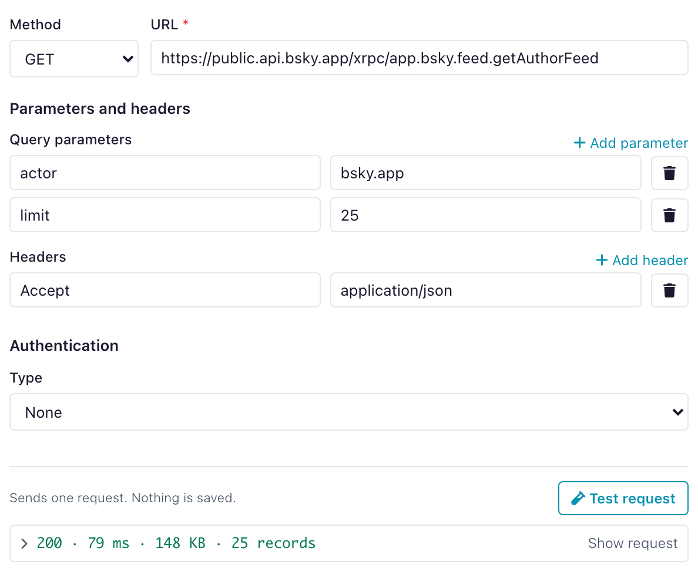
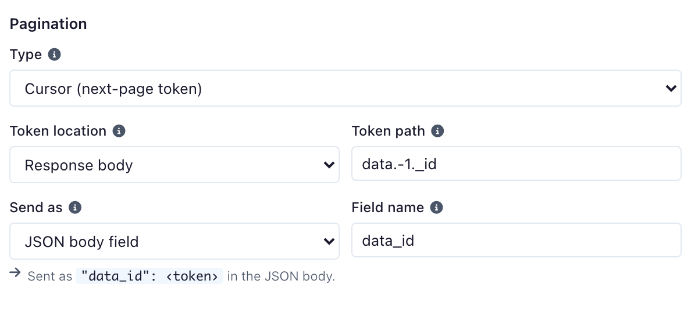
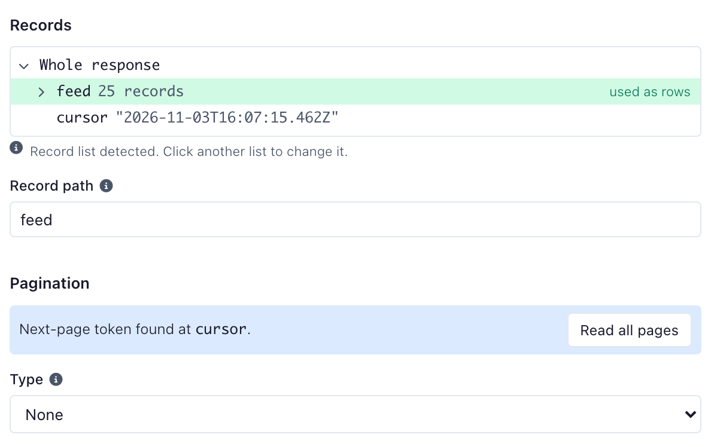
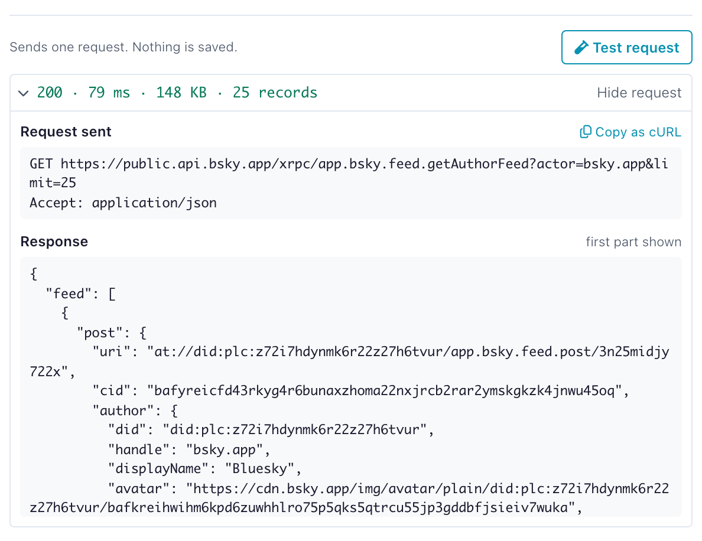

# REST APIs and Google Analytics

Pull data from HTTP endpoints and Google Analytics 4 into a flow. This page covers the REST API Reader (node and `ff.read_api`) and the Google Analytics reader. Both are read-only sources: they fetch data in, they do not write back.

!!! info "Not in Flowfile Lite"
    Both readers require the full desktop or server build. The browser-only [Flowfile Lite](../deployment/lite.md) edition has no backend and cannot reach external APIs.

## REST APIs

The **REST API Reader** node fetches JSON from an HTTP endpoint, flattens the response into a table, and hands it downstream. It handles authentication and pagination so you don't script the request loop yourself. JSON is the only supported response format.

### Request settings

The node's request is built from these settings (the same fields `ff.read_api` accepts):

| Setting | Meaning |
|---|---|
| URL | The request URL. |
| Method | `GET` or `POST`. |
| Headers | Request headers as key/value pairs. |
| Query params | URL query parameters. |
| JSON body | Request body for `POST`. |
| Record path | Dot-path to the record array inside the response (e.g. `data.items`). Empty uses the top-level response. A number picks a list item, so `data.0.items` reads the `items` of the first element of `data`. |
| Timeout (seconds) | Per-request timeout (default 30). |
| Max retries | Retries for transient failures (default 3). |

{ width="594" }

### Authentication

Authentication is configured by `auth_type`, one of:

- `none` — no authentication.
- `api_key` — an API key sent as a header (default name `X-API-Key`) or query parameter, per `api_key_location`.
- `bearer` — a bearer token in the `Authorization` header.
- `basic` — HTTP basic auth with a username and a secret password.

In the node, the credential references a stored secret by name ([Secrets](../visual-editor/catalog/secrets.md)) so it never lands in the flow file. In `ff.read_api` you may instead pass an inline `secret` for programmatic use; it is encrypted with the master key and never persisted.

### Pagination

`pagination_type` selects the strategy:

- `none` — a single request.
- `offset` — offset/limit paging (`offset_param`, `limit_param`, `page_size`).
- `page` — page-number paging (`page_param`, `start_page`, `page_size`).
- `cursor` — cursor / next-token paging (`cursor_param`, `cursor_response_path`, `initial_cursor`, `cursor_request_location`).

Safety caps `max_pages` (default 1000), `max_records`, and `page_delay_seconds` bound the paging loop.

#### Cursor paging

`cursor_response_path` says where the next cursor is in each response: a dot-path into the JSON body (or a header name, with `cursor_location="header"`). A number in the path picks a list item and a negative number counts from the end, so `data.-1._id` is the `_id` of the last record on the page. That is how keyset APIs that page by "the last id you saw" are read.

`cursor_request_location` says where the next request carries it:

- `query` (default) — as the query parameter `cursor_param`.
- `body` — as the field `cursor_param` of the JSON body, merged into the configured body on every page (a dotted name such as `page.after` places it in a nested object). Needs `POST` and a body that is a JSON object (or no body): with a list or a plain value as the body the settings are refused.

The first request is sent without a token unless `initial_cursor` holds one. In the node that field is **Initial token**, under **Advanced**.

Cursor paging stops at the first of: no next cursor, a page with no records, or a cursor the API already handed out (a page that only repeats the previous page's records is dropped, so the result holds no duplicates).

For example, an API that takes `{"app_id": …, "entry_id": …, "limit": 100, "data_id": <last id>}` and answers `{"data": [...]}`:

```python
# Illustrative — not runnable as written.
records = ff.read_api(
    "https://api.example.com/v5/app/entry/data/list",
    method="POST",
    json_body={"app_id": "YOUR_APP", "entry_id": "YOUR_ENTRY", "limit": 100},
    auth={"auth_type": "bearer", "secret": "YOUR_TOKEN"},
    record_path="data",
    pagination={
        "pagination_type": "cursor",
        "cursor_param": "data_id",
        "cursor_request_location": "body",
        "cursor_response_path": "data.-1._id",
    },
).collect()
```

In the node: set **Method** to `POST`, set the **Type** under **Pagination** to **Cursor (next-page token)**, set **Token path** to `data.-1._id`, set **Send as** to **JSON body field** and set **Field name** to `data_id`. The line under the fields shows what each next request carries: `"data_id": ‹token›` in the JSON body.

{ width="594" }

Cursor paging needs a cursor path; a run without one stops before the first request. In the node, **Test request** shows the response as a tree: click a value to use it as the next-page token, or pick one of the paths listed under the field (that list includes the last record's id, for keyset APIs).

{ width="594" }

### Debugging a request

**Test request** in the node sends one request and nothing else; it saves nothing. It reads the first page only and keeps at most 50 of its records, which is what the columns are found from. Under the button you see the status, the time and size of the response and how many records it held. **Show request** unfolds the request as it was sent (the method, the URL with every query parameter, the headers and the JSON body) and the start of the response. A credential is not shown: where it was sent you see the name of the secret, and **Copy as cURL** writes it as an environment variable. The one exception is a secret shorter than four characters, which is replaced only where it is a whole value: inside longer text of the API's own answer it stays as it is.

{ width="594" }

A run logs every request to the flow's log, the first ten pages one by one and every tenth after that:

```text
Page 1: GET https://api.example.com/v1/orders answered 200 in 212 ms, 100 records, next cursor c2
Page 2: GET https://api.example.com/v1/orders?cursor=c2 answered 200 in 198 ms, 37 records
Stopped after 2 pages: the API returned no next cursor.
```

The last line says why the read stopped: no next cursor, an empty page, a last page shorter than the page size, a cursor the API already gave, or a limit. Stopping at **Max pages** is logged as a warning, since the API may hold more.

A request that fails ends the node with the request, the status and the start of the API's own answer, for example `GET https://api.example.com/v1/orders?api_key=REDACTED answered 401 Unauthorized: {"error": "token expired"}`. The secret reads `REDACTED` wherever it was sent, in the message and in the log.

A host that does not answer, a `5xx` status and a `429` are tried again, up to **Max retries** times, with a pause that doubles from half a second (a `429` waits its `Retry-After` instead). Each attempt at a host that does not answer waits the whole **Timeout**, and nothing is logged between attempts, so with the defaults (30 seconds, 3 retries) a test request or a run takes about two minutes to fail. Both settings are under **Advanced**. Any other `4xx` fails at once.

### Read a REST API in Python

`ff.read_api` builds a REST API Reader node and returns a [FlowFrame](../python-api/index.md). The fragment below is **illustrative** — it points at a placeholder host, so it will not run as written; substitute your own endpoint and credentials.

```python
# Illustrative — not runnable as written.
import flowfile as ff

users = ff.read_api(
    "https://api.example.com/v1/users",
    auth={"auth_type": "bearer", "secret": "YOUR_TOKEN"},
    pagination={"pagination_type": "offset", "page_size": 100},
    record_path="data",
).collect()
```

The full signature is:

```python
ff.read_api(
    url,
    *,
    method="GET",
    headers=None,
    params=None,
    json_body=None,
    auth=None,
    pagination=None,
    record_path="",
    timeout_seconds=30.0,
    max_retries=3,
    description=None,
)
```

`auth` and `pagination` accept a plain dict (as above) or the typed `RestApiAuthSettings` / `RestApiPaginationSettings` objects.

## Google Analytics

The **Google Analytics** reader pulls reports from a **GA4 property** — dimensions and metrics over a date range — into a flow. It reads through a saved Google Analytics connection; there is no `ff.*` helper for GA, so set the connection up first, then use the reader node on the canvas.

### Connecting an account

Create a Google Analytics connection on the **Connections** page under the **Google Analytics** tab. Two credential types are supported:

- **OAuth 2.0** — sign in with Google and consent to the `analytics.readonly` scope. Flowfile stores the resulting refresh token encrypted; no raw credential is entered by hand. This requires a Google OAuth **web application client** (client id, client secret, redirect URI), which you paste into the Google OAuth card on the same page. Create the client at [Google Cloud Console → Credentials](https://console.cloud.google.com/apis/credentials).
- **Service account** — upload a service-account JSON key. Flowfile validates and encrypts it at rest. The service account's email must be granted **Viewer** on each GA4 property you want to read; a service-account connection sees whatever properties that email has access to.

Each connection can carry a **default property id** (the GA4 property, e.g. `123456789`). Use **Test** on the connection to confirm the credential is valid — for a service account with a default property set, the test also verifies Viewer access to that property.

!!! note "Credentials needed"
    OAuth needs a Google OAuth web-application client (id, secret, redirect URI) plus the interactive sign-in. A service account needs the JSON key and Viewer access on the target GA4 property. In either case you supply a GA4 property id to run a report.

No runnable example is provided for Google Analytics: it reads from a live Google account and property that can't be seeded in a test.
