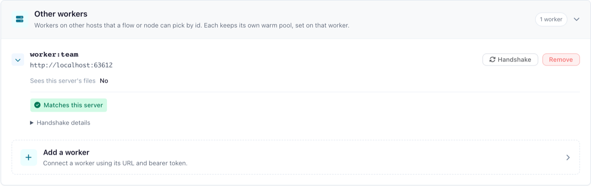
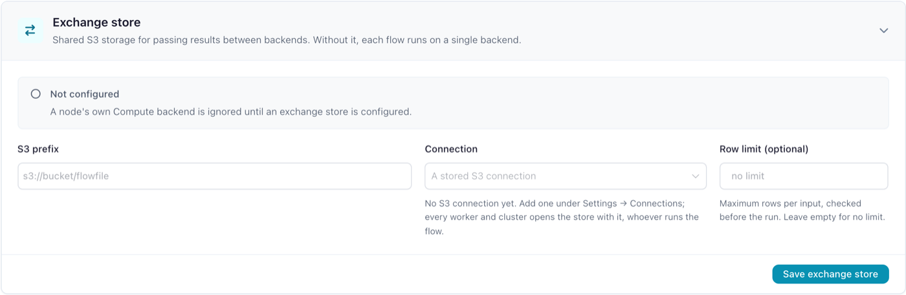

# Remote workers

This page covers running `flowfile_worker` on a host other than core's: what each side needs in its environment, how to add the worker, and what does not run there. It assumes the [Docker deployment](docker.md). [Where flows run](where-flows-run.md) explains the model with diagrams; the design behind it is the [compute protocol](../../for-developers/compute-protocol.md).

## How it works

- Core sends each node's plan to the worker and takes back a bounded sample of the rows, the schema and the row count. It never opens a file the worker wrote.
- Results stay in the worker's own storage, except a result that crosses to another backend through an [exchange store](#nodes-on-several-backends).
- The worker reads sources and writes destinations itself. A plan carries no credentials: the worker resolves a stored connection from the catalog database with the master key.

This needs `FLOWFILE_COMPUTE_PROTOCOL` on, which is core's default. Results are released as described in [When results are released](where-flows-run.md#when-results-are-released); the worker's age sweep (`CACHE_EXPIRATION_TIME`, 24 hours) is only the backstop for a core that stopped without closing its flows.

!!! warning "A remote worker is inside your trust boundary"
    It holds the master key, reads the whole catalog database and signs with the internal token, so whoever controls its host controls every stored connection and secret. Run it where you would run core: on the same network, under the same administrators, with the same patching and backups. A [Polars cluster](#a-polars-cluster-as-a-backend) added as a backend holds none of these.

## Setup at a glance

1. Run core on a PostgreSQL catalog; the worker uses the same one ([why](#the-shared-catalog-and-the-master-key)).
2. Start the worker with core's `FLOWFILE_DATABASE_URL`, `FLOWFILE_MASTER_KEY` and `FLOWFILE_INTERNAL_TOKEN` ([The worker's environment](#the-workers-environment)).
3. Check the network: the worker reaches every database, broker and storage endpoint your connections name, and core reaches the worker's port.
4. Add the worker to core ([Add the worker to core](#add-the-worker-to-core)); for a worker added on the Backends page, click **Handshake** on its row.
5. Keep the flows it runs on object storage or URLs: a remote worker does not read core's local files ([Storage](#storage-a-remote-worker-can-use)).
6. Pick the worker's id under a flow's **Execution location**. A worker set as the default worker runs the flows on **Auto (default worker)**.

## The worker's environment

The `flowfile-worker` image starts `python -m flowfile_worker --host 0.0.0.0` on port `63579`; `--host` and `--port` change both.

| Variable | Value |
|---|---|
| `FLOWFILE_MODE` | `docker` (the image sets it). Only in this mode does the worker read the master key from its environment or the `flowfile_master_key` Docker secret. |
| `FLOWFILE_INTERNAL_TOKEN` | Core's value. Every route requires it except the API docs (`/docs`, which the image's health check calls, `/redoc` and `/openapi.json`). `POST /shutdown` takes it too, or no token from a loopback address when the desktop app runs the worker. |
| `FLOWFILE_MASTER_KEY` | Core's value. |
| `FLOWFILE_DATABASE_URL` | Core's PostgreSQL catalog, for example `postgresql://flowfile:<password>@<catalog host>:5432/flowfile`. |
| `CORE_HOST`, `CORE_PORT` | Where the worker posts node log lines (`/raw_logs`, signed with its token). `CORE_PORT` defaults to `63578`. |
| `FLOWFILE_STORAGE_DIR` | The worker's own storage for results. Defaults to `/app/internal_storage` in Docker mode. |
| `FLOWFILE_WORKER_LOCAL_FILES` | Leave unset. `1` declares local files among what the worker reads and writes, which is true only for a worker that sees core's files. |
| `FLOWFILE_WORKER_TLS_CERT`, `FLOWFILE_WORKER_TLS_KEY` | Optional: paths of a PEM certificate and its private key in the container. Set both and the worker serves `https` and `wss` itself; see [TLS](#tls). |

The worker reaches the catalog database and every database, Kafka broker, REST endpoint and storage endpoint the flows use, by the names their connections use. For an Azure service principal or a GCS service account it also reaches the provider's token endpoint, since it exchanges the stored secret for a bearer token itself. Core reaches the worker's port.

!!! tip "A connection's endpoint must reach the service from both hosts"
    A connection names one endpoint for every process that opens it. An endpoint at the worker host's own LAN address, for example, times out from the worker's container when that host's firewall drops traffic from Docker's bridge network (ufw's default), while core on another host reaches it. For a storage service in a container on the worker's host: give it a network alias on the worker's Docker network, add the same name to core's `extra_hosts` with the worker host's address, and use that name in the connection. Until then a read through the connection retries for about a minute before its node fails.

## Core's environment

| Variable | Value |
|---|---|
| `FLOWFILE_DATABASE_URL`, `FLOWFILE_MASTER_KEY`, `FLOWFILE_INTERNAL_TOKEN` | The worker's values. |
| `FLOWFILE_WORKER_URL` | The default worker's URL, for example `http://<worker host>:63579`. Unset, core uses `http://<WORKER_HOST>:<FLOWFILE_WORKER_PORT>`, the port defaulting to `63579`. |
| `FLOWFILE_COMPUTE_BACKEND` | Optional: a `worker:<name>` id that becomes the default backend, for **Auto (default worker)** flows and for every scheduled and `flowfile run flow` run started with it in its environment. |
| `FLOWFILE_COMPUTE_PROTOCOL` | Leave unset. Switched off, core opens the worker's result files itself, which a worker on another host does not share. |
| `FLOWFILE_EXCHANGE_URI` | Optional: an `s3://` root where results cross between backends, for example `s3://flowfile-exchange/runs`. Set, each node runs on its own **Compute backend**; see [Nodes on several backends](#nodes-on-several-backends). Overrides the **Exchange store** saved on the Backends page, which applies with no restart. |
| `FLOWFILE_EXCHANGE_CONNECTION` | With the URI: the name of a stored S3 connection an administrator owns, for example `exchange`. Core and every worker open the store with it whoever runs the flow, so no user needs a connection of that name. |
| `FLOWFILE_EXCHANGE_MAX_ROWS` | Optional: the most rows an input may cross between backends with, for example `50000000`. Best effort; see [Row limit](#nodes-on-several-backends). Unset, there is no limit. |

## The shared catalog and the master key

- **One catalog.** Core and the worker use one PostgreSQL catalog database. A SQLite catalog is a file on core's host, so it serves only a worker on that host. On a catalog of its own, a worker's cloud read fails with *A worker resolves a plan's cloud connection against the catalog core writes, so it must use core's catalog database.*
- **One master key.** The worker decrypts a stored connection's secrets when the node runs. With another key, a cloud read fails with *Core and the worker must share the same master key.*
- **The host's own identity.** `aws-cli`, `iam_role`, `env_vars` and `managed_identity` connections store no credentials and authenticate as the host that runs the node. On a remote worker that is the worker host's AWS profile or role, environment or managed identity, not core's.

## Storage a remote worker can use

| Storage | Reads | Writes |
|---|---|---|
| Object storage (`s3`, `az`, `gs`) | Yes | Yes |
| `http` and `https` URLs | Yes | Only the artifact store's presigned `https` URLs |
| Local files | No | No |

Core checks every node of a run against this before the run starts. A node the worker cannot run stops the run before any node starts; its row on the run report reads `cannot run on backend "<id>": <reason>`, followed by the setting that moves it: its **Compute backend** under **General Settings**, the flow's **Execution location** under **Flow Settings**, or either. With an [exchange store](#nodes-on-several-backends), the node runs on the default worker instead.

Core offers local files on its own to the default worker on core's host at an unconfigured address (neither `FLOWFILE_WORKER_URL` nor `WORKER_HOST` set) and to a worker marked **Sees this server's files**; a worker started with `FLOWFILE_WORKER_LOCAL_FILES=1` declares them itself.

- **Catalog tables** must be on object storage. A catalog gets its storage when it is created: **Object storage (optional)** and **Storage connection** in the **Create Catalog** dialog, or, left empty, `FLOWFILE_CATALOG_STORAGE_URI` and `FLOWFILE_CATALOG_STORAGE_CONNECTION` from core's environment when set. A **Read from Catalog** or **Write to Catalog** node on a local-disk catalog, the seeded **General** catalog included, is refused with `namespace "<name>" is on local disk, not object storage`. Core also reads and commits catalog tables itself (the freshness check at the start of a run, enabling a change feed, reading an SCD2 write's result), so core needs access to those buckets through the catalog's storage connection; credentials only the worker holds do not give it that.
- **Files.** A **Read data** or **Write data** node on a local path is refused (`it reads local files`), and so is a file uploaded through the File Manager, which is a local path on core's host.
- **Models.** A **Train Model** node with **Save to catalog** on, and an **Apply Model** node whose **Model source** is **From catalog**, move the model through the artifact store. That needs the S3 artifact store on core (`FLOWFILE_ARTIFACT_STORAGE=s3`, `FLOWFILE_S3_BUCKET`, and `FLOWFILE_S3_ENDPOINT_URL` for an S3-compatible store) on an `https` endpoint the worker reaches by the same name, because core presigns the URLs the worker uploads to and downloads from. The worker needs no store credentials; a private certificate authority goes in the worker's `REQUESTS_CA_BUNDLE`. With the filesystem store, the default, both nodes are refused. A model trained and applied in one flow without the catalog stays on the worker and needs neither.

## Versions and the handshake

Core checks each worker on first use after it starts, and again after a call cannot reach it: it compares versions and runs a few small plans there, one per expression plugin (`polars_grouper`, `polars_ds`) and one with a Python function. **Handshake** on the worker's row on the Backends page runs the same check; run it after adding a worker and after upgrading either side.

| Compared | When it differs |
|---|---|
| Worker contract (protocol version), Polars version, Polars runtime index width | The worker is refused whole and runs nothing: `Backend "<id>" does not match core (<field>: core <value>, backend <value>; …)` |
| Each plugin: missing, another version, or fails to load from the path core's plans carry | Only the nodes that use that plugin are refused there |
| Python version, to the patch release, when core's Python functions fail there | Only the formula nodes (**Formula**, **Multi-field formula**, and **Filter data**, **Gate** and **Rename columns** with a formula) and a cloud storage read of a table's changes are refused there |
| App version, platform, plugin library paths | Nothing; shown only |

A backend that resolves credentials with its own identity (a Polars cluster) is also refused whole while `FLOWFILE_COMPUTE_PROTOCOL` is off, since core's plans then carry encrypted credentials; the message names the flag.

The last result shows beside the worker's id in every user's **Execution location** and **Compute backend** pickers and on its row; [Where flows run](where-flows-run.md#the-settings) lists the labels. Opening the row shows **Handshake details**: each difference and each piece the worker is accepted without.

??? info "Polars builds, releases and plugin paths"
    The `flowfile` package takes a Polars *range*, so `pip install flowfile` runs beside the Polars you have and the index runtime it loads, the 32-bit one unless `polars-runtime-64` is installed. The desktop app and the core and worker images pin their release's exact Polars build with the 64-bit runtime, so the images of one release match each other and a cluster. A `pip install flowfile` core is refused by those workers until it installs the same Polars build and `polars-runtime-64` at that version (`pip install polars-runtime-64==<that version>`); a cluster is refused until core runs the build the cluster runs.

    Two releases that speak one worker contract work together: the app version is not compared, and a worker refuses a request field it does not know rather than ignoring it. Upgrade the workers when a release changes the protocol version or Polars.

    A desktop app, or a Windows core, with a worker in a Linux container keeps plugins at other library paths, so the nodes that use a plugin, the formula nodes among them, are refused there.

## Add the worker to core

**As the default worker:** point core at it with `FLOWFILE_WORKER_URL`, or `WORKER_HOST` and `FLOWFILE_WORKER_PORT`. Flows on **Auto (default worker)** run there.

**On the Backends page** (administrators only):

1. Open **Settings → Execution → Backends**, and in the **Other workers** card open **Add a worker**.
2. Enter a **Name** (the worker's id becomes `worker:<name>`), its **Worker URL** (`http://` or `https://`) and its **Bearer token**: core's `FLOWFILE_INTERNAL_TOKEN`, which the worker was started with.
3. For an `https://` worker whose certificate is not public, add the **CA certificate (PEM)** under **Private TLS certificate** ([TLS](#tls)).
4. Tick **Sees this server's files** only for a worker that sees core's files at the same paths, the kernel shared folder included: on core's host, or with those folders mounted at the same paths. Flows then read and write local paths there, and kernel nodes may run there. A worker started with `FLOWFILE_WORKER_LOCAL_FILES=1` needs no tick.
5. Click **Add worker**, then **Handshake** on its row.

The id then appears under **Execution location** in [Flow settings](../visual-editor/building-flows.md#flow-settings) for every user, and a flow set to it runs there. Setting core's `FLOWFILE_COMPUTE_BACKEND` to the id makes it the default backend instead. While the URL is plain `http://` to a host other than `localhost`, `127.0.0.1` or `[::1]`, the page warns that the token and every plan cross the network in clear.

A worker cannot be edited: to change its URL, token, CA certificate or **Sees this server's files**, **Remove** it and add it again, ticking the box again if it was ticked. Its row says whether core offers it local files: marked on the row, declared by the worker, or no. A row changed directly in the catalog database is not seen by a running core that has already used that worker, until core restarts.

!!! warning "The token is code execution on the worker"
    A plan can carry Python code that the worker runs when it loads the plan, and an operation runs node code there, so whoever holds the token and reaches the worker's port can run code on the worker, with its access to the catalog database, the master key and every stored connection. Keep the worker's port off untrusted networks, and beyond a trusted network serve it over [TLS](#tls). The single-host `docker-compose.yml` stays plain HTTP inside its own Docker network.

    The worker accepts one token, and core signs some calls to every worker with its own internal token (the Delta operations, the visualisation sessions, the catalog services and the custom-node dry run), which is why the worker is started with core's. The version check signs with the worker's **Bearer token**.

## TLS

The worker serves `https` and `wss` itself, so a self-signed certificate needs no proxy:

1. Set `FLOWFILE_WORKER_TLS_CERT` and `FLOWFILE_WORKER_TLS_KEY` in [the worker's environment](#the-workers-environment).
2. Add the worker with an `https://` URL whose host the certificate names.
3. If no public certificate authority signed the certificate, paste the signing authority's certificate, or the self-signed certificate itself, as the **CA certificate (PEM)** under **Private TLS certificate**. Core then trusts that certificate for that URL on every call it makes to the worker.

A worker whose certificate core cannot verify is unreachable: its **Handshake** says core could not reach it, naming `CERTIFICATE_VERIFY_FAILED`. A proxy in front of the worker that terminates TLS still works, with the proxy's certificate. The default worker (`FLOWFILE_WORKER_URL`) has no CA setting, so add a worker with a private certificate on the Backends page.

The image's health check calls `http://localhost:63579/docs`, which a worker serving TLS does not answer; override it, for example with `curl -fk https://localhost:63579/docs`.

## Nodes on several backends

With an exchange store, each node runs on the backend its own **Compute backend** names ([A node's own backend](../visual-editor/building-flows.md#a-nodes-own-backend)), and a node left on **Auto** runs on the flow's. Set the store under **Exchange store** on the Backends page, or with `FLOWFILE_EXCHANGE_URI` and `FLOWFILE_EXCHANGE_CONNECTION` in [core's environment](#cores-environment), which override the page. Without one, every node runs on the flow's backend, a node's own **Compute backend** is not read, and no result crosses between backends.

**Fallback.** A node whose backend cannot run it, whether that backend is the flow's or its own, runs on the default backend instead: the default worker in the designer and in Docker, the worker embedded in the runner's own process for a scheduled or `flowfile run flow` run. Its edges then cross through the store like any other. Its log line reads `backend "<id>" cannot run it: <reason>; it runs on the default backend "<default>" instead`, its row on the run report names both backends, and the designer marks the node before the run. A node set to `local` in a core that serves runs on the default worker the same way.

These still refuse the run before any node starts:

- the default backend cannot run the node either; the reason then names both backends;
- a backend is refused whole: its handshake found another Polars version or contract, or its id is no longer configured;
- the node type always runs on one backend, as the Google Analytics reader does.

A store core cannot use (a URI without a connection, a scheme other than `s3`, or a connection name no administrator owns) refuses each node that would read an input across backends, before any node starts. A backend that cannot be reached still fails its nodes when they run; they do not move.

**Crossing.** Where an edge joins two nodes on different backends, the upstream result is exported to `<uri>/<flow id>/<run id>/`. The node that reads it imports it on its own backend and stores its own result there, so nothing refers to the exported file after the run. Core removes the run's prefix when the run ends, whether the run succeeded or failed.

**Row limit.** `FLOWFILE_EXCHANGE_MAX_ROWS` is checked before the run against the row counts core already has: from an earlier run of the open flow while nothing up to the upstream node has changed, or a **Manual input**'s own rows. An edge whose size core cannot know before the run, as on a flow's first run after it is opened, crosses at any size. Above the limit the reading node is refused with `the input from node <n> would cross from backend "<id>" with <rows> rows of <columns> columns, above FLOWFILE_EXCHANGE_MAX_ROWS=<limit>`. In **Development** mode it can also refuse a node whose input has not changed since the last run, when nothing would cross.

!!! tip "Give the bucket a lifecycle rule"
    A core that stops in the middle of a run leaves that run's prefix in the bucket, and so does a removal that fails, which is a warning in the flow log. Expire objects under the URI's prefix after longer than the longest run takes, a day for example.

Core and every worker open the store at its connection's endpoint, so that endpoint must lead to the store from each of them; see [The worker's environment](#the-workers-environment).

## A Polars cluster as a backend

A Polars Cloud cluster is added like any worker: a `worker:<name>` row on the Backends page whose URL is a connector that speaks the worker's `/v1` wire in front of the cluster. The connector is not part of this repository; [the compute protocol](../../for-developers/compute-protocol.md#backends) says what a backend must serve. Core holds nothing specific to the cluster and learns what it can do from the handshake:

- **Operations.** The cluster runs plain Polars plans and declares which operations, if any, its connector runs beside them (a cloud write, say). Every node whose operation it does not declare stays on a worker: database, Kafka, REST and Google Analytics reads, Polars Code and SQL Query nodes, custom nodes, random splits, fuzzy joins, model training and scoring, the file, database, Delta and catalog writes, Explore Data. Placement says so per node before the run.
- **Credentials.** The cluster resolves storage with its own identity (`credential_resolution: ambient`). A stored connection that holds a secret of its own (an access key, a SAS token, a service principal, a service account key) is refused on it before the run, naming the connection; `env_vars` and `managed_identity` connections work and read with the cluster's identity. It receives no credential of core's, encrypted or not, and needs neither the master key nor the catalog database.
- **Versions.** It must run the Polars build and index runtime core runs, or the handshake refuses it whole ([above](#versions-and-the-handshake)).
- **Crossing.** Mixing it with a worker in one run needs the [exchange store](#nodes-on-several-backends), which the cluster's identity must be able to read and write.
- **Scheduled runs** reach it as they reach any backend: through the flow's **Execution location**, `--backend`, or `FLOWFILE_COMPUTE_BACKEND`.

## Limitations

- **Kernel nodes.** A **Python Script** node, or a custom node that runs on a kernel, is refused on a remote worker: `it runs on a notebook kernel, which reads its inputs from core's disk`. Such a flow runs on a worker on core's host, or on a worker marked **Sees this server's files**, which is trusted to write the kernel shared folder at core's path; mark a worker only when that holds, or its kernel nodes fail when they run.
- **Plugin layout.** On a worker whose plugins sit at other library paths than core's, the nodes that use a plugin are refused ([Versions and the handshake](#versions-and-the-handshake)); every other node still runs there.
- **Headless and scheduled runs** compute in their own process (inside core's container for a scheduled run) unless a worker is named, so a remote worker runs a scheduled flow only when the flow or `FLOWFILE_COMPUTE_BACKEND` names it; see [Which process computes](where-flows-run.md#which-process-computes). A **Google Analytics** read always runs on the default worker. A named worker that cannot be reached fails the run.
- **Node logs.** A node's log lines reach core's flow log only when the worker reaches `CORE_HOST` on `CORE_PORT` with core's token; otherwise they stay in the worker's own output.
- **One worker per backend id.** A `worker:<name>` row is one worker at one URL, and a worker holds state: a run's results, a fitted model, an Explore Data session. No load balancer may front a worker, and several workers behind one name are not supported; add each worker as its own row.
- **No retry on another worker.** A worker that cannot be reached, or that stops mid-run, fails its nodes with `ComputeUnavailable`; the run is not restarted elsewhere. Run the flow again once the worker is back.
- **Explore Data stays where its data is.** An **Explore Data** node's session runs on the backend that holds its input's result. A backend without visualisation sessions (a Polars cluster) is refused the node before the run, or, with an exchange store, the node moves to the default worker.

Hosting a worker on Kubernetes or behind an ingress, and running and scaling several workers, are outside this page.
