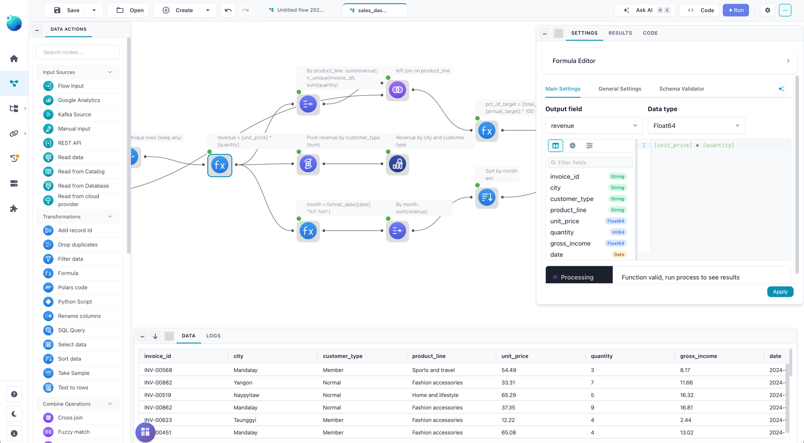
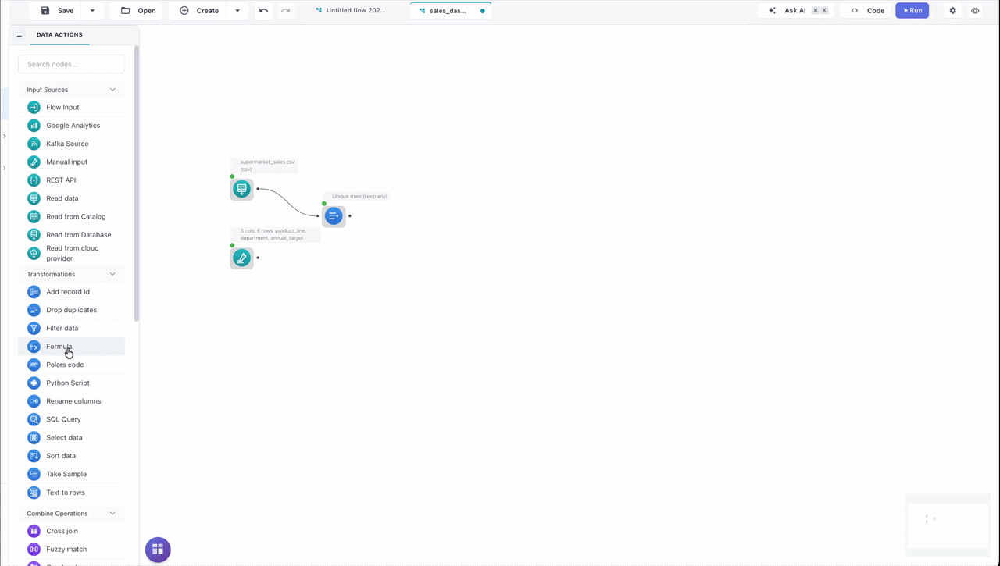
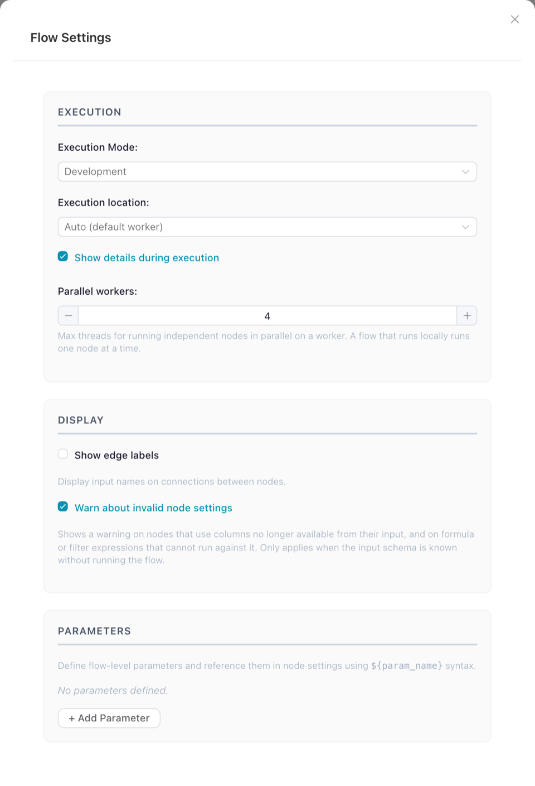

# Building Flows

This page covers the canvas mechanics: creating a flow, adding and connecting nodes, running, and saving. For a complete worked pipeline, follow the [Quickstart](../../quickstart.md#your-first-flow-visually) — or open the finished [sales pipeline in your browser](https://demo.flowfile.org), no install needed.

## The interface

{ width="800px" }

- **Left sidebar** — the node palette, grouped into six categories ([full reference](nodes/index.md))
- **Center canvas** — the flow itself
- **Right sidebar** — settings for the selected node
- **Bottom panel** — data preview for the selected node

| Canvas control | Action |
|---|---|
| Mouse wheel | Zoom |
| Drag empty canvas | Pan |
| Shift + drag | Select multiple nodes |
| Alt + click (also ⌘ + click on macOS, Ctrl + click elsewhere) | Add a node to the selection, or remove it |
| Right-click | Context menu; add notes to the canvas |

## Create a flow

1. Click **Create** in the top toolbar and name the flow.
2. An empty canvas opens.
3. **Save** writes it as a `.yaml` file (`.json` also supported) — plain text that diffs and versions cleanly in Git. Legacy `.flowfile` files still open; re-save to convert.

## Add and connect nodes

1. Drag a node from the left sidebar onto the canvas.
2. Drag from a node's output handle to the next node's input to connect them.
3. Click a node to configure it in the right sidebar — alongside each node's own settings there is a shared **General Settings** tab with the node's description, its reference name (used for edge labels, see below), a toggle to cache its result between runs, and the backend it runs on. Clicking the canvas or another node, or minimizing the panel, saves it first; if the settings cannot be saved, the panel stays open with a warning, and clicking away again discards the unsaved changes.



## Run

1. Click **Run** in the top toolbar. An open settings panel is saved first; if its settings cannot be saved, the flow does not start and a notification says so.
2. Node borders show execution state: green success, red failure, orange warning, grey not yet executed. A hollow grey ring means the node was deliberately skipped behind a closed [Gate](nodes/combine.md#gate) — a successful outcome, not an error.
3. Click any executed node to inspect its output in the bottom panel.

The preview's status bar has **Copy** and **Download CSV**. Copy puts the selected rows, or the node's result, on the clipboard as tab-separated text that pastes into Excel or Google Sheets; it is capped at 10,000 rows and 100,000 cells (rows × columns). Download CSV saves up to 10,000 rows; to export a full result, add a [Write data](nodes/output.md) node. Copying the result or downloading needs a run with the node's current settings and cannot include list or struct columns.

In **Development** mode every node's data is available for preview after a run. A new flow starts in **Performance** mode, the default; switch to **Development** while you build it. In **Performance** mode only the steps needed for outputs execute, and the query optimizer works across nodes.

## Flow settings

The **gear icon** in the top toolbar opens the flow-level settings:



| Setting | Options |
|---|---|
| Execution mode | **Development** (preview everything) / **Performance** (optimized, outputs only) |
| Execution location | **Auto (default worker)**, or a worker added under **Settings → Execution → Backends**, with its last check beside its id |
| Parallel workers | 1–32, default 4 |
| Show details during execution | More granular per-node status during runs |
| Show edge labels | Display each connection's name on the canvas |
| Warn about invalid node settings | Flag nodes whose settings no longer match their input, before you run |

**Execution location** picks the worker the flow runs on. **Auto** runs it on the default worker: the worker service that comes with Flowfile, on the same machine by default (in Docker, the worker container). An administrator can add workers on other hosts under **Settings → Execution → Backends**, and every user can pick one here by its id, `worker:<name>`, shown with what its last check said ([Versions and the handshake](../deployment/remote-worker.md#versions-and-the-handshake)). A flow run from the designer runs on a worker, so a step that runs out of memory fails on its own instead of taking Flowfile down. A flow saved with Local or Remote by an earlier version opens as **Auto**.

**Parallel workers** sets how many independent steps the worker runs at the same time, so a flow with independent branches finishes in a few *rounds* instead of one step after another. At 1 every step waits its turn.


### A node's own backend

A node's **General Settings** tab has a **Compute backend** setting: **Auto (the flow's backend)**, the default, **Default worker**, and the workers added under **Settings → Execution → Backends**, each with its last check beside its id; **Manage backends** next to it opens that page. It never offers Local. A node's own backend is used only where the deployment has an exchange store ([Remote workers](../deployment/remote-worker.md#nodes-on-several-backends)); otherwise every node runs on the flow's **Execution location**. API response has no such setting and runs on the flow's backend.

With an exchange store, a node whose backend cannot run it (a worker that does not read local files or `https` URLs, a cluster without a node's operation or plugin) runs on the default worker instead, and its data crosses to the other nodes through the store. That holds for a node left on **Auto** and for one set to a backend of its own. Before you run, the node shows a small amber badge, **→ worker**, whose tooltip says which backend could not run it and why; the **Compute backend** setting in its drawer says the same under the picker. After the run, the run card lists the nodes that ran on the default worker, and the flow log has a warning for each. A node the default worker cannot run either gets a red badge, and the run is refused with both reasons. Without an exchange store nothing moves: the run is refused, and the message says that an exchange store would let such nodes run on the default worker.

After a run, a refused one included, a connection whose two nodes were placed on different backends shows a round badge with two arrows. The badge is for the last run, so a change of backend shows after the next one. When a crossing is refused, because the exchange store could not be used or the input was above the row limit, the reading node's row on the run report says why.

### Settings warnings

With **Warn about invalid node settings** on (the default), Flowfile checks each node against the columns its input will actually produce and marks the ones that no longer add up — without running the flow. Two things are flagged:

- Settings that reference a column that is gone, usually after an upstream rename or a column dropped in a Select.
- Formula and filter expressions that cannot run against the input — `[amount] + "x"` on a numeric column, or an advanced filter that does not produce true or false.

An amber dot appears on the node; hover it to see what is wrong. Fix the setting and the dot clears — no run needed.

Nodes that *tolerate* a missing column are never flagged. Select and Dynamic rename skip a column that is no longer there and keep running, and a Join ignores unavailable entries in its column lists — only a missing **join key** breaks the node, so only that warns.

!!! info "Silence is not a clean bill of health"
    The check never guesses. A node stays unmarked whenever its input schema cannot be known without running the flow — downstream of a custom node or Python Script that has to execute once first — and raw Python and SQL nodes are never checked at all. Run the flow to catch what static analysis cannot see.

### Edge labels and Python Script nodes

Each connection's name comes from the source node's **node reference** (default `df_{node_id}`). With edge labels on, the canvas shows the exact name a [Python Script node](kernel-api.md#writing-output-data) uses to read that input:

```python
total_sales = flowfile_ctx.read_input("total_sales")
sales_per_city = flowfile_ctx.read_input("sales_per_city")
```

Python Script nodes likewise publish named outputs with `flowfile_ctx.publish_output(df, "name")`.

## From here

- Open the finished sales pipeline: in-app via **Create → From template**, [as a download](../../assets/flows/sales_pipeline.yaml), or [live in the browser](../../assets/try-sales-pipeline.html).
- [Worked examples](tutorials/index.md) — complete flows with data and expected results.
- [Node reference](nodes/index.md) — every node, per category.
