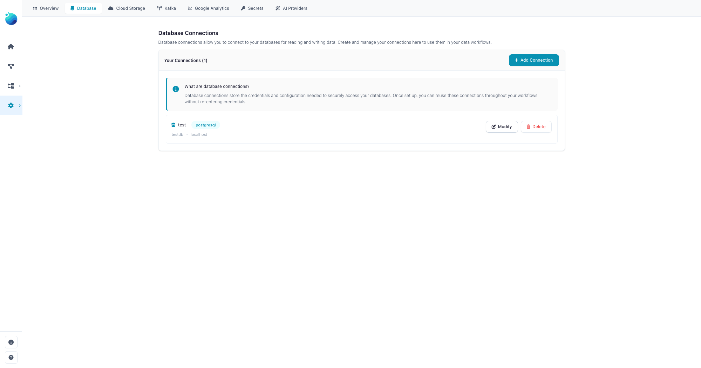
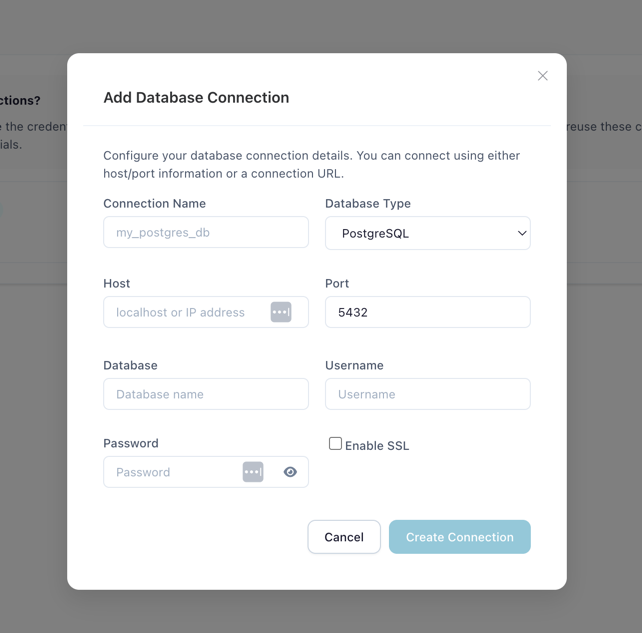
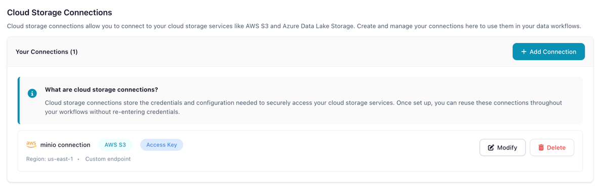

# Connections

Save and reuse database, cloud storage, and Kafka credentials across your flows.

All connection types and secrets are managed from a single **Connections** page, accessible
via **Settings → Connections → All connections** in the left sidebar. Use the tabs to switch between
**Overview**, **Database**, **Cloud Storage**, **Kafka**, **Google Analytics**, and **Secrets**. LLM provider
keys live under **Settings → AI** — see [Provider Setup](../../ai/providers.md).

Connections store your credentials securely (passwords are encrypted via [Secrets](catalog/secrets.md))
so you can reference them by name in Database Reader, Database Writer, Cloud Storage Reader,
and Cloud Storage Writer nodes without re-entering credentials each time.

!!! info "Not in Flowfile Lite"
    Saved connections require the full desktop/server build. The browser-only [Flowfile Lite](../deployment/lite.md) edition has no backend, so database, cloud storage, and Kafka connections (and the secrets that back them) are not available.

---

## Database Connections

### Supported Databases

| Database | Type Key |
|----------|----------|
| **PostgreSQL** | `postgresql` |
| **MySQL** | `mysql` |
| **SQLite** | `sqlite` |
| **DuckDB** | `duckdb` |
| **SQL Server** | `mssql` |
| **Denodo** | `denodo` |
| **Snowflake** | `snowflake` — see [Snowflake](#snowflake) |

!!! note "File-based connections (SQLite, DuckDB)"
    SQLite and DuckDB connect to a local database **file path** (e.g. `/path/to/database.db`
    or `/path/to/analytics.duckdb`) — no host, port, or credentials are required.

!!! warning "DuckDB single-writer files"
    A DuckDB file allows many concurrent readers but only one writer at a time. When a flow
    writes to a DuckDB file, close other tools (e.g. the DuckDB CLI or an IDE) that have the
    same file open.

!!! note "Denodo (PostgreSQL-compatible port)"
    Denodo connections use Denodo's PostgreSQL-compatible interface (port **9996** by default)
    through the standard psycopg2 driver, so no Denodo-specific driver is needed. Point the
    connection at the Virtual DataPort host, use the virtual database as **Database**, and enable
    **SSL** when the server requires it. Reading views, running queries and browsing from the
    reader node are supported — virtual databases are listed as schemas and views as tables.
    Writing to Denodo has not been verified against a live Denodo server. Arrow Flight SQL (port 9994) for faster large extracts is planned.

!!! note "DuckDB `INTERVAL` columns"
    `INTERVAL` columns are read as text — calendar intervals (months) have no fixed length,
    so there is no matching Polars type.

### Creating a Database Connection

1. Open **Settings → Connections → All connections** from the left sidebar and select the **Database** tab
2. Click **Create New Connection**
3. Fill in the connection fields:

| Field | Description | Example |
|-------|-------------|---------|
| **Connection Name** | Unique identifier for this connection | `prod_postgres` |
| **Database Type** | PostgreSQL, MySQL, SQLite, DuckDB, SQL Server, Denodo, or Snowflake | `postgresql` |
| **Host** | Database server hostname | `db.example.com` |
| **Port** | Database port | `5432` |
| **Database** | Database name | `analytics` |
| **Username** | Database user | `readonly_user` |
| **Password** | Stored as an encrypted secret | |
| **Enable SSL** | Use SSL for the connection | Recommended for cloud databases |

4. Click **Update Connection** to save

<!-- should show the new tabbed Connections page with the Database tab active -->


*The Connections page showing the Database tab with saved connections*

<!-- should show the Add Database Connection dialog opened from the Database tab -->


*Creating a new PostgreSQL connection*

### Snowflake { #snowflake }

A Snowflake connection replaces Host, Port, Password and SSL with its own fields: an account, a sign-in
method, a warehouse and an optional default database. A connection holds one credential (a token, a key or a
browser sign-in) and stores it encrypted like any other password.

**Account.** Enter the account identifier (`myorg-myaccount`), its host
(`myorg-myaccount.snowflakecomputing.com`), or paste a link copied from Snowsight. The form shows the host it
resolved to under the field.

**Sign-in method.** Snowflake no longer accepts a password on its own, so the form offers three methods:

| Method | Available in | Use it for |
|---|---|---|
| **Browser sign-in** | Desktop app and local installs | Your own account. Opens your browser; your Snowflake password never passes through Flowfile. |
| **Access token** | Every install | A personal account on a server, or when browser sign-in is turned off for your account. |
| **Key-pair** | Every install | Service users and scheduled flows. |

=== "Browser sign-in"

    Pick **Browser sign-in** under **Sign-in method**, click **Sign in with Snowflake**, sign in in the browser
    tab that opens, and return to the form. It then shows who you are signed in as and fills the warehouse and
    database lists.

    - The sign-in belongs to you: a browser-signed-in connection cannot be shared with a group.
    - It is bound to one role. Set **Role** before signing in (empty uses your default role); changing the role
      means signing in again.
    - Prefer a role with only the access your flows need over an administrator role such as `ACCOUNTADMIN`:
      every flow that uses the connection runs with that role.
    - When Snowflake's sign-in expires, using the connection reports it; edit the connection and sign in again.
    - It uses Snowflake's built-in sign-in for local applications. If an administrator has turned that off for
      the account, the form says so; use an access token or a key-pair instead.

=== "Access token"

    Enter your Snowflake **Username** and paste the **Access token**. Generate one in Snowsight under your user
    menu: **Settings → Authentication → Programmatic access tokens**.

    - A token expires: 15 days by default, at most 365. When it has expired, generate a new one and paste it on
      the connection.
    - For a human user (not a service user), Snowflake accepts a token only when a network policy is attached to
      the user. Without one, connecting fails with a message saying so; ask an administrator to attach a policy
      that allows your IP address.

=== "Key-pair"

    Enter the Snowflake **Username**, then **Choose .p8 file** (or paste the key), and the **Passphrase** if the
    key file is encrypted. The passphrase opens the key once and is not stored. Only RSA keys are accepted.

    Create a key and register its public half on the user:

    ```bash
    openssl genrsa 2048 | openssl pkcs8 -topk8 -inform PEM -out rsa_key.p8 -nocrypt
    openssl rsa -in rsa_key.p8 -pubout -out rsa_key.pub
    ```

    ```sql
    -- The contents of rsa_key.pub, without the BEGIN/END lines
    ALTER USER etl_service SET RSA_PUBLIC_KEY='MIIBIjANBgkqh...';
    ```

    Leave out `-nocrypt` to protect the key file with a passphrase.

With an access token or a key-pair, **Connect** signs in with what you entered and fills the warehouse and
database lists.

**Warehouse, database and role.** **Warehouse** and **Default database (optional)** are lists filled from your
session; you can also type a name. An empty warehouse or role uses the user's defaults in Snowflake. A query
needs a warehouse, so set one when the user has no default.

A connection reaches every database its role may use; the default database is only what a node starts on, and
the form leaves it empty unless you choose one. Each **Read from Database** and **Write to Database** node picks
its own database in a **Database** dropdown above **Schema**; left empty, the node uses the connection's default
database (or, with none, lists every database's schemas). A node with a database needs a schema too, and reads or
writes `database.schema.table`. Writing needs a database, either on the node or on the connection.

**Test.** Each saved connection has a **Test** button in the list. It signs in and reports the user, role,
warehouse and database the session got, or a plain reason it failed: no warehouse, a role that is not granted,
a missing network policy, an expired token or sign-in, or an account that cannot be found.

**Reading and writing.** Snowflake connections work in the **Read from Database** and **Write to Database** nodes
in **Reference** mode only; there is no inline Snowflake connection.

- Snowflake upper-cases names that are not quoted. Columns written from Flowfile are created unquoted, so
  `order_id` becomes `ORDER_ID`; a name that is not a plain identifier, or is a reserved word, is quoted.
- Database, schema and table names may hold `$` or be double-quoted, as the lists offer them: a name that is
  not plain upper case arrives quoted (`"USER$evaneechoud"`, `"My Schema"`), and a quoted name keeps its case.
  Other databases keep the plain rule: letters, numbers and underscores only.
- A write uploads the rows to a temporary stage in the table's schema, then copies them into the table, so the
  connection's role needs `CREATE STAGE` on that schema as well as rights on the table.
- **Replace** recreates the table (`CREATE OR REPLACE TABLE`); **Append** creates it when it does not exist;
  **Fail** stops when it exists.

**Installing.** The desktop app and the Docker images include the Snowflake driver. A pip install needs the
extra:

```bash
pip install "flowfile[snowflake]"
```

Without it, the Database Type list shows **Snowflake (not installed)** with that command underneath.

!!! note "Docker and server installs"
    On a multi-user Docker or server install only **Access token** and **Key-pair** are offered; browser sign-in
    is available in the desktop app and local installs.

### Using Database Connections in Flows

In a **Database Reader** or **Database Writer** node:

1. Set **Connection Mode** to **Reference**
2. Select your saved connection from the dropdown
3. Configure schema, table, and query settings

!!! tip "Reference vs Inline Mode"
    **Reference** mode uses a saved connection (recommended). Credentials are encrypted,
    reusable, and supported by the [code generator](tutorials/code-generator.md).

    **Inline** mode lets you enter credentials directly in the node settings. This is convenient for
    quick tests but credentials are not reusable and inline connections cannot be exported to Python code.

---

## Cloud Storage Connections

### Supported Providers

| Provider | Description |
|----------|-------------|
| **AWS S3** | Amazon Simple Storage Service (including S3-compatible services like MinIO) |
| **Azure Data Lake Storage (ADLS)** | Azure Data Lake Storage Gen2 / Blob Storage |
| **Google Cloud Storage (GCS)** | Google Cloud object storage buckets |

### Creating a Cloud Storage Connection

1. Open **Settings → Connections → All connections** and select the **Cloud Storage** tab
2. Click **Add Connection**
3. Configure the connection:

| Field | Description |
|-------|-------------|
| **Connection Name** | Unique identifier (e.g., `my_s3_storage`) |
| **Storage Type** | **AWS S3**, **Azure Data Lake Storage**, or **Google Cloud Storage** |
| **AWS Access Key ID** | Your access key |
| **AWS Secret Access Key** | Stored as encrypted secret |
| **AWS Session Token (Optional)** | Access Key only: for temporary credentials; stored as encrypted secret |
| **AWS Profile (Optional)** | AWS CLI only: a profile from the AWS config on the machine running Flowfile; blank uses the default credentials |
| **AWS Region** | e.g., `us-east-1` |
| **Custom Endpoint URL** | For S3-compatible services (MinIO, etc.), with any authentication method |
| **Verify SSL** | On by default; turn off only for an endpoint with a self-signed certificate (S3 and ADLS; no effect on GCS) |
| **Allow HTTP (unencrypted) endpoint** | Allows plain `http://` endpoints (e.g., local MinIO) |

!!! note "Provider-specific fields"
    The fields above describe an **AWS S3** connection. The credential fields adapt to the selected **Storage Type**: **Azure Data Lake Storage** uses an account name with service-principal or SAS-token credentials, and **Google Cloud Storage** uses a project ID with a service-account key.

4. Click **Create Connection**

<!-- should show the new tabbed Connections page with the Cloud Storage tab active -->


*The Connections page showing the Cloud Storage tab*

### Using Cloud Connections in Flows

In a **Cloud Storage Reader** or **Cloud Storage Writer** node, select your saved connection from the dropdown. **No connection** uses the credentials of the machine running Flowfile instead, and is unavailable on a multi-user server; see [Running a node without a connection](tutorials/cloud-connections.md#no-connection).

For a step-by-step tutorial, see [Manage Cloud Storage](tutorials/cloud-connections.md).

---

## Kafka Connections

### Creating a Kafka Connection

1. Open **Settings → Connections → All connections** and select the **Kafka** tab
2. Click **Add Connection**
3. Configure the connection:

| Field | Description |
|-------|-------------|
| **Connection Name** | Unique identifier (e.g., `prod_kafka`) |
| **Bootstrap Servers** | Comma-separated list of broker addresses (e.g., `broker1:9092,broker2:9092`) |
| **Security Protocol** | `PLAINTEXT`, `SSL`, `SASL_PLAINTEXT`, or `SASL_SSL` |
| **SASL Mechanism** | `PLAIN`, `SCRAM-SHA-256`, or `SCRAM-SHA-512` (when using SASL) |
| **SASL Username / Password** | Credentials for SASL authentication |
| **SSL CA Certificate** | CA certificate for SSL connections |
| **SSL Certificate / Key** | Client certificate and key for mutual TLS |
| **Schema Registry URL** | URL of the Confluent Schema Registry (optional) |

4. Click **Create Connection**

### Using Kafka Connections in Flows

Select your saved Kafka connection when configuring the **Kafka Source** node. Kafka support is read-only — there is no Kafka writer node. See [Kafka](../connect/kafka.md) for the node's settings and a runnable example.

---

## Security

- Passwords and secret keys are stored as encrypted [Secrets](catalog/secrets.md) using Fernet encryption
- Connection metadata (host, port, database name) is stored in the local database
- Credentials are decrypted only at runtime when a flow executes
- Each user's connections are isolated (Docker multi-user mode)

---

## Related Documentation

- [Secrets](catalog/secrets.md) — How credential encryption works
- [Input Nodes: Database Reader](nodes/input.md#database-reader) — Reading from databases
- [Output Nodes: Database Writer](nodes/output.md#database-writer) — Writing to databases
- [Tutorial: Connect to PostgreSQL](tutorials/database-connectivity.md)
- [Tutorial: Manage Cloud Storage](tutorials/cloud-connections.md)
